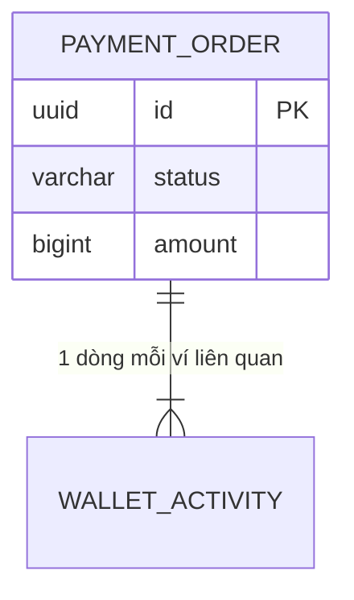

# Template tài liệu data model

Khi cập nhật tài liệu đã có, giữ cấu trúc của tài liệu đó; dưới đây là các phần mỗi service và mỗi bảng cần có.

## Mục của một service

````markdown
## <service> (`<service>_db`)

### ERD

Thực thể của service khác vẽ bằng ghi chú, không vẽ quan hệ khoá ngoại.

### Bảng truy vấn chính
| # | Truy vấn | Ai / khi nào | Tần suất (giả định) | Index dùng |
|---|---|---|---|---|
| Q1 | Lịch sử của một ví, mới nhất trước, keyset | Khách mở app | ~150/giây lúc cao điểm | `ix_activity_wallet_time` |

### Khối lượng & lưu trữ
| Bảng | Dòng/ngày (giả định) | Lưu nóng | Archive / ẩn danh | Partition |
|---|---|---|---|---|
| payment_order | ~2 triệu | 24 tháng | Export WORM, rồi detach | Theo tháng |
````

## Mục của một bảng

````markdown
### `payment.payment_order`
**Mục đích:** một dòng cho mỗi lệnh tiền của khách (nạp, rút, P2P). Loại: aggregate.
**Chủ sở hữu:** `payment`. **Ai đọc qua API/event:** recon (projection), dispute (API).

```sql
create table payment.payment_order (
  id              uuid primary key,                      -- UUIDv7, sinh ở ứng dụng
  type            varchar(16) not null,
  status          varchar(16) not null,
  customer_id     uuid not null,                         -- id từ identity.customer (không FK)
  amount          bigint not null,
  idempotency_key varchar(64) not null,
  ...
  constraint ck_payment_order_type   check (type in ('TOPUP','WITHDRAW','P2P')),
  constraint ck_payment_order_amount check (amount > 0),
  constraint uq_payment_order_idem   unique (customer_id, idempotency_key)
);
create index ix_payment_order_pending on payment.payment_order (next_check_at)
  where status in ('PROCESSING','UNKNOWN');                -- Q3: hàng đợi resolver
```

**Ghi chú thiết kế**
| Quyết định | Lý do | Nguồn |
|---|---|---|
| `uq_payment_order_idem` | Gửi lại cùng khoá không tạo lệnh thứ hai | F-PAY-03.FR-08, FR-11 |
| Không lưu số dư sau giao dịch | Số dư thuộc `ledger` | design §5 |

**Chuyển trạng thái** (nếu có): bảng từ SRS 3.4 và câu `UPDATE` có điều kiện tương ứng.

**Dữ liệu cá nhân:** cột nào, mã hoá/che ra sao, thời hạn lưu, ẩn danh khi hết hạn.

**Truy vết:** FR/BR nào cần bảng/cột này.
````

## Cuối tài liệu (hoặc cuối mục được cập nhật)

```markdown
### Câu hỏi mở
| # | Câu hỏi | Ảnh hưởng (bảng/cột) | Ai quyết định |

### Thay đổi phá tương thích
| Thay đổi | Bảng | Ảnh hưởng | Cần migration expand → contract |

### Lịch sử thay đổi
| Ngày | Thay đổi | Lý do / nguồn |
```

## Checklist trước khi giao

**Sở hữu & ranh giới**
- [ ] Mỗi bảng có đúng một service sở hữu; không có FK hay truy vấn xuyên database của service
- [ ] Tham chiếu sang service khác có comment nguồn; bản sao dữ liệu có `source_version`

**Tính đúng**
- [ ] Tiền là `bigint` + `currency`; không có số thực
- [ ] Mọi bất biến một dòng có `CHECK`; mọi khoá nghiệp vụ (idempotency, mã đối tác, ghi sổ) có `UNIQUE`
- [ ] Quy tắc "chỉ một bản ghi hiệu lực" có partial unique index (hoặc exclusion constraint)
- [ ] Bảng append-only có `REVOKE UPDATE, DELETE`
- [ ] Trạng thái có `CHECK` đủ giá trị và khớp SRS 3.4

**Hiệu năng**
- [ ] Mỗi index trỏ về một truy vấn trong bảng truy vấn; không có index trùng với `UNIQUE`
- [ ] Đã ước lượng khối lượng; bảng lớn có quyết định về partition
- [ ] Bảng partition: không unique nào bảo vệ tiền bị yếu đi vì phải thêm cột partition
- [ ] Không có `jsonb` cho trường cần lọc, ràng buộc hay join

**Dữ liệu cá nhân & vận hành**
- [ ] Dữ liệu nhạy cảm mã hoá + hash; không có dạng rõ; ảnh để ở object storage
- [ ] Có thời hạn lưu trữ và kế hoạch ẩn danh/archive cho từng bảng chứa dữ liệu cá nhân hoặc tăng nhanh

**Tài liệu**
- [ ] Mỗi cột truy vết được về FR/BR, truy vấn, hoặc yêu cầu vận hành
- [ ] Ràng buộc và index có tên theo quy ước
- [ ] DDL đã chạy thử trên PostgreSQL (hoặc đã ghi rõ là chưa kiểm cú pháp)
- [ ] Đã liệt kê thay đổi phá tương thích với schema đang có
