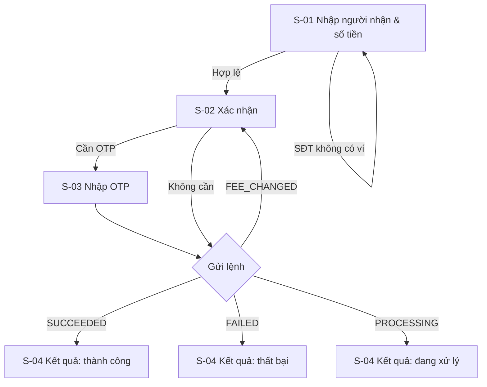

# Template đặc tả UI cho một tính năng

Dùng đúng thứ tự mục. Mục không áp dụng: ghi "Không áp dụng — lý do".

**ID màn hình:** `<FeatureID>.S-NN` (ví dụ `F-PAY-03.S-02`). Dialog/sheet đáng kể cũng có ID riêng. ID không bao giờ đổi hay dùng lại.

````markdown
# UI — F-PAY-03 Chuyển tiền ví–ví

| | |
|---|---|
| Trạng thái | Draft \| In review \| Approved |
| Phiên bản | 0.1 |
| Ngày | <yyyy-mm-dd> |
| SRS | [F-PAY-03](../../srs/features/F-PAY-03-chuyen-tien-vi-vi.md) v0.1 |
| Bề mặt | Web khách hàng \| CMS \| cả hai |
| Design system | [docs/ui/design-system.md](../design-system.md) |

## 1. Mục tiêu & người dùng
- Người dùng chính, bối cảnh sử dụng (thiết bị, tần suất, mức hiểu biết).
- Mục tiêu UX đo được nếu có, ví dụ "hoàn tất chuyển tiền trong ≤ 3 màn hình khi không cần xác thực tăng cường".

## 2. User flow

Mọi nhánh lỗi của SRS phải có mặt.

## 3. Danh sách màn hình
| ID | Tên | Loại | Bề mặt | Ghi chú |
|---|---|---|---|---|
| F-PAY-03.S-01 | Nhập thông tin chuyển | Trang | Web | |

## 4. Chi tiết màn hình

### F-PAY-03.S-01 — <Tên>
**Mục đích:** một câu.

**Wireframe (mobile ~360 px)**
```
┌────────────────────────────────┐
│ ←  Chuyển tiền                 │
├────────────────────────────────┤
│ Số điện thoại người nhận       │
│ ┌────────────────────────────┐ │
│ │ 0900 000 002               │ │
│ └────────────────────────────┘ │
│ ✓ NGUYEN V*** A                │
│                                │
│ Số tiền                        │
│ ┌────────────────────────────┐ │
│ │ 100.000                  ₫ │ │
│ └────────────────────────────┘ │
│ Số dư khả dụng: 1.000.000 ₫    │
│                                │
│ Lời nhắn (không bắt buộc)      │
│ ┌────────────────────────────┐ │
│ │                            │ │
│ └────────────────────────────┘ │
│                         0/140  │
├────────────────────────────────┤
│ [        Tiếp tục          ]   │
└────────────────────────────────┘
```

**Thành phần**
| Vùng | Component (shadcn/ui) | Ghi chú |
|---|---|---|
| Ô SĐT | `Input` (`inputMode="tel"`) trong `Form` | Tra cứu khi rời ô / sau 500 ms ngừng gõ |

**Dữ liệu**
| Hiển thị | Nguồn | Định dạng |
|---|---|---|
| Tên người nhận | `GET /transfers/recipient` → `displayName` | Nguyên văn (đã che từ server) |

**Tương tác & validation**
- Khi nào kiểm (rời ô / khi gửi), lỗi hiện ở đâu, nút nào bị khoá khi nào.

**Trạng thái**
| Trạng thái | Hiển thị |
|---|---|
| Đang tải | |
| Rỗng | |
| Lỗi tải dữ liệu | |
| Lỗi nhập liệu | |
| Đang gửi / đang xử lý | |
| Thành công | |
| Không có quyền / phiên hết hạn | |
| Mất mạng / timeout | |

**Nội dung chữ**
| Khoá | Nội dung |
|---|---|
| title | Chuyển tiền |
| field.phone.label | Số điện thoại người nhận |

**Accessibility:** ghi chú riêng (thứ tự focus, `aria-live`, nhãn cho icon...).

**Truy vết:** FR-01, FR-03, FR-14; AC-23, AC-25.

## 5. Ánh xạ lỗi
| Mã (SRS §6) | Nơi hiển thị | Nội dung | Hành động cho người dùng |
|---|---|---|---|
| `RECIPIENT_NOT_FOUND` | Dưới ô SĐT (S-01) | Không tìm thấy ví với số điện thoại này. | Sửa số |
| `INSUFFICIENT_BALANCE` | S-04 kết quả thất bại | Số dư không đủ để thực hiện giao dịch. | Nút "Nạp tiền", "Thử lại" (khoá mới) |

## 6. Responsive & accessibility tổng
Breakpoint thay đổi bố cục; thứ tự tab toàn luồng; thông báo động (`aria-live`).

## 7. Truy vết SRS → UI
| SRS | Màn hình / phần tử |
|---|---|
| FR-01 | S-01 dòng tên người nhận |
| AC-31 | S-04 trạng thái "Đang xử lý" |

FR có biểu hiện trên giao diện mà chưa có trong bảng → thiếu thiết kế.

## 8. Câu hỏi mở
| # | Câu hỏi | Ảnh hưởng | Ai quyết định |

## 9. Lịch sử thay đổi
| Phiên bản | Ngày | Thay đổi | Lý do |
````

## Checklist trước khi giao

- [ ] Mỗi nhánh user flow có màn hình/trạng thái; mỗi mã lỗi SRS §6 có dòng trong mục 5
- [ ] Mỗi màn hình có wireframe, thành phần, dữ liệu, tương tác, ma trận trạng thái, nội dung chữ, truy vết
- [ ] Màn hình thao tác tiền đã áp dụng đủ quy tắc patterns-web §1 (hoặc patterns-cms §4 với CMS)
- [ ] Không có hành vi nghiệp vụ ngoài SRS; chỗ cần thêm nằm trong câu hỏi mở
- [ ] Dùng component có sẵn; component mới có lý do
- [ ] Nội dung chữ: tiếng Việt tự nhiên, không lộ thuật ngữ kỹ thuật, theo a11y-content §3
- [ ] Không dùng màu làm tín hiệu duy nhất; có `aria-live` cho trạng thái thay đổi tự động; thứ tự focus hợp lý
- [ ] Định dạng tiền, ngày giờ, SĐT theo a11y-content §4
- [ ] Bảng truy vết phủ mọi FR có biểu hiện trên giao diện
