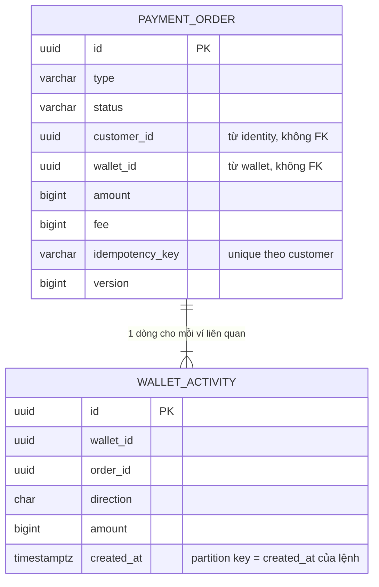

# EWallet — Data model (PostgreSQL)

Đi kèm [thiết kế chính](2026-11-04-ewallet-design.md). DDL dưới đây là bản thiết kế; khi code, mỗi khối thành Flyway migration của service tương ứng.

Quy ước:
- **Mỗi service một database** (tên `<service>_db`), có DB user riêng. Tên schema trong DDL (`ledger.`, `payment.`...) giữ lại để dễ đọc; khi triển khai mỗi DB chỉ có schema của chính service đó.
- Tiền: `bigint`, đơn vị đồng. `currency char(3)` mặc định `'VND'`.
- Thời gian: `timestamptz`, lưu UTC. Kỳ ngày/tháng của hạn mức tính theo `Asia/Ho_Chi_Minh` ở tầng ứng dụng.
- ID nghiệp vụ: `uuid` (UUIDv7, sinh ở ứng dụng).
- Không có khoá ngoại xuyên service. Tham chiếu sang service khác chỉ là cột id.
- Cột `*_enc`: AES-GCM envelope (`bytea`). Cột `*_hash`: HMAC-SHA256 (`bytea`) dùng để tra cứu và kiểm tra unique.
- Bảng có hậu tố `_projection` / `_directory` là **bản sao dữ liệu** nhận từ event của service khác. Chỉ consumer được ghi vào; chỉ dùng để tra cứu, không dùng để quyết định về tiền.

## Bảng dùng chung trong mọi service (do `platform` starter cung cấp)

```sql
create table outbox (
  id            uuid primary key,          -- = CloudEvents id
  topic         varchar(128) not null,
  event_key     varchar(128) not null,     -- id của aggregate, dùng làm key Kafka
  event_type    varchar(128) not null,
  payload       jsonb not null,
  headers       jsonb not null,            -- traceparent...
  created_at    timestamptz not null default now(),
  published_at  timestamptz
);
create index ix_outbox_unpublished on outbox (created_at) where published_at is null;

create table inbox (
  event_id      uuid not null,
  consumer      varchar(64) not null,      -- tên handler, để một event có thể được nhiều handler trong cùng service xử lý
  processed_at  timestamptz not null default now(),
  primary key (event_id, consumer)
);
-- shedlock: theo DDL chuẩn của ShedLock
```
Bảng `outbox` có job dọn bản ghi đã publish quá 7 ngày; bảng `inbox` dọn bản ghi quá 30 ngày (dài hơn retention của Kafka).

---

## ledger

```sql
create schema ledger;

create table ledger.account (
  id            bigint generated always as identity primary key,
  code          varchar(64) not null unique,      -- WALLET:<uuid>, BANK_SETTLEMENT:<bank>, FEE_REVENUE...
  category      varchar(16) not null check (category in ('ASSET','LIABILITY','REVENUE','EXPENSE')),
  normal_side   char(1)     not null check (normal_side in ('D','C')),
  bucket_count  smallint    not null default 1 check (bucket_count between 1 and 64),
  allow_negative boolean    not null default false, -- true cho tài khoản hệ thống
  currency      char(3)     not null default 'VND',
  debit_blocked  boolean    not null default false, -- ví bị khoá: chặn ghi nợ, vẫn cho ghi có (nạp đang treo)
  credit_blocked boolean    not null default false, -- ví đã đóng: chặn cả hai chiều
  status        varchar(16) not null default 'ACTIVE',
  created_at    timestamptz not null default now()
);

-- Số dư theo phía tăng của tài khoản. Ví: 1 bucket; tài khoản hệ thống: 16 bucket.
create table ledger.account_balance (
  account_id    bigint   not null references ledger.account(id),
  bucket        smallint not null,
  balance       bigint   not null default 0,
  held          bigint   not null default 0,
  allow_negative boolean not null,                 -- sao chép từ account để CHECK dùng được
  updated_at    timestamptz not null default now(),
  primary key (account_id, bucket),
  constraint ck_nonneg check (allow_negative or balance >= 0),
  constraint ck_held   check (held >= 0 and (allow_negative or held <= balance))
);

create table ledger.journal (
  id             uuid primary key,
  purpose        varchar(32) not null,  -- TOPUP, WITHDRAW, P2P, ADJUSTMENT, REVERSAL, BANK_FEE, REBALANCE
  reference_type varchar(32) not null,  -- PAYMENT_ORDER, APPROVAL, RECON_ITEM
  reference_id   uuid        not null,
  reversal_of    uuid        references ledger.journal(id),
  created_at     timestamptz not null default now(),
  constraint uq_journal_ref unique (reference_type, reference_id, purpose)  -- chặn ghi sổ 2 lần
);

create table ledger.entry (
  id          bigint generated always as identity,
  journal_id  uuid    not null,
  account_id  bigint  not null,
  direction   char(1) not null check (direction in ('D','C')),
  amount      bigint  not null check (amount > 0),
  created_at  timestamptz not null default now(),
  primary key (id, created_at)
) partition by range (created_at);
create index ix_entry_account_time on ledger.entry (account_id, created_at);
create index ix_entry_journal on ledger.entry (journal_id);
-- partition theo tháng, job tạo trước 3 tháng:
-- create table ledger.entry_2026_11 partition of ledger.entry for values from ('2026-11-01') to ('2026-12-01');

create table ledger.hold (
  id           uuid primary key,
  account_id   bigint not null references ledger.account(id),
  amount       bigint not null check (amount > 0),
  reason       varchar(32) not null,      -- WITHDRAW, LEGAL_FREEZE
  reference_id uuid not null unique,      -- order id hoặc approval id
  status       varchar(16) not null check (status in ('ACTIVE','CAPTURED','RELEASED')),
  created_at   timestamptz not null default now(),
  updated_at   timestamptz not null default now()
);

-- Ứng dụng chỉ được thêm entry/journal:
-- revoke update, delete on ledger.entry, ledger.journal from ewallet_app;
```

Câu lệnh cốt lõi:

```sql
-- Trừ ví (bucket 0); 0 dòng bị cập nhật nghĩa là INSUFFICIENT_BALANCE
update ledger.account_balance
   set balance = balance - :amt, updated_at = now()
 where account_id = :id and bucket = 0 and balance - held >= :amt;

-- Đặt hold
update ledger.account_balance
   set held = held + :amt, updated_at = now()
 where account_id = :id and bucket = 0 and balance - held >= :amt;

-- Capture hold (trong cùng TX với post journal)
update ledger.account_balance
   set held = held - :amt, balance = balance - :amt, updated_at = now()
 where account_id = :id and bucket = 0 and held >= :amt;

-- Tài khoản hệ thống: bucket ngẫu nhiên
update ledger.account_balance set balance = balance + :delta, updated_at = now()
 where account_id = :id and bucket = :randomBucket;
```

`POST /internal/journals` làm theo thứ tự:
1. Kiểm Σ D = Σ C. Lệch → `422`, không ghi gì.
2. Kiểm `debit_blocked`/`credit_blocked` của các tài khoản.
3. Insert `journal`. Nếu `uq_journal_ref` báo trùng: so nội dung với journal đã có; giống thì trả `200` với journal cũ (idempotent replay), khác thì trả `409`.
4. Cập nhật số dư theo thứ tự lock (mục 6.2 của thiết kế chính).
5. Batch insert `entry`.
6. Insert `outbox` (`JournalPosted`).

Tất cả nằm trong **một** DB transaction.

---

## wallet

```sql
create schema wallet;
create table wallet.wallet (
  id                 uuid primary key,
  customer_id        uuid not null unique,      -- 1 khách 1 ví
  ledger_account_id  bigint not null unique,
  status             varchar(16) not null check (status in ('ACTIVE','FROZEN','CLOSING','CLOSED')),
  version            bigint not null default 0,   -- = aggregateversion trong event
  frozen_reason      varchar(64),
  created_at         timestamptz not null default now(),
  closed_at          timestamptz
);
```
- Phong toả một phần số dư: `wallet` gọi `ledger` tạo hold với reason `LEGAL_FREEZE`.
- Khoá toàn bộ ví: `status = FROZEN` ở `wallet`, đồng thời gọi đồng bộ `ledger` đặt `debit_blocked = true`. `ledger` là nơi chặn thật sự; `payment` kiểm `status` ở `wallet` chỉ để báo lỗi sớm.

```sql
-- bản sao từ identity.events (CustomerRegistered, CustomerUpdated) và kyc.events
create table wallet.customer_directory (
  customer_id    uuid primary key,
  phone          varchar(15) not null unique,
  display_masked varchar(64) not null,   -- "NGUYEN V*** A"
  source_version bigint not null,        -- aggregateversion lớn nhất đã áp; event cũ hơn bị bỏ qua
  updated_at     timestamptz not null
);
```

---

## payment (`payment_db`)

### ERD


### Truy vấn chính
| # | Truy vấn | Ai / khi nào | Tần suất (giả định) | Index |
|---|---|---|---|---|
| Q1 | Tra lệnh theo `(customer_id, idempotency_key)` khi nhận lệnh (tra trước mọi kiểm tra) | `POST /topups`, `/withdrawals`, `/transfers` | ~150/giây lúc cao điểm | `uq_order_idem` |
| Q2 | Lấy lệnh theo `id` (kiểm `customer_id` ở ứng dụng) | `GET /orders/{id}`, UI hỏi lại kết quả | ~300/giây (polling) | PK |
| Q3 | Lệnh `PROCESSING` quá 2 phút | Job recovery, mỗi 30 giây | Thấp | `ix_order_recover` |
| Q4 | Lệnh `UNKNOWN` đến hạn kiểm | Job resolver, mỗi 30 giây | Thấp | `ix_order_pending` |
| Q5 | Số lệnh `PROCESSING`/`UNKNOWN` của một ví | `GET /internal/orders/open?walletId=` khi đóng ví | Rất thấp | `ix_payment_order_wallet_open` |
| Q6 | Lệnh theo khoảng thời gian (+ lọc status, ngân hàng) | CMS `GET /admin/v1/orders`, chạy trên read replica | Thấp | `ix_payment_order_created`; xem lại khi có SRS F-BO-02 |
| Q7 | Lịch sử của một ví, mới nhất trước, keyset `(created_at, id)` | `GET /activities` | ~100/giây | `ix_wallet_activity_wallet_time` |

### Khối lượng & lưu trữ
Giả định: 500k khách, 30% hoạt động mỗi ngày, trung bình 2 lệnh/khách hoạt động → ~300k lệnh/ngày; mỗi lệnh ~1,5 dòng `wallet_activity` (P2P có 2 dòng).

| Bảng | Dòng/ngày | Sau 24 tháng | Lưu nóng | Archive | Partition |
|---|---|---|---|---|---|
| `payment_order` | ~300k | ~220 triệu | 24 tháng (NFR-L-06) | Export sang lưu trữ không sửa được, rồi xoá theo lô các lệnh đã ở trạng thái cuối | **Không** (lý do bên dưới) |
| `wallet_activity` | ~450k | ~330 triệu | 24 tháng | Export, rồi detach partition | Theo tháng |

**Vì sao không partition `payment_order`:** partition theo thời gian buộc mọi `UNIQUE` phải chứa cột partition. Khi đó `uq_order_idem` thành `(customer_id, idempotency_key, created_at)`, và một lần gửi lại vắt qua ranh giới tháng (23:59:59 → 00:00:01) sẽ tạo **lệnh thứ hai**: đúng lỗi chuyển trùng mà idempotency phải chặn. Giữ bảng không partition. Xem lại khi vượt khoảng 300 triệu dòng: khi đó tách idempotency ra bảng riêng không partition rồi partition bảng lệnh.

**Vì sao partition `wallet_activity` được:** `created_at` của dòng activity **lấy bằng `created_at` của lệnh**, không phải thời điểm insert. Nhờ vậy `(wallet_id, order_id, created_at)` tương đương `(wallet_id, order_id)` và unique vẫn đúng. Insert ngoài khoảng của mọi partition sẽ báo lỗi (đã kiểm), nên job tạo partition trước 3 tháng là bắt buộc.

### `payment.payment_order`
**Mục đích:** một dòng cho mỗi lệnh tiền của khách (nạp, rút, P2P). Loại: aggregate. Bản thân lệnh là bản ghi idempotency. **Chủ sở hữu:** `payment`. **Ai dùng:** `recon` (projection qua event), `dispute` (API), CMS (API).

```sql
create schema payment;
create table payment.payment_order (
  id                     uuid primary key,                -- UUIDv7
  type                   varchar(16) not null check (type in ('TOPUP','WITHDRAW','P2P')),
  status                 varchar(16) not null check (status in ('PROCESSING','SUCCEEDED','FAILED','UNKNOWN')),
  customer_id            uuid not null,                   -- id từ identity.customer (không FK)
  wallet_id              uuid not null,                   -- ví bị trừ (P2P, rút) hoặc được cộng (nạp); id từ wallet
  counterparty_wallet_id uuid,                            -- ví người nhận; chỉ P2P
  bank_code              varchar(16),                     -- chỉ nạp/rút
  bank_link_id           uuid,                            -- chỉ nạp/rút; id từ bank-gateway
  amount                 bigint not null check (amount > 0),
  fee                    bigint not null default 0 check (fee >= 0),
  currency               char(3) not null default 'VND',
  fee_rule_id            uuid,                            -- null = không có rule phí áp dụng (khi đó fee = 0)
  idempotency_key        varchar(64) not null,
  request_hash           bytea not null,                  -- sha256 của (người nhận/nguồn, số tiền, lời nhắn) đã chuẩn hoá
  external_ref           varchar(32) unique,              -- gửi ngân hàng; Crockford base32; chỉ nạp/rút
  bank_ref               varchar(64),
  failure_code           varchar(64),                     -- bắt buộc khi FAILED; có thể có khi SUCCEEDED (CREDITED_TO_SUSPENSE)
  failure_detail         jsonb,                           -- dữ liệu cho thông điệp lỗi, ví dụ {"scope":"P2P_DAY","remaining":2500000}
  note                   varchar(140),
  saga_step              varchar(24) not null default 'STARTED',
    -- BANK_CALLED được commit TRƯỚC khi gọi bank-gateway; từ step này chỉ được hỏi trạng thái, không gửi lại
  check_attempts         int not null default 0,
  next_check_at          timestamptz,                     -- chỉ dùng khi UNKNOWN
  version                bigint not null default 0,       -- tăng mỗi lần đổi trạng thái; = aggregateversion trong event
  trace_id               varchar(32) not null,            -- traceId của request tạo lệnh; hiển thị trên CMS
  created_at             timestamptz not null default now(),
  updated_at             timestamptz not null default now(),
  constraint uq_order_idem unique (customer_id, idempotency_key),
  constraint ck_payment_order_type_fields check (
       (type = 'P2P' and counterparty_wallet_id is not null
          and bank_code is null and bank_link_id is null and external_ref is null)
    or (type in ('TOPUP','WITHDRAW') and counterparty_wallet_id is null
          and bank_code is not null and bank_link_id is not null and external_ref is not null)),
  constraint ck_payment_order_not_self       check (counterparty_wallet_id <> wallet_id),
  constraint ck_payment_order_p2p_no_unknown check (type <> 'P2P' or status <> 'UNKNOWN'),
  constraint ck_payment_order_saga_by_type   check (
       (type = 'P2P'      and saga_step in ('STARTED','LIMIT_RESERVED','POSTED'))
    or (type = 'TOPUP'    and saga_step in ('STARTED','LIMIT_RESERVED','BANK_CALLED','POSTED'))
    or (type = 'WITHDRAW' and saga_step in ('STARTED','LIMIT_RESERVED','HOLD_PLACED','BANK_CALLED','POSTED'))),
  constraint ck_payment_order_failed_code    check (status <> 'FAILED' or failure_code is not null),
  constraint ck_payment_order_fee_rule       check (fee = 0 or fee_rule_id is not null),
  constraint ck_payment_order_note           check (note is null or note !~ '[[:cntrl:]]'),
  constraint ck_payment_order_attempts       check (check_attempts >= 0),
  constraint ck_payment_order_version        check (version >= 0)
);
create index ix_order_pending on payment.payment_order (next_check_at)
  where status in ('PROCESSING','UNKNOWN');                  -- Q4
create index ix_order_recover on payment.payment_order (updated_at)
  where status = 'PROCESSING';                               -- Q3
create index ix_payment_order_wallet_open on payment.payment_order (wallet_id)
  where status in ('PROCESSING','UNKNOWN');                  -- Q5
create index ix_payment_order_created on payment.payment_order (created_at desc);  -- Q6

-- Đổi trạng thái luôn kèm điều kiện trạng thái cũ và tăng version:
-- update payment.payment_order set status = :new, version = version + 1, updated_at = now(), ...
--  where id = :id and status = :expected;
```

**Ghi chú thiết kế**
| Quyết định | Lý do | Nguồn |
|---|---|---|
| `uq_order_idem` | Gửi lại cùng khoá không tạo lệnh thứ hai, kể cả hai request đồng thời | F-PAY-03.FR-08, FR-11; NFR-C-03 |
| `ck_payment_order_not_self` | Chặn tự chuyển cho chính mình ở DB, kể cả khi code bỏ sót | F-PAY-03.BR-03 |
| `ck_payment_order_p2p_no_unknown` | P2P không gọi đối tác nên không bao giờ `UNKNOWN`; trạng thái này xuất hiện ở P2P là bug | SRS F-PAY-03 §2.4 |
| `ck_payment_order_type_fields` | Mỗi loại lệnh có đúng bộ trường của nó; lệnh nạp/rút thiếu `external_ref` không đối soát được | F-PAY-03.FR-19; design §6.4; IR-04 |
| `ck_payment_order_saga_by_type` | Bước saga phải hợp lệ với loại lệnh; P2P không có `BANK_CALLED` | design §6.3–6.6 |
| `ck_payment_order_failed_code` | Lệnh thất bại luôn có lý do để hiển thị và tra soát | F-PAY-03 §6 |
| `ck_payment_order_fee_rule` | Thu phí thì phải biết rule nào đã áp dụng (lịch sử phí không đổi khi biểu phí đổi) | FR-FEE-02 |
| `ck_payment_order_note` | Chặn ký tự điều khiển trong lời nhắn ở DB | F-PAY-03.FR-31 (giả định về ký tự bị cấm) |
| `failure_detail` (`jsonb`) | Gửi lại cùng khoá phải trả đúng lệnh cũ, kể cả dữ liệu cho thông điệp `LIMIT_EXCEEDED` ("Hạn mức còn lại: {remaining}"); không lọc theo trường này nên `jsonb` phù hợp | F-PAY-03 §6, FR-08; UI UQ5 |
| `version` | Event phải mang `aggregateversion` để consumer bỏ qua event đến muộn | design §7 |
| `trace_id` | Mỗi lệnh truy vết được về log/trace từ CMS | F-PAY-03.NFR-05 |
| Không lưu số dư sau giao dịch | Số dư thuộc `ledger` | design §5 |

**Chuyển trạng thái** (SRS F-PAY-03 §3.4 cho P2P; design §6.6 cho nạp/rút):
| Từ | Sang | Loại lệnh |
|---|---|---|
| — | `PROCESSING` | Tất cả |
| `PROCESSING` | `SUCCEEDED`, `FAILED` | Tất cả |
| `PROCESSING` | `UNKNOWN` | Chỉ nạp/rút (P2P bị `ck_payment_order_p2p_no_unknown` chặn) |
| `UNKNOWN` | `SUCCEEDED`, `FAILED` | Chỉ nạp/rút |

Chuyển từ trạng thái cuối không bị DB chặn (cần trigger); được chặn bằng `UPDATE ... WHERE status = :expected` ở ứng dụng.

**Dữ liệu cá nhân:** `note` là văn bản tự do khách nhập, có thể chứa thông tin cá nhân. Lưu cùng lệnh theo thời hạn chứng từ; khi archive thì giữ nguyên (là một phần chứng từ). Không có cột nhạy cảm cần mã hoá.

### `payment.wallet_activity`
**Mục đích:** bản ghi lịch sử theo từng ví (read model trong cùng service), để khách xem lịch sử nhanh mà không phải join hay hỏi `ledger`. Loại: bản ghi gần như chỉ thêm (chỉ cột `status` được cập nhật theo lệnh). **Chủ sở hữu:** `payment`.

```sql
create table payment.wallet_activity (
  id                   uuid not null,
  wallet_id            uuid not null,
  order_id             uuid not null,             -- payment_order.id (cùng DB nhưng không FK: bảng partition, giữ ghi nhanh)
  direction            char(1) not null,           -- I = tiền vào, O = tiền ra
  type                 varchar(16) not null,
  amount               bigint not null,            -- số tiền tác động lên ví này (tiền ra đã gồm phí)
  status               varchar(16) not null,       -- cập nhật cùng transaction với lệnh
  counterparty_display varchar(64),                -- tên đã che (P2P) hoặc tên ngân hàng; null nếu chưa có
  created_at           timestamptz not null,       -- = payment_order.created_at, KHÔNG phải thời điểm insert
  constraint pk_wallet_activity primary key (id, created_at),
  constraint uq_wallet_activity_order unique (wallet_id, order_id, created_at),
  constraint ck_wallet_activity_direction check (direction in ('I','O')),
  constraint ck_wallet_activity_type      check (type in ('TOPUP','WITHDRAW','P2P')),
  constraint ck_wallet_activity_status    check (status in ('PROCESSING','SUCCEEDED','FAILED','UNKNOWN')),
  constraint ck_wallet_activity_amount    check (amount > 0)
) partition by range (created_at);
create index ix_wallet_activity_wallet_time on payment.wallet_activity (wallet_id, created_at desc, id desc);  -- Q7
-- partition theo tháng, job tạo trước 3 tháng:
-- create table payment.wallet_activity_2026_11 partition of payment.wallet_activity
--   for values from ('2026-11-01') to ('2026-12-01');
```

- Người gửi (P2P) hoặc chủ ví (nạp/rút): ghi dòng khi tạo lệnh, cập nhật `status` theo lệnh. Người nhận P2P: chỉ ghi dòng khi lệnh `SUCCEEDED`, trong cùng transaction chốt lệnh (F-PAY-03.FR-30).
- Lỗi vi phạm unique trên bảng partition hiện tên ràng buộc do PostgreSQL sinh cho từng partition (ví dụ `wallet_activity_2026_11_wallet_id_order_id_created_at_key`), không phải `uq_wallet_activity_order`; khi đọc log cần biết điều này.

**Đã kiểm (2026-11-04):** DDL của mục này chạy được trên PostgreSQL 16. 14 tình huống vi phạm đều bị chặn đúng ràng buộc: tự chuyển, P2P `UNKNOWN`, trùng khoá idempotency, `FAILED` thiếu mã, P2P mang trường ngân hàng, nạp thiếu `external_ref`, P2P ở bước `BANK_CALLED`, thu phí thiếu rule, lời nhắn có ký tự điều khiển, lời nhắn dài 141 ký tự, số tiền 0, trùng dòng activity, activity số tiền 0, activity ngoài mọi partition.

### Câu hỏi mở (payment)

ID chung: DQ1 = OQ-021, DQ2 = OQ-026 ([open-questions.md](../open-questions.md)).
| # | Câu hỏi | Ảnh hưởng | Ai quyết định |
|---|---|---|---|
| DQ1 | `GET /orders/{id}` hiện không trả thông tin người nhận, mà màn hình kết quả UI F-PAY-03.S-04 cần "Người nhận". Lấy từ `wallet_activity.counterparty_display` (dòng của người gửi) và thêm field `counterpartyDisplay` vào response? | API `order`, Q2 | Nhóm API |
| DQ2 | Có cần trigger chặn đổi trạng thái từ `SUCCEEDED`/`FAILED` ở DB (phòng thủ thêm), hay chấp nhận chỉ chặn ở ứng dụng? | `payment_order` | Nhóm thiết kế |

---

## limit & fee

```sql
create schema limits;
create table limits.limit_rule (
  id            uuid primary key,
  layer         varchar(16) not null check (layer in ('LEGAL','TIER','CUSTOMER')),
  kyc_tier      smallint,                 -- null cho LEGAL và CUSTOMER
  customer_id   uuid,                     -- chỉ cho CUSTOMER
  scope         varchar(32) not null,     -- TOPUP, WITHDRAW, P2P, OUTGOING_ALL...
  period        varchar(8)  not null check (period in ('TXN','DAY','MONTH')),
  max_amount    bigint,
  max_count     int,
  effective_from timestamptz not null,
  effective_to   timestamptz,
  approval_id   uuid not null,            -- được tạo qua maker–checker
  created_at    timestamptz not null default now()
);

-- Mỗi lệnh một reservation; id = orderId → gọi reserve lại là idempotent
create table limits.limit_reservation (
  id          uuid primary key,             -- = payment orderId
  customer_id uuid not null,
  wallet_id   uuid not null,
  amount      bigint not null,
  usages      jsonb not null,               -- [{scope, periodKey}] đã cộng vào limit_usage
  status      varchar(16) not null check (status in ('RESERVED','COMMITTED','RELEASED')),
  created_at  timestamptz not null default now(),
  updated_at  timestamptz not null default now()
);
-- release: chỉ khi status = 'RESERVED' → trừ lại limit_usage theo usages, chuyển RELEASED (cùng TX)

-- bản sao từ kyc.events (KycTierChanged); lưu theo customer vì kyc không biết walletId
create table limits.customer_tier (
  customer_id    uuid primary key,
  kyc_tier       smallint not null,       -- 0, 1, 2; -1 = RESTRICTED (CCCD hết hạn)
  source_version bigint not null,
  updated_at     timestamptz not null
);
-- Chưa có dòng cho customer → coi như tier 0 (không được giao dịch): an toàn khi event đến chậm.

create table limits.limit_usage (
  wallet_id   uuid not null,
  scope       varchar(32) not null,
  period_key  varchar(10) not null,       -- '2026-11-04' | '2026-11'
  used_amount bigint not null default 0,
  used_count  int    not null default 0,
  primary key (wallet_id, scope, period_key)
);
-- reserve (một câu, nguyên tử):
-- insert into limits.limit_usage values (:w,:s,:p,:amt,1)
-- on conflict (wallet_id,scope,period_key) do update
--   set used_amount = limit_usage.used_amount + :amt, used_count = limit_usage.used_count + 1
--   where limit_usage.used_amount + :amt <= :max and limit_usage.used_count + 1 <= :maxCount;
-- 0 dòng → LIMIT_EXCEEDED. Trường hợp insert mới, kiểm :amt <= :max trước ở ứng dụng.

create schema fee;
create table fee.fee_rule (
  id             uuid primary key,
  tx_type        varchar(16) not null,
  bank_code      varchar(16),            -- null = mọi ngân hàng
  amount_from    bigint not null default 0,
  amount_to      bigint,                 -- null = không giới hạn
  fixed_fee      bigint not null default 0,
  percent_bp     int    not null default 0,   -- basis point: 10 = 0,1%
  min_fee        bigint not null default 0,
  max_fee        bigint,
  rounding       varchar(16) not null default 'CEILING',
  priority       int not null default 0,
  effective_from timestamptz not null,
  effective_to   timestamptz,
  approval_id    uuid not null
);
```
Công thức phí: `fee = clamp(fixed + ceil(amount × bp / 10000), min, max)`. Khi nhiều rule cùng khớp, chọn rule cụ thể nhất (có `bank_code` thắng null), sau đó theo `priority`.

---

## identity

```sql
create schema identity;
create table identity.customer (
  id          uuid primary key,
  phone       varchar(15) not null unique,     -- E.164
  email       varchar(254),
  full_name   varchar(128),
  status      varchar(16) not null check (status in ('PENDING','ACTIVE','LOCKED','CLOSED')),
  kyc_tier    smallint not null default 0,
  created_at  timestamptz not null default now()
);
create table identity.credential (
  customer_id    uuid primary key references identity.customer(id),
  password_hash  varchar(255) not null,        -- Argon2id
  failed_count   int not null default 0,
  locked_until   timestamptz,
  changed_at     timestamptz not null
);
create table identity.device (
  id            uuid primary key,
  customer_id   uuid not null references identity.customer(id),
  fingerprint_hash bytea not null,
  label         varchar(64),
  trusted       boolean not null default false,
  last_seen_at  timestamptz,
  unique (customer_id, fingerprint_hash)
);
create table identity.refresh_token (
  id          uuid primary key,
  customer_id uuid not null,
  device_id   uuid not null,
  family_id   uuid not null,
  token_hash  bytea not null unique,
  expires_at  timestamptz not null,
  used_at     timestamptz,
  revoked_at  timestamptz
);
create table identity.otp_challenge (
  id           uuid primary key,
  customer_id  uuid,                -- null khi đăng ký
  phone        varchar(15),
  purpose      varchar(32) not null, -- REGISTER, LOGIN_NEW_DEVICE, P2P, WITHDRAW, CHANGE_PHONE...
  payload_hash bytea,               -- gắn challenge với đúng nội dung lệnh
  code_hash    bytea not null,
  attempts     smallint not null default 0,
  expires_at   timestamptz not null,
  factor       varchar(8) not null default 'OTP',  -- OTP | FACE
  consumed_at  timestamptz,
  consumer_ref varchar(64)   -- idempotency key của lệnh đã dùng challenge; verify lại với cùng ref → OK
);

create table identity.consent (
  id            uuid primary key,
  customer_id   uuid not null,
  purpose       varchar(32) not null,   -- TERMS, BIOMETRIC_PROCESSING, MARKETING...
  terms_version varchar(16) not null,
  granted       boolean not null,
  ip            inet,
  user_agent    varchar(256),
  created_at    timestamptz not null default now()
);
create index ix_consent_customer on identity.consent (customer_id, purpose, created_at desc);
-- Chỉ INSERT; trạng thái hiện tại = dòng mới nhất theo (customer_id, purpose).
```

---

## kyc

```sql
create schema kyc;
create table kyc.kyc_application (
  id               uuid primary key,
  customer_id      uuid not null,
  status           varchar(16) not null check (status in ('SUBMITTED','PENDING_REVIEW','APPROVED','REJECTED','CLOSED')),
  granted_tier     smallint,
  provider         varchar(32) not null,
  id_number_enc    bytea not null,
  id_number_hash   bytea not null,
  full_name        varchar(128) not null,
  date_of_birth    date not null,
  id_expiry        date,
  scores           jsonb not null,        -- {ocr:..., liveness:..., faceMatch:..., nationalDb:...}
  aml_result       varchar(16),
  image_keys       jsonb not null,        -- object storage keys, không lưu ảnh trong DB
  reviewed_by      varchar(64),
  review_note      text,
  created_at       timestamptz not null default now(),
  decided_at       timestamptz
);
-- 1 CCCD chỉ gắn 1 ví đang hoạt động:
create unique index uq_kyc_idnumber_approved on kyc.kyc_application (id_number_hash) where status = 'APPROVED';

-- thuộc aml_db (service aml)
create table aml.internal_blacklist (
  id             uuid primary key,
  id_number_hash bytea,
  full_name_norm varchar(128),
  reason         text not null,
  approval_id    uuid not null,
  created_at     timestamptz not null default now()
);

-- thuộc aml_db: giám sát giao dịch (NFR-L-02)
create table aml.monitoring_rule (
  id          uuid primary key,
  code        varchar(32) not null,      -- LARGE_VALUE, VELOCITY, STRUCTURING...
  params      jsonb not null,            -- ngưỡng, cửa sổ thời gian
  active      boolean not null,
  approval_id uuid not null
);
create table aml.monitoring_alert (
  id          uuid primary key,
  rule_code   varchar(32) not null,
  customer_id uuid not null,
  order_ids   uuid[] not null,
  status      varchar(16) not null check (status in ('OPEN','INVESTIGATING','REPORTED','DISMISSED')),
  assignee    varchar(64),
  note        text,
  created_at  timestamptz not null default now(),
  closed_at   timestamptz
);
create index ix_alert_open on aml.monitoring_alert (status, created_at) where status in ('OPEN','INVESTIGATING');
```
Hồ sơ có `id_expiry` < hôm nay → job phát `KycTierChanged(tier = RESTRICTED)`. Khi đóng ví, hồ sơ KYC chuyển sang `CLOSED` để giải phóng CCCD. Dữ liệu vẫn được giữ đủ thời hạn lưu trữ AML.

---

## banking

```sql
create schema banking;
create table banking.bank (
  code               varchar(16) primary key,
  name               varchar(128) not null,
  ledger_account_id  bigint not null,      -- BANK_SETTLEMENT:<code>
  status             varchar(16) not null,  -- ACTIVE, MAINTENANCE, DISABLED
  capabilities       jsonb not null,        -- {"queryStatus":true,"reconFile":true,"callback":true}
  low_liquidity_threshold bigint not null default 0
);
create table banking.bank_link (
  id             uuid primary key,
  customer_id    uuid not null,
  bank_code      varchar(16) not null references banking.bank(code),
  link_token_enc bytea not null,
  account_masked varchar(32) not null,
  holder_name    varchar(128) not null,
  status         varchar(16) not null check (status in ('PENDING','ACTIVE','REVOKED')),
  created_at     timestamptz not null default now(),
  revoked_at     timestamptz
);
create index ix_link_customer on banking.bank_link (customer_id) where status = 'ACTIVE';

create table banking.bank_call_log (
  id           bigint generated always as identity,
  bank_code    varchar(16) not null,
  operation    varchar(32) not null,
  external_ref varchar(32),
  request      jsonb not null,       -- đã che dữ liệu nhạy cảm
  response     jsonb,
  outcome      varchar(16) not null, -- SUCCESS, FAILED, PENDING, UNKNOWN, ERROR
  duration_ms  int not null,
  trace_id     varchar(32),
  created_at   timestamptz not null default now(),
  primary key (id, created_at)
) partition by range (created_at);
create index ix_calllog_ref on banking.bank_call_log (external_ref);

-- Lệnh chuyển tiền với ngân hàng: INSERT TRƯỚC khi gọi ngân hàng → chặn gửi trùng
create table banking.bank_transfer (
  external_ref  varchar(32) primary key,
  direction     varchar(8)  not null check (direction in ('DEBIT','CREDIT')),
  customer_id   uuid not null,
  bank_link_id  uuid,                   -- null khi VOIDED
  bank_code     varchar(16),
  amount        bigint,
  status        varchar(16) not null check (status in ('SENDING','SUCCESS','FAILED','PENDING','UNKNOWN','VOIDED')),
  bank_ref      varchar(64),
  created_at    timestamptz not null default now(),
  updated_at    timestamptz not null default now()
);
-- void: insert ... values (:ref,...,'VOIDED') on conflict do nothing; rồi đọc lại status thật.
-- Lệnh debit/credit đến sau mà gặp VOIDED → trả Failed(VOIDED), không gọi ngân hàng.

-- bản sao từ kyc.events, dùng để đối chiếu chính chủ khi liên kết
create table banking.kyc_identity (
  customer_id    uuid primary key,
  full_name_norm varchar(128) not null,    -- đã bỏ dấu, viết hoa
  id_number_hash bytea not null,
  updated_at     timestamptz not null
);

create table banking.callback_inbox (
  id          uuid primary key,
  bank_code   varchar(16) not null,
  dedup_key   varchar(128) not null,
  payload     jsonb not null,
  received_at timestamptz not null default now(),
  processed_at timestamptz,
  unique (bank_code, dedup_key)
);
```

---

## recon

```sql
create schema recon;

-- bản sao từ payment.events và ledger.events, dùng cho đối soát chéo và báo cáo
create table recon.payment_projection (
  order_id uuid primary key, type varchar(16) not null, status varchar(16) not null,
  wallet_id uuid not null, bank_code varchar(16), external_ref varchar(32),
  amount bigint not null, fee bigint not null, created_at timestamptz not null, updated_at timestamptz not null
);
create index ix_payproj_ref on recon.payment_projection (external_ref);
create table recon.journal_projection (
  journal_id uuid primary key, reference_id uuid not null, purpose varchar(32) not null,
  total_amount bigint not null, created_at timestamptz not null
);
create index ix_jproj_ref on recon.journal_projection (reference_id);

create table recon.recon_run (
  id             uuid primary key,
  kind           varchar(16) not null check (kind in ('BANK','INTERNAL')),
  bank_code      varchar(16),
  business_date  date not null,
  status         varchar(16) not null,     -- RUNNING, COMPLETED, FAILED
  matched_count  int, discrepancy_count int,
  started_at     timestamptz not null, finished_at timestamptz,
  unique (kind, bank_code, business_date)
);
create table recon.discrepancy (
  id            uuid primary key,
  run_id        uuid not null references recon.recon_run(id),
  type          varchar(24) not null,  -- MISSING_INTERNAL, MISSING_BANK, AMOUNT_MISMATCH, STATUS_MISMATCH, LEDGER_IMBALANCE, SAFEGUARD_GAP
  external_ref  varchar(32),
  order_id      uuid,
  internal_data jsonb, bank_data jsonb,
  status        varchar(16) not null check (status in ('OPEN','IN_APPROVAL','RESOLVED')),
  resolution    varchar(32),           -- COMPLETE_ORDER, FAIL_ORDER, ADJUSTMENT, NO_ACTION
  approval_id   uuid,
  created_at    timestamptz not null default now(),
  resolved_at   timestamptz
);
```

---

## approval, audit, dispute, notification

```sql
create schema approval;
create table approval.approval_request (
  id          uuid primary key,
  type        varchar(48) not null,     -- WALLET_ADJUSTMENT, WALLET_FREEZE, FEE_RULE_CHANGE, ...
  payload     jsonb not null,
  reason      text not null,
  maker_id    varchar(64) not null,
  checker_id  varchar(64),
  status      varchar(16) not null check (status in ('PENDING','APPROVED','REJECTED','EXPIRED','EXECUTED','EXEC_FAILED')),
  created_at  timestamptz not null default now(),
  decided_at  timestamptz,
  expires_at  timestamptz not null,
  constraint ck_four_eyes check (checker_id is null or checker_id <> maker_id)
);

create schema audit;
create table audit.audit_log (
  id          bigint generated always as identity,
  event_id    uuid not null,           -- AuditRecorded event id (chống trùng khi Kafka giao lại)
  source      varchar(32) not null,    -- service phát
  actor_type  varchar(16) not null,    -- CUSTOMER, STAFF, SYSTEM
  actor_id    varchar(64) not null,
  action      varchar(64) not null,
  target_type varchar(32), target_id varchar(64),
  before      jsonb, after jsonb,
  ip          inet, user_agent varchar(256), trace_id varchar(32),
  prev_hash   bytea, row_hash bytea not null,
  created_at  timestamptz not null default now(),
  primary key (id, created_at)
) partition by range (created_at);
-- revoke update, delete on audit.audit_log from audit_app;
-- Chống trùng dùng bảng inbox (event_id); không unique trên bảng partition vì unique phải chứa cột partition.
-- Chuỗi hash: audit service ghi tuần tự theo một consumer duy nhất (1 partition cho topic audit) để prev_hash xác định được.

create schema dispute;
create table dispute.dispute (
  id          uuid primary key,
  customer_id uuid not null,
  order_id    uuid,
  category    varchar(32) not null,
  description text not null,
  status      varchar(16) not null check (status in ('OPEN','IN_PROGRESS','WAITING_BANK','RESOLVED','REJECTED')),
  assignee    varchar(64),
  sla_due_at  timestamptz not null,
  created_at  timestamptz not null default now(),
  resolved_at timestamptz
);
create table dispute.dispute_event (
  id uuid primary key, dispute_id uuid not null references dispute.dispute(id),
  actor varchar(64) not null, kind varchar(32) not null, note text, created_at timestamptz not null default now()
);

create schema notification;
create table notification.template (
  code varchar(64) not null, channel varchar(16) not null, locale varchar(8) not null default 'vi',
  subject varchar(200), body text not null, version int not null,
  primary key (code, channel, locale, version)
);
create table notification.message (
  id uuid primary key,
  idempotency_key varchar(128) not null unique,   -- vd. 'PaymentSucceeded:<orderId>:EMAIL'
  customer_id uuid, channel varchar(16) not null, recipient_masked varchar(128) not null,
  template_code varchar(64) not null, params jsonb not null,
  status varchar(16) not null, attempts int not null default 0,
  provider_message_id varchar(128), created_at timestamptz not null default now()
);
create table notification.inbox (
  id uuid primary key, customer_id uuid not null, title varchar(200) not null, body text not null,
  read_at timestamptz, created_at timestamptz not null default now()
);
create index ix_inbox_customer on notification.inbox (customer_id, created_at desc);
```

## Phân bổ database

| Database | Bảng chính | Cluster |
|---|---|---|
| `ledger_db` | `account`, `account_balance`, `journal`, `entry`, `hold` | 1 (riêng) |
| `payment_db` | `payment_order`, `wallet_activity` | 2 (riêng) |
| `identity_db` | `customer`, `credential`, `device`, `refresh_token`, `otp_challenge`, `consent` | 3 |
| `kyc_db` | `kyc_application` | 3 |
| `aml_db` | `internal_blacklist`, kết quả sàng lọc, `monitoring_rule`, `monitoring_alert` | 3 |
| `wallet_db` | `wallet`, `customer_directory` | 3 |
| `limit_db` | `limit_rule`, `limit_usage`, `limit_reservation`, `customer_tier` | 3 |
| `fee_db` | `fee_rule` | 3 |
| `bank_db` | `bank`, `bank_link`, `bank_transfer`, `bank_call_log`, `callback_inbox`, `kyc_identity` | 3 |
| `recon_db` | `recon_run`, `discrepancy`, `payment_projection`, `journal_projection` | 3 |
| `dispute_db`, `approval_db`, `audit_db`, `notification_db` | như trên | 3 |

Bảng `internal_blacklist` chuyển từ `kyc` sang `aml_db`. Mọi DB đều có `outbox`, `inbox`, `shedlock`.

**Xoá/ẩn danh dữ liệu cá nhân (NFR-L-07):**
- Mỗi service sở hữu dữ liệu cá nhân (`identity`, `kyc`, `aml`, `wallet`, `bank-gateway`, `notification`) có job hằng ngày: hết hạn lưu trữ (theo bảng 7.5 của requirements) và không còn nghĩa vụ pháp lý → ẩn danh hoá (thay giá trị bằng hash hoặc null, xoá ảnh trên object storage).
- Dữ liệu sổ cái và audit không chứa dữ liệu cá nhân dạng rõ, nên giữ nguyên.
- Mọi bảng partition theo tháng (`ledger.entry`, `banking.bank_call_log`, `audit.audit_log`, `payment.wallet_activity`) cần job tạo partition trước 3 tháng; thiếu partition thì insert bị lỗi (đã kiểm với `wallet_activity`).

## Lịch sử thay đổi

| Ngày | Thay đổi | Lý do / nguồn |
|---|---|---|
| 2026-11-04 | Mục `payment`: thêm `version`, `trace_id`, `failure_detail`; 8 ràng buộc `CHECK` mới (tự chuyển, P2P không `UNKNOWN`, trường theo loại lệnh, bước saga theo loại, `FAILED` có mã, phí có rule, lời nhắn, `version`/`check_attempts`); 2 index mới (lệnh treo theo ví, theo thời gian); `wallet_activity` partition theo tháng, thêm `CHECK`. Thêm ERD, bảng truy vấn, khối lượng. DDL và 14 ca vi phạm đã chạy thử trên PostgreSQL 16 | Đối chiếu SRS F-PAY-03 bằng skill `data-model-design`. Không phá tương thích: chưa có dữ liệu thật |
