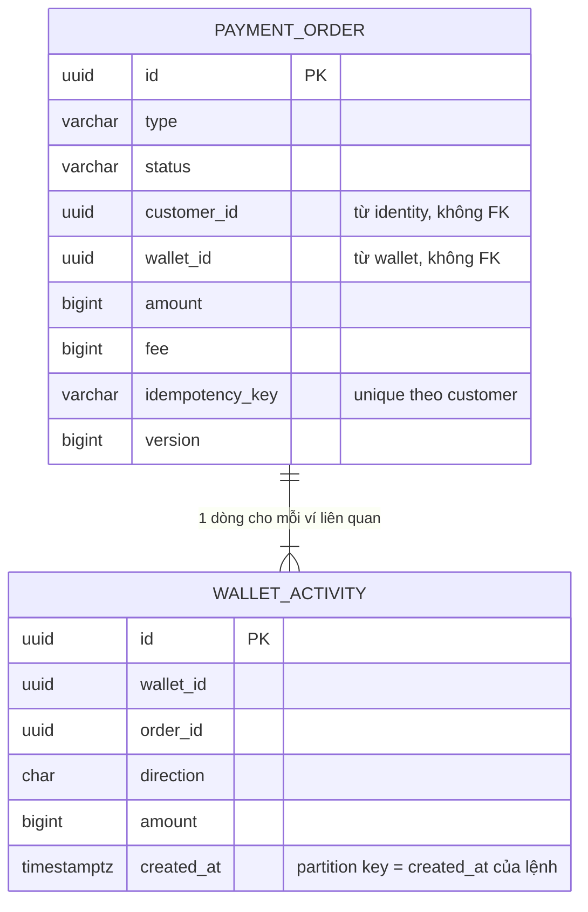
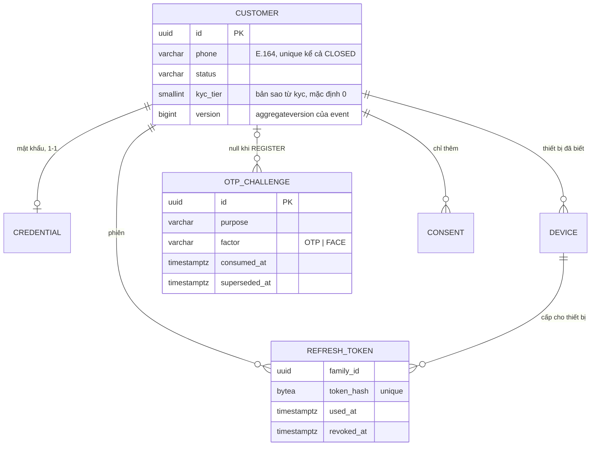

# EWallet — Data model (PostgreSQL)

Đi kèm [thiết kế chính](2026-11-04-ewallet-design.md). DDL dưới đây là bản thiết kế; khi code, mỗi khối thành Flyway migration của service tương ứng.

Quy ước:
- **Mỗi service một database** (tên `<service>_db`), có DB user riêng. Tên schema trong DDL (`ledger.`, `payment.`...) giữ lại để dễ đọc; khi triển khai mỗi DB chỉ có schema của chính service đó.
- Tiền: `bigint`, đơn vị đồng. `currency char(3)` mặc định `'VND'`.
- Thời gian: `timestamptz`, lưu UTC. Kỳ ngày/tháng của hạn mức tính theo `Asia/Ho_Chi_Minh` ở tầng ứng dụng.
- ID nghiệp vụ: `uuid` (UUIDv7, sinh ở ứng dụng).
- Không có khoá ngoại xuyên service. Tham chiếu sang service khác chỉ là cột id.
- Cột `*_enc`: AES-GCM envelope (`bytea`). Cột `*_hash`: HMAC-SHA256 (`bytea`) dùng để tra cứu và kiểm tra unique.
- Bảng có hậu tố `_projection` / `_directory` là **bản sao dữ liệu** nhận từ event của service khác. Chỉ consumer được ghi vào; chỉ dùng để tra cứu, không dùng để quyết định về tiền.

## Bảng dùng chung trong mọi service (do `platform` starter cung cấp)

```sql
create table outbox (
  id            uuid primary key,          -- = CloudEvents id
  topic         varchar(128) not null,
  event_key     varchar(128) not null,     -- id của aggregate, dùng làm key Kafka
  event_type    varchar(128) not null,
  payload       jsonb not null,
  headers       jsonb not null,            -- traceparent...
  created_at    timestamptz not null default now(),
  published_at  timestamptz
);
create index ix_outbox_unpublished on outbox (created_at) where published_at is null;

create table inbox (
  event_id      uuid not null,
  consumer      varchar(64) not null,      -- tên handler, để một event có thể được nhiều handler trong cùng service xử lý
  processed_at  timestamptz not null default now(),
  primary key (event_id, consumer)
);
-- shedlock: theo DDL chuẩn của ShedLock
```
Bảng `outbox` có job dọn bản ghi đã publish quá 7 ngày; bảng `inbox` dọn bản ghi quá 30 ngày (dài hơn retention của Kafka).

---

## ledger

```sql
create schema ledger;

create table ledger.account (
  id            bigint generated always as identity primary key,
  code          varchar(64) not null unique,      -- WALLET:<uuid>, BANK_SETTLEMENT:<bank>, FEE_REVENUE...
  category      varchar(16) not null check (category in ('ASSET','LIABILITY','REVENUE','EXPENSE')),
  normal_side   char(1)     not null check (normal_side in ('D','C')),
  bucket_count  smallint    not null default 1 check (bucket_count between 1 and 64),
  allow_negative boolean    not null default false, -- true cho tài khoản hệ thống
  currency      char(3)     not null default 'VND',
  debit_blocked  boolean    not null default false, -- ví bị khoá: chặn ghi nợ, vẫn cho ghi có (nạp đang treo)
  credit_blocked boolean    not null default false, -- ví đã đóng: chặn cả hai chiều
  status        varchar(16) not null default 'ACTIVE',
  created_at    timestamptz not null default now()
);

-- Số dư theo phía tăng của tài khoản. Ví: 1 bucket; tài khoản hệ thống: 16 bucket.
create table ledger.account_balance (
  account_id    bigint   not null references ledger.account(id),
  bucket        smallint not null,
  balance       bigint   not null default 0,
  held          bigint   not null default 0,
  allow_negative boolean not null,                 -- sao chép từ account để CHECK dùng được
  updated_at    timestamptz not null default now(),
  primary key (account_id, bucket),
  constraint ck_nonneg check (allow_negative or balance >= 0),
  constraint ck_held   check (held >= 0 and (allow_negative or held <= balance))
);

create table ledger.journal (
  id             uuid primary key,
  purpose        varchar(32) not null,  -- TOPUP, WITHDRAW, P2P, ADJUSTMENT, REVERSAL, BANK_FEE, REBALANCE
  reference_type varchar(32) not null,  -- PAYMENT_ORDER, APPROVAL, RECON_ITEM
  reference_id   uuid        not null,
  reversal_of    uuid        references ledger.journal(id),
  created_at     timestamptz not null default now(),
  constraint uq_journal_ref unique (reference_type, reference_id, purpose)  -- chặn ghi sổ 2 lần
);

create table ledger.entry (
  id          bigint generated always as identity,
  journal_id  uuid    not null,
  account_id  bigint  not null,
  direction   char(1) not null check (direction in ('D','C')),
  amount      bigint  not null check (amount > 0),
  created_at  timestamptz not null default now(),
  primary key (id, created_at)
) partition by range (created_at);
create index ix_entry_account_time on ledger.entry (account_id, created_at);
create index ix_entry_journal on ledger.entry (journal_id);
-- partition theo tháng, job tạo trước 3 tháng:
-- create table ledger.entry_2026_11 partition of ledger.entry for values from ('2026-11-01') to ('2026-12-01');

create table ledger.hold (
  id           uuid primary key,
  account_id   bigint not null references ledger.account(id),
  amount       bigint not null check (amount > 0),
  reason       varchar(32) not null,      -- WITHDRAW, LEGAL_FREEZE
  reference_id uuid not null unique,      -- order id hoặc approval id
  status       varchar(16) not null check (status in ('ACTIVE','CAPTURED','RELEASED')),
  created_at   timestamptz not null default now(),
  updated_at   timestamptz not null default now()
);

-- Ứng dụng chỉ được thêm entry/journal:
-- revoke update, delete on ledger.entry, ledger.journal from ewallet_app;
```

Câu lệnh cốt lõi:

```sql
-- Trừ ví (bucket 0); 0 dòng bị cập nhật nghĩa là INSUFFICIENT_BALANCE
update ledger.account_balance
   set balance = balance - :amt, updated_at = now()
 where account_id = :id and bucket = 0 and balance - held >= :amt;

-- Đặt hold
update ledger.account_balance
   set held = held + :amt, updated_at = now()
 where account_id = :id and bucket = 0 and balance - held >= :amt;

-- Capture hold (trong cùng TX với post journal)
update ledger.account_balance
   set held = held - :amt, balance = balance - :amt, updated_at = now()
 where account_id = :id and bucket = 0 and held >= :amt;

-- Tài khoản hệ thống: bucket ngẫu nhiên
update ledger.account_balance set balance = balance + :delta, updated_at = now()
 where account_id = :id and bucket = :randomBucket;
```

`POST /internal/journals` làm theo thứ tự:
1. Kiểm Σ D = Σ C. Lệch → `422`, không ghi gì.
2. Kiểm `debit_blocked`/`credit_blocked` của các tài khoản.
3. Insert `journal`. Nếu `uq_journal_ref` báo trùng: so nội dung với journal đã có; giống thì trả `200` với journal cũ (idempotent replay), khác thì trả `409`.
4. Cập nhật số dư theo thứ tự lock (mục 6.2 của thiết kế chính).
5. Batch insert `entry`.
6. Insert `outbox` (`JournalPosted`).

Tất cả nằm trong **một** DB transaction.

---

## wallet

```sql
create schema wallet;
create table wallet.wallet (
  id                 uuid primary key,
  customer_id        uuid not null unique,      -- 1 khách 1 ví
  ledger_account_id  bigint not null unique,
  status             varchar(16) not null check (status in ('ACTIVE','FROZEN','CLOSING','CLOSED')),
  version            bigint not null default 0,   -- = aggregateversion trong event
  frozen_reason      varchar(64),
  created_at         timestamptz not null default now(),
  closed_at          timestamptz
);
```
- Phong toả một phần số dư: `wallet` gọi `ledger` tạo hold với reason `LEGAL_FREEZE`.
- Khoá toàn bộ ví: `status = FROZEN` ở `wallet`, đồng thời gọi đồng bộ `ledger` đặt `debit_blocked = true`. `ledger` là nơi chặn thật sự; `payment` kiểm `status` ở `wallet` chỉ để báo lỗi sớm.

```sql
-- bản sao từ identity.events (CustomerRegistered, CustomerUpdated) và kyc.events
create table wallet.customer_directory (
  customer_id    uuid primary key,
  phone          varchar(15) not null unique,
  display_masked varchar(64) not null,   -- "NGUYEN V*** A"
  source_version bigint not null,        -- aggregateversion lớn nhất đã áp; event cũ hơn bị bỏ qua
  updated_at     timestamptz not null
);
```

---

## payment (`payment_db`)

### ERD


### Truy vấn chính
| # | Truy vấn | Ai / khi nào | Tần suất (giả định) | Index |
|---|---|---|---|---|
| Q1 | Tra lệnh theo `(customer_id, idempotency_key)` khi nhận lệnh (tra trước mọi kiểm tra) | `POST /topups`, `/withdrawals`, `/transfers` | ~150/giây lúc cao điểm | `uq_order_idem` |
| Q2 | Lấy lệnh theo `id` (kiểm `customer_id` ở ứng dụng) | `GET /orders/{id}`, UI hỏi lại kết quả | ~300/giây (polling) | PK |
| Q3 | Lệnh `PROCESSING` quá 2 phút | Job recovery, mỗi 30 giây | Thấp | `ix_order_recover` |
| Q4 | Lệnh `UNKNOWN` đến hạn kiểm | Job resolver, mỗi 30 giây | Thấp | `ix_order_pending` |
| Q5 | Số lệnh `PROCESSING`/`UNKNOWN` của một ví | `GET /internal/orders/open?walletId=` khi đóng ví | Rất thấp | `ix_payment_order_wallet_open` |
| Q6 | Lệnh theo khoảng thời gian (+ lọc status, ngân hàng) | CMS `GET /admin/v1/orders`, chạy trên read replica | Thấp | `ix_payment_order_created`; xem lại khi có SRS F-BO-02 |
| Q7 | Lịch sử của một ví, mới nhất trước, keyset `(created_at, id)` | `GET /activities` | ~100/giây | `ix_wallet_activity_wallet_time` |

### Khối lượng & lưu trữ
Giả định: 500k khách, 30% hoạt động mỗi ngày, trung bình 2 lệnh/khách hoạt động → ~300k lệnh/ngày; mỗi lệnh ~1,5 dòng `wallet_activity` (P2P có 2 dòng).

| Bảng | Dòng/ngày | Sau 24 tháng | Lưu nóng | Archive | Partition |
|---|---|---|---|---|---|
| `payment_order` | ~300k | ~220 triệu | 24 tháng (NFR-L-06) | Export sang lưu trữ không sửa được, rồi xoá theo lô các lệnh đã ở trạng thái cuối | **Không** (lý do bên dưới) |
| `wallet_activity` | ~450k | ~330 triệu | 24 tháng | Export, rồi detach partition | Theo tháng |

**Vì sao không partition `payment_order`:** partition theo thời gian buộc mọi `UNIQUE` phải chứa cột partition. Khi đó `uq_order_idem` thành `(customer_id, idempotency_key, created_at)`, và một lần gửi lại vắt qua ranh giới tháng (23:59:59 → 00:00:01) sẽ tạo **lệnh thứ hai**: đúng lỗi chuyển trùng mà idempotency phải chặn. Giữ bảng không partition. Xem lại khi vượt khoảng 300 triệu dòng: khi đó tách idempotency ra bảng riêng không partition rồi partition bảng lệnh.

**Vì sao partition `wallet_activity` được:** `created_at` của dòng activity **lấy bằng `created_at` của lệnh**, không phải thời điểm insert. Nhờ vậy `(wallet_id, order_id, created_at)` tương đương `(wallet_id, order_id)` và unique vẫn đúng. Insert ngoài khoảng của mọi partition sẽ báo lỗi (đã kiểm), nên job tạo partition trước 3 tháng là bắt buộc.

### `payment.payment_order`
**Mục đích:** một dòng cho mỗi lệnh tiền của khách (nạp, rút, P2P). Loại: aggregate. Bản thân lệnh là bản ghi idempotency. **Chủ sở hữu:** `payment`. **Ai dùng:** `recon` (projection qua event), `dispute` (API), CMS (API).

```sql
create schema payment;
create table payment.payment_order (
  id                     uuid primary key,                -- UUIDv7
  type                   varchar(16) not null check (type in ('TOPUP','WITHDRAW','P2P')),
  status                 varchar(16) not null check (status in ('PROCESSING','SUCCEEDED','FAILED','UNKNOWN')),
  customer_id            uuid not null,                   -- id từ identity.customer (không FK)
  wallet_id              uuid not null,                   -- ví bị trừ (P2P, rút) hoặc được cộng (nạp); id từ wallet
  counterparty_wallet_id uuid,                            -- ví người nhận; chỉ P2P
  bank_code              varchar(16),                     -- chỉ nạp/rút
  bank_link_id           uuid,                            -- chỉ nạp/rút; id từ bank-gateway
  amount                 bigint not null check (amount > 0),
  fee                    bigint not null default 0 check (fee >= 0),
  currency               char(3) not null default 'VND',
  fee_rule_id            uuid,                            -- null = không có rule phí áp dụng (khi đó fee = 0)
  idempotency_key        varchar(64) not null,
  request_hash           bytea not null,                  -- sha256 của (người nhận/nguồn, số tiền, lời nhắn) đã chuẩn hoá
  external_ref           varchar(32) unique,              -- gửi ngân hàng; Crockford base32; chỉ nạp/rút
  bank_ref               varchar(64),
  failure_code           varchar(64),                     -- bắt buộc khi FAILED; có thể có khi SUCCEEDED (CREDITED_TO_SUSPENSE)
  failure_detail         jsonb,                           -- dữ liệu cho thông điệp lỗi, ví dụ {"scope":"P2P_DAY","remaining":2500000}
  note                   varchar(140),
  saga_step              varchar(24) not null default 'STARTED',
    -- BANK_CALLED được commit TRƯỚC khi gọi bank-gateway; từ step này chỉ được hỏi trạng thái, không gửi lại
  check_attempts         int not null default 0,
  next_check_at          timestamptz,                     -- chỉ dùng khi UNKNOWN
  version                bigint not null default 0,       -- tăng mỗi lần đổi trạng thái; = aggregateversion trong event
  trace_id               varchar(32) not null,            -- traceId của request tạo lệnh; hiển thị trên CMS
  created_at             timestamptz not null default now(),
  updated_at             timestamptz not null default now(),
  constraint uq_order_idem unique (customer_id, idempotency_key),
  constraint ck_payment_order_type_fields check (
       (type = 'P2P' and counterparty_wallet_id is not null
          and bank_code is null and bank_link_id is null and external_ref is null)
    or (type in ('TOPUP','WITHDRAW') and counterparty_wallet_id is null
          and bank_code is not null and bank_link_id is not null and external_ref is not null)),
  constraint ck_payment_order_not_self       check (counterparty_wallet_id <> wallet_id),
  constraint ck_payment_order_p2p_no_unknown check (type <> 'P2P' or status <> 'UNKNOWN'),
  constraint ck_payment_order_saga_by_type   check (
       (type = 'P2P'      and saga_step in ('STARTED','LIMIT_RESERVED','POSTED'))
    or (type = 'TOPUP'    and saga_step in ('STARTED','LIMIT_RESERVED','BANK_CALLED','POSTED'))
    or (type = 'WITHDRAW' and saga_step in ('STARTED','LIMIT_RESERVED','HOLD_PLACED','BANK_CALLED','POSTED'))),
  constraint ck_payment_order_failed_code    check (status <> 'FAILED' or failure_code is not null),
  constraint ck_payment_order_fee_rule       check (fee = 0 or fee_rule_id is not null),
  constraint ck_payment_order_note           check (note is null or note !~ '[[:cntrl:]]'),
  constraint ck_payment_order_attempts       check (check_attempts >= 0),
  constraint ck_payment_order_version        check (version >= 0)
);
create index ix_order_pending on payment.payment_order (next_check_at)
  where status in ('PROCESSING','UNKNOWN');                  -- Q4
create index ix_order_recover on payment.payment_order (updated_at)
  where status = 'PROCESSING';                               -- Q3
create index ix_payment_order_wallet_open on payment.payment_order (wallet_id)
  where status in ('PROCESSING','UNKNOWN');                  -- Q5
create index ix_payment_order_created on payment.payment_order (created_at desc);  -- Q6

-- Đổi trạng thái luôn kèm điều kiện trạng thái cũ và tăng version:
-- update payment.payment_order set status = :new, version = version + 1, updated_at = now(), ...
--  where id = :id and status = :expected;
```

**Ghi chú thiết kế**
| Quyết định | Lý do | Nguồn |
|---|---|---|
| `uq_order_idem` | Gửi lại cùng khoá không tạo lệnh thứ hai, kể cả hai request đồng thời | F-PAY-03.FR-08, FR-11; NFR-C-03 |
| `ck_payment_order_not_self` | Chặn tự chuyển cho chính mình ở DB, kể cả khi code bỏ sót | F-PAY-03.BR-03 |
| `ck_payment_order_p2p_no_unknown` | P2P không gọi đối tác nên không bao giờ `UNKNOWN`; trạng thái này xuất hiện ở P2P là bug | SRS F-PAY-03 §2.4 |
| `ck_payment_order_type_fields` | Mỗi loại lệnh có đúng bộ trường của nó; lệnh nạp/rút thiếu `external_ref` không đối soát được | F-PAY-03.FR-19; design §6.4; IR-04 |
| `ck_payment_order_saga_by_type` | Bước saga phải hợp lệ với loại lệnh; P2P không có `BANK_CALLED` | design §6.3–6.6 |
| `ck_payment_order_failed_code` | Lệnh thất bại luôn có lý do để hiển thị và tra soát | F-PAY-03 §6 |
| `ck_payment_order_fee_rule` | Thu phí thì phải biết rule nào đã áp dụng (lịch sử phí không đổi khi biểu phí đổi) | FR-FEE-02 |
| `ck_payment_order_note` | Chặn ký tự điều khiển trong lời nhắn ở DB | F-PAY-03.FR-31 (giả định về ký tự bị cấm) |
| `failure_detail` (`jsonb`) | Gửi lại cùng khoá phải trả đúng lệnh cũ, kể cả dữ liệu cho thông điệp `LIMIT_EXCEEDED` ("Hạn mức còn lại: {remaining}"); không lọc theo trường này nên `jsonb` phù hợp | F-PAY-03 §6, FR-08; UI UQ5 |
| `version` | Event phải mang `aggregateversion` để consumer bỏ qua event đến muộn | design §7 |
| `trace_id` | Mỗi lệnh truy vết được về log/trace từ CMS | F-PAY-03.NFR-05 |
| Không lưu số dư sau giao dịch | Số dư thuộc `ledger` | design §5 |

**Chuyển trạng thái** (SRS F-PAY-03 §3.4 cho P2P; design §6.6 cho nạp/rút):
| Từ | Sang | Loại lệnh |
|---|---|---|
| — | `PROCESSING` | Tất cả |
| `PROCESSING` | `SUCCEEDED`, `FAILED` | Tất cả |
| `PROCESSING` | `UNKNOWN` | Chỉ nạp/rút (P2P bị `ck_payment_order_p2p_no_unknown` chặn) |
| `UNKNOWN` | `SUCCEEDED`, `FAILED` | Chỉ nạp/rút |

Chuyển từ trạng thái cuối không bị DB chặn (cần trigger); được chặn bằng `UPDATE ... WHERE status = :expected` ở ứng dụng.

**Dữ liệu cá nhân:** `note` là văn bản tự do khách nhập, có thể chứa thông tin cá nhân. Lưu cùng lệnh theo thời hạn chứng từ; khi archive thì giữ nguyên (là một phần chứng từ). Không có cột nhạy cảm cần mã hoá.

### `payment.wallet_activity`
**Mục đích:** bản ghi lịch sử theo từng ví (read model trong cùng service), để khách xem lịch sử nhanh mà không phải join hay hỏi `ledger`. Loại: bản ghi gần như chỉ thêm (chỉ cột `status` được cập nhật theo lệnh). **Chủ sở hữu:** `payment`.

```sql
create table payment.wallet_activity (
  id                   uuid not null,
  wallet_id            uuid not null,
  order_id             uuid not null,             -- payment_order.id (cùng DB nhưng không FK: bảng partition, giữ ghi nhanh)
  direction            char(1) not null,           -- I = tiền vào, O = tiền ra
  type                 varchar(16) not null,
  amount               bigint not null,            -- số tiền tác động lên ví này (tiền ra đã gồm phí)
  status               varchar(16) not null,       -- cập nhật cùng transaction với lệnh
  counterparty_display varchar(64),                -- tên đã che (P2P) hoặc tên ngân hàng; null nếu chưa có
  created_at           timestamptz not null,       -- = payment_order.created_at, KHÔNG phải thời điểm insert
  constraint pk_wallet_activity primary key (id, created_at),
  constraint uq_wallet_activity_order unique (wallet_id, order_id, created_at),
  constraint ck_wallet_activity_direction check (direction in ('I','O')),
  constraint ck_wallet_activity_type      check (type in ('TOPUP','WITHDRAW','P2P')),
  constraint ck_wallet_activity_status    check (status in ('PROCESSING','SUCCEEDED','FAILED','UNKNOWN')),
  constraint ck_wallet_activity_amount    check (amount > 0)
) partition by range (created_at);
create index ix_wallet_activity_wallet_time on payment.wallet_activity (wallet_id, created_at desc, id desc);  -- Q7
-- partition theo tháng, job tạo trước 3 tháng:
-- create table payment.wallet_activity_2026_11 partition of payment.wallet_activity
--   for values from ('2026-11-01') to ('2026-12-01');
```

- Người gửi (P2P) hoặc chủ ví (nạp/rút): ghi dòng khi tạo lệnh, cập nhật `status` theo lệnh. Người nhận P2P: chỉ ghi dòng khi lệnh `SUCCEEDED`, trong cùng transaction chốt lệnh (F-PAY-03.FR-30).
- Lỗi vi phạm unique trên bảng partition hiện tên ràng buộc do PostgreSQL sinh cho từng partition (ví dụ `wallet_activity_2026_11_wallet_id_order_id_created_at_key`), không phải `uq_wallet_activity_order`; khi đọc log cần biết điều này.

**Đã kiểm (2026-11-04):** DDL của mục này chạy được trên PostgreSQL 16. 14 tình huống vi phạm đều bị chặn đúng ràng buộc: tự chuyển, P2P `UNKNOWN`, trùng khoá idempotency, `FAILED` thiếu mã, P2P mang trường ngân hàng, nạp thiếu `external_ref`, P2P ở bước `BANK_CALLED`, thu phí thiếu rule, lời nhắn có ký tự điều khiển, lời nhắn dài 141 ký tự, số tiền 0, trùng dòng activity, activity số tiền 0, activity ngoài mọi partition.

### Câu hỏi mở (payment)

ID chung: DQ1 = OQ-021, DQ2 = OQ-026 ([open-questions.md](../open-questions.md)).
| # | Câu hỏi | Ảnh hưởng | Ai quyết định |
|---|---|---|---|
| DQ1 | `GET /orders/{id}` hiện không trả thông tin người nhận, mà màn hình kết quả UI F-PAY-03.S-04 cần "Người nhận". Lấy từ `wallet_activity.counterparty_display` (dòng của người gửi) và thêm field `counterpartyDisplay` vào response? | API `order`, Q2 | Nhóm API |
| DQ2 | Có cần trigger chặn đổi trạng thái từ `SUCCEEDED`/`FAILED` ở DB (phòng thủ thêm), hay chấp nhận chỉ chặn ở ứng dụng? | `payment_order` | Nhóm thiết kế |

---

## limit & fee

```sql
create schema limits;
create table limits.limit_rule (
  id            uuid primary key,
  layer         varchar(16) not null check (layer in ('LEGAL','TIER','CUSTOMER')),
  kyc_tier      smallint,                 -- null cho LEGAL và CUSTOMER
  customer_id   uuid,                     -- chỉ cho CUSTOMER
  scope         varchar(32) not null,     -- TOPUP, WITHDRAW, P2P, OUTGOING_ALL...
  period        varchar(8)  not null check (period in ('TXN','DAY','MONTH')),
  max_amount    bigint,
  max_count     int,
  effective_from timestamptz not null,
  effective_to   timestamptz,
  approval_id   uuid not null,            -- được tạo qua maker–checker
  created_at    timestamptz not null default now()
);

-- Mỗi lệnh một reservation; id = orderId → gọi reserve lại là idempotent
create table limits.limit_reservation (
  id          uuid primary key,             -- = payment orderId
  customer_id uuid not null,
  wallet_id   uuid not null,
  amount      bigint not null,
  usages      jsonb not null,               -- [{scope, periodKey}] đã cộng vào limit_usage
  status      varchar(16) not null check (status in ('RESERVED','COMMITTED','RELEASED')),
  created_at  timestamptz not null default now(),
  updated_at  timestamptz not null default now()
);
-- release: chỉ khi status = 'RESERVED' → trừ lại limit_usage theo usages, chuyển RELEASED (cùng TX)

-- bản sao từ kyc.events (KycTierChanged); lưu theo customer vì kyc không biết walletId
create table limits.customer_tier (
  customer_id    uuid primary key,
  kyc_tier       smallint not null,       -- 0, 1, 2; -1 = RESTRICTED (CCCD hết hạn)
  source_version bigint not null,
  updated_at     timestamptz not null
);
-- Chưa có dòng cho customer → coi như tier 0 (không được giao dịch): an toàn khi event đến chậm.

create table limits.limit_usage (
  wallet_id   uuid not null,
  scope       varchar(32) not null,
  period_key  varchar(10) not null,       -- '2026-11-04' | '2026-11'
  used_amount bigint not null default 0,
  used_count  int    not null default 0,
  primary key (wallet_id, scope, period_key)
);
-- reserve (một câu, nguyên tử):
-- insert into limits.limit_usage values (:w,:s,:p,:amt,1)
-- on conflict (wallet_id,scope,period_key) do update
--   set used_amount = limit_usage.used_amount + :amt, used_count = limit_usage.used_count + 1
--   where limit_usage.used_amount + :amt <= :max and limit_usage.used_count + 1 <= :maxCount;
-- 0 dòng → LIMIT_EXCEEDED. Trường hợp insert mới, kiểm :amt <= :max trước ở ứng dụng.

create schema fee;
create table fee.fee_rule (
  id             uuid primary key,
  tx_type        varchar(16) not null,
  bank_code      varchar(16),            -- null = mọi ngân hàng
  amount_from    bigint not null default 0,
  amount_to      bigint,                 -- null = không giới hạn
  fixed_fee      bigint not null default 0,
  percent_bp     int    not null default 0,   -- basis point: 10 = 0,1%
  min_fee        bigint not null default 0,
  max_fee        bigint,
  rounding       varchar(16) not null default 'CEILING',
  priority       int not null default 0,
  effective_from timestamptz not null,
  effective_to   timestamptz,
  approval_id    uuid not null
);
```
Công thức phí: `fee = clamp(fixed + ceil(amount × bp / 10000), min, max)`. Khi nhiều rule cùng khớp, chọn rule cụ thể nhất (có `bank_code` thắng null), sau đó theo `priority`.

---

## identity (`identity_db`)

Nguồn: SRS [F-ACC-01](../srs/features/F-ACC-01-dang-ky-dang-nhap.md) (Draft v0.1), design §5 và §10. Mục này được viết lại ngày 2026-11-04; so sánh với bản trước ở "Lịch sử thay đổi" cuối tài liệu.

### ERD


### Truy vấn chính
| # | Truy vấn | Ai / khi nào | Tần suất (giả định) | Index |
|---|---|---|---|---|
| Q1 | Tra khách và credential theo SĐT | `POST /auth/login`, quên mật khẩu, kiểm SĐT đã đăng ký | ~50/giây lúc cao điểm (F-ACC-01.NFR-01) | `uq_customer_phone`, PK `credential` |
| Q2 | Tăng bộ đếm sai nguyên tử, khoá khi đạt ngưỡng; đặt lại về 0 | Đăng nhập sai/đúng, đổi/đặt lại mật khẩu | Thấp | PK `credential` |
| Q3 | Tìm thiết bị theo `(customer_id, fingerprint_hash)` | Đăng nhập | Như Q1 | `uq_device_fingerprint` |
| Q4 | Liệt kê thiết bị còn tin cậy của một khách | `GET /me/devices` | Rất thấp | `uq_device_fingerprint` (tiền tố `customer_id`; mỗi khách vài dòng) |
| Q5 | Tra refresh token theo hash; xoay vòng bằng `UPDATE ... WHERE used_at IS NULL AND revoked_at IS NULL` rồi thêm token mới | `POST /auth/refresh` | ~100/giây (150k khách hoạt động/ngày, làm mới mỗi 5 phút khi đang dùng) | `uq_refresh_token_hash` |
| Q6 | Thu hồi theo family, theo thiết bị, hoặc toàn bộ phiên của khách | Dùng lại token, đăng xuất, thu hồi thiết bị, đổi/đặt lại mật khẩu, khoá tài khoản | Thấp | `ix_refresh_token_customer_active` |
| Q7 | Xác minh challenge: lấy theo `id`, tăng `attempts` nguyên tử, đánh dấu đã dùng | Nhập OTP | ~10/giây | PK |
| Q8 | Vô hiệu challenge còn sống cùng đối tượng rồi cấp challenge mới | Gửi OTP, gửi lại | ~10/giây | `uq_challenge_active` |
| Q9 | Đồng ý mới nhất của mỗi mục đích | `GET /me/consents` | Rất thấp | `ix_consent_customer` |
| Q10 | Dọn refresh token hết hạn quá 1 ngày; challenge cũ hơn 7 ngày | Job hằng ngày | 1 lần/ngày | Quét bảng (bảng nhỏ, xem khối lượng) |

### Khối lượng & lưu trữ
Giả định: 500k khách (NFR-P-01); 30% hoạt động mỗi ngày (~150k), mỗi người dùng khoảng 1 giờ/ngày nên làm mới phiên khoảng 12 lần/ngày; khoảng 100k OTP/ngày (đăng nhập thiết bị mới, lệnh cần xác thực, đăng ký).

| Bảng | Dòng/ngày | Quy mô ổn định | Lưu nóng | Archive / ẩn danh | Partition |
|---|---|---|---|---|---|
| `customer`, `credential` | Vài nghìn (đăng ký mới) | 500k dòng | Vô thời hạn khi còn tài khoản | Ẩn danh khi hết hạn lưu trữ (bên dưới) | Không |
| `device` | Vài nghìn | ~750k dòng | Như `customer` | Xoá khi ẩn danh khách | Không |
| `refresh_token` | ~1,8 triệu | ~2–4 triệu dòng (1 ngày sau hết hạn rồi xoá theo lô) | 1 ngày sau `expires_at` | Xoá, không export | Không. Xem lại nếu autovacuum không theo kịp lượng xoá: khi đó partition theo ngày |
| `otp_challenge` | ~100k | ~700k dòng | 7 ngày (challenge giao dịch phải còn để xác minh lại với cùng `consumerRef` trong 24 giờ của `Idempotency-Key`) | Xoá | Không |
| `consent` | Vài nghìn | ~1 triệu dòng | Theo nghĩa vụ chứng minh đã đồng ý `[Cần xác nhận ⚖️]` | Ẩn danh `ip`, `user_agent` khi hết hạn lưu trữ | Không |

### `identity.customer`
**Mục đích:** tài khoản của khách, khoá bởi SĐT. Loại: aggregate. **Chủ sở hữu:** `identity`. **Ai dùng qua event:** `wallet` (danh bạ tra cứu người nhận), `audit`. `kyc_tier` là bản sao từ `kyc.events` (ghi bởi consumer của F-ACC-02).

```sql
create schema identity;

create table identity.customer (
  id          uuid primary key,                          -- UUIDv7
  phone       varchar(15) not null,                      -- E.164 đã chuẩn hoá (F-ACC-01.BR-01)
  full_name   varchar(128) not null,                     -- đã chuẩn hoá (BR-03)
  status      varchar(16) not null,
  kyc_tier    smallint not null default 0,               -- 0 = chưa eKYC (FR-03)
  version     bigint not null default 1,                 -- = aggregateversion của CustomerRegistered / CustomerUpdated
  created_at  timestamptz not null default now(),
  updated_at  timestamptz not null default now(),
  constraint uq_customer_phone      unique (phone),     -- BR-10: một SĐT một tài khoản, kể cả CLOSED
  constraint ck_customer_phone      check (phone ~ '^\+84[0-9]{9}$'),
  constraint ck_customer_status     check (status in ('PENDING','ACTIVE','LOCKED','CLOSED')),
  constraint ck_customer_tier       check (kyc_tier >= 0),
  constraint ck_customer_version    check (version >= 1),
  constraint ck_customer_full_name  check (char_length(full_name) >= 1
                                           and full_name = btrim(full_name)
                                           and full_name !~ '\s{2,}'
                                           and full_name !~ '[[:cntrl:]]')
);
```

**Ghi chú thiết kế**
| Quyết định | Lý do | Nguồn |
|---|---|---|
| `uq_customer_phone` | Hai yêu cầu đăng ký đồng thời cùng SĐT chỉ một bên thắng | F-ACC-01.FR-06, BR-10 |
| `ck_customer_phone` chỉ nhận `+84` và 9 chữ số | SĐT đã chuẩn hoá trước khi vào DB; chỉ SĐT Việt Nam | BR-01 `[Cần xác nhận Q15 / OQ-044]` |
| `full_name` `NOT NULL` kèm kiểm chuẩn hoá | SRS bắt buộc họ tên khi đăng ký | FR-03, BR-03 `[Cần xác nhận OQ-038]` |
| Thêm `version`, `updated_at` | Event cần `aggregateversion`; mỗi lần đổi trạng thái/SĐT tăng `version` bằng `UPDATE ... WHERE id = ? AND version = ?` | EV-01, EV-02 |
| `status` giữ `PENDING` | Chưa rõ dùng cho việc gì, bỏ khi OQ-043 trả lời | OQ-043 |
| Bỏ cột `email` | Không có FR nào dùng, requirements không thu email. Thêm lại nếu OQ-040 chọn kênh email | F-ACC-01 Q11 |
| Không có `closed_at`, `locked_at` | Thuộc F-ACC-03 và F-BO-02; audit đã ghi thời điểm | — |

**Chuyển trạng thái** (F-ACC-01.ST-01..05; chuyển do tính năng khác kích hoạt):
```pgsql
-- khoá/mở khoá/đóng: UPDATE có điều kiện trạng thái hiện tại
update identity.customer set status = 'LOCKED', version = version + 1, updated_at = now()
 where id = :id and status = 'ACTIVE';           -- 0 dòng = trạng thái đã khác, không làm gì
```

**Dữ liệu cá nhân:** `phone`, `full_name` ở dạng rõ vì cần tra cứu và hiển thị (nằm trong DB riêng của `identity`, user riêng). Trả cho client dạng đã che trừ chính chủ. Ẩn danh: bên dưới.

**Truy vết:** FR-03, FR-06, FR-36, BR-01, BR-03, BR-10, ST-01..05, EV-01, EV-02.

### `identity.credential`
**Mục đích:** mật khẩu và bộ đếm đăng nhập sai của một khách. Loại: aggregate (1-1 với `customer`).

```sql
create table identity.credential (
  customer_id    uuid primary key,
  password_hash  varchar(255) not null,                  -- Argon2id (NFR-02)
  failed_count   int not null default 0,                 -- BR-07
  locked_until   timestamptz,                            -- null = không bị khoá tạm
  changed_at     timestamptz not null default now(),
  constraint fk_credential_customer foreign key (customer_id) references identity.customer (id),
  constraint ck_credential_algo     check (password_hash like '$argon2id$%'),
  constraint ck_credential_failed   check (failed_count >= 0)
);
```

**Ghi chú thiết kế**
| Quyết định | Lý do | Nguồn |
|---|---|---|
| `ck_credential_algo` | Chặn ghi băm bằng thuật toán khác (bcrypt, SHA) do lỗi cấu hình | NFR-02 |
| Bộ đếm cộng nguyên tử bằng `UPDATE`, không đọc-rồi-ghi | Nhiều lần thử đồng thời không lọt qua ngưỡng | FR-17, BR-07 |
| `locked_until` là khoá tạm; `customer.status = LOCKED` là khoá do nhân viên | Hai cơ chế khác nhau: hết giờ tự mở / phải có người mở | FR-17, FR-18 |

```pgsql
-- Sai mật khẩu (chỉ khi không đang khoá; trong thời gian khoá không tăng — FR-17)
update identity.credential
   set failed_count = failed_count + 1,
       locked_until = case when failed_count + 1 >= :max_failures then now() + :lock_duration else locked_until end
 where customer_id = :id and (locked_until is null or locked_until <= now());
-- Đúng mật khẩu, đặt lại mật khẩu, hết thời gian khoá:
update identity.credential set failed_count = 0, locked_until = null where customer_id = :id;
```
Khi khoá hết hạn, bước đặt lại về 0 phải chạy trước lần cộng kế tiếp (ứng dụng gọi câu thứ hai khi thấy `locked_until <= now()`).

**Dữ liệu cá nhân:** `password_hash` không bao giờ ra khỏi `identity`; không log.

**Truy vết:** FR-15..FR-18, FR-33, FR-34, BR-07, NFR-02.

### `identity.device`
**Mục đích:** thiết bị mà khách đã chứng minh sở hữu (qua OTP hoặc đăng ký). Loại: aggregate nhỏ.

```sql
create table identity.device (
  id                uuid primary key,
  customer_id       uuid not null,
  fingerprint_hash  bytea not null,                      -- HMAC-SHA256 của dấu vân tay; không lưu bản gốc (FR-23)
  label             varchar(64),                         -- null = chưa đặt nhãn
  trusted_at        timestamptz,                         -- null = đã bị thu hồi tin cậy (FR-39)
  last_seen_at      timestamptz not null default now(),
  created_at        timestamptz not null default now(),
  constraint fk_device_customer     foreign key (customer_id) references identity.customer (id),
  constraint uq_device_fingerprint  unique (customer_id, fingerprint_hash),
  constraint ck_device_fingerprint  check (octet_length(fingerprint_hash) = 32)
);
```

**Ghi chú thiết kế**
| Quyết định | Lý do | Nguồn |
|---|---|---|
| `trusted_at` thay cho `trusted boolean` | Cần thời điểm để áp `auth.device.trust_ttl`; thu hồi = đặt null, giữ dòng để `refresh_token.device_id` còn tham chiếu và để audit | BR-04, FR-39 |
| Thiết bị mới đăng nhập OTP xong mới có dòng | Chưa qua OTP thì chưa tin cậy, không ghi | FR-21 |
| Đăng nhập lại từ thiết bị đã thu hồi | `UPDATE ... SET trusted_at = now(), last_seen_at = now()` trên dòng cũ, không tạo dòng mới | FR-39 |
| Thiết bị là "mới" khi không có dòng, hoặc `trusted_at is null`, hoặc `trusted_at + trust_ttl < now()` | | BR-04 |

**Dữ liệu cá nhân:** dấu vân tay chỉ ở dạng HMAC (khoá HMAC từ KMS); `label` do hệ thống đặt từ user agent hoặc khách tự đặt.

**Truy vết:** FR-19..FR-23, FR-38, FR-39, BR-04, NFR-07.

### `identity.refresh_token`
**Mục đích:** các refresh token đã cấp, theo từng chuỗi (family) xoay vòng. Loại: bản ghi sống ngắn.

```sql
create table identity.refresh_token (
  id                 uuid primary key,
  customer_id        uuid not null,
  device_id          uuid not null,
  family_id          uuid not null,                      -- chung cho mọi token xoay vòng từ một lần đăng nhập
  token_hash         bytea not null,                     -- SHA-256 của token (token ngẫu nhiên 256 bit)
  created_at         timestamptz not null default now(),
  expires_at         timestamptz not null,               -- = least(created_at + idle_timeout, family_expires_at)
  family_expires_at  timestamptz not null,               -- hạn tuyệt đối tính từ lúc đăng nhập (auth.refresh.ttl)
  used_at            timestamptz,                        -- null = chưa dùng để làm mới (ST-13)
  revoked_at         timestamptz,                        -- null = chưa thu hồi (ST-14)
  constraint fk_refresh_token_customer  foreign key (customer_id) references identity.customer (id),
  constraint fk_refresh_token_device    foreign key (device_id) references identity.device (id),
  constraint uq_refresh_token_hash      unique (token_hash),
  constraint ck_refresh_token_hash      check (octet_length(token_hash) = 32),
  constraint ck_refresh_token_expiry    check (expires_at > created_at and expires_at <= family_expires_at),
  constraint ck_refresh_token_used      check (used_at is null or used_at >= created_at)
);
create index ix_refresh_token_customer_active on identity.refresh_token (customer_id)
  where revoked_at is null;                                -- Q6
```

**Ghi chú thiết kế**
| Quyết định | Lý do | Nguồn |
|---|---|---|
| Hai cột hạn: `expires_at` và `family_expires_at` | Khi xoay vòng, token mới có `expires_at = least(now() + idle_timeout, family_expires_at)`: một cột kiểm cả hạn không hoạt động lẫn hạn tuyệt đối | FR-27 |
| Giữ token đã `USED` đến khi hết hạn | Để nhận ra việc dùng lại token cũ và thu hồi cả family | FR-26 |
| Chỉ một index ngoài khoá | Thu hồi theo family hoặc thiết bị đều lọc thêm trên danh sách token chưa thu hồi của khách (vài chục dòng); không cần index riêng cho `family_id`, `device_id` | Q6 |
| Không lưu IP/user agent | Không có FR; audit đã ghi | — |

**Chuyển trạng thái** (ST-12..ST-15; token không có cột trạng thái, suy từ `used_at`, `revoked_at`, `expires_at`):
```pgsql
-- Làm mới: chỉ một yêu cầu thắng (FR-25). 0 dòng = token đã dùng/thu hồi → áp FR-26
update identity.refresh_token set used_at = now()
 where token_hash = :hash and used_at is null and revoked_at is null and expires_at > now()
returning id, customer_id, device_id, family_id, family_expires_at;
-- Dùng lại token đã dùng: thu hồi cả family
update identity.refresh_token set revoked_at = now()
 where customer_id = :customer and family_id = :family and revoked_at is null;
```
Cả hai câu chạy cùng transaction với việc thêm token mới (để không có khoảng hở mất token).

**Dữ liệu cá nhân:** không. Token gốc chỉ ở cookie; DB chỉ có hash.

**Truy vết:** FR-24..FR-28, FR-31, FR-33, FR-34, FR-36, FR-39, ST-12..ST-15.

### `identity.otp_challenge`
**Mục đích:** yêu cầu xác thực (OTP hoặc khuôn mặt) gắn với một mục đích và một đối tượng. Loại: bản ghi sống ngắn. Dùng cho đăng ký, đăng nhập thiết bị mới, quên mật khẩu, đổi SĐT, và xác thực tăng cường của lệnh tiền. Tên bảng giữ `otp_challenge` dù có `factor = FACE` để không đổi tên.

```sql
create table identity.otp_challenge (
  id             uuid primary key,
  customer_id    uuid,                                   -- chủ challenge; null chỉ khi purpose = REGISTER
  phone          varchar(15),                            -- nơi nhận OTP (E.164); null khi factor = FACE
  purpose        varchar(32) not null,
  factor         varchar(8) not null default 'OTP',
  payload_hash   bytea,                                  -- gắn challenge với đúng nội dung lệnh (F-ACC-01.FR-41)
  code_hash      bytea,                                  -- HMAC-SHA256(khoá KMS, id || mã); null khi FACE
  attempts       smallint not null default 0,            -- số lần nhập sai (FR-11)
  created_at     timestamptz not null default now(),
  expires_at     timestamptz not null,
  consumed_at    timestamptz,                            -- ST-07
  superseded_at  timestamptz,                            -- ST-10: bị thay bằng challenge mới, hoặc không giao được OTP
  consumer_ref   varchar(64),                            -- khoá idempotency của lệnh đã dùng challenge (FR-42)
  constraint fk_challenge_customer      foreign key (customer_id) references identity.customer (id),
  constraint ck_challenge_purpose       check (purpose in ('REGISTER','LOGIN_NEW_DEVICE','RESET_PASSWORD','CHANGE_PHONE','P2P','WITHDRAW')),
  constraint ck_challenge_factor        check (factor in ('OTP','FACE')),
  constraint ck_challenge_factor_purpose check (factor = 'OTP' or purpose in ('CHANGE_PHONE','P2P','WITHDRAW')),
  constraint ck_challenge_owner         check ((purpose = 'REGISTER') = (customer_id is null)),
  constraint ck_challenge_phone         check ((factor = 'OTP') = (phone is not null)),
  constraint ck_challenge_code          check ((factor = 'OTP') = (code_hash is not null)),
  constraint ck_challenge_code_len      check (code_hash is null or octet_length(code_hash) = 32),
  constraint ck_challenge_payload_req   check (purpose not in ('P2P','WITHDRAW') or payload_hash is not null),
  constraint ck_challenge_payload_none  check (purpose not in ('REGISTER','LOGIN_NEW_DEVICE','RESET_PASSWORD') or payload_hash is null),
  constraint ck_challenge_attempts      check (attempts >= 0),
  constraint ck_challenge_expiry        check (expires_at > created_at),
  constraint ck_challenge_terminal      check (consumed_at is null or superseded_at is null),
  constraint ck_challenge_consumer_ref  check (consumer_ref is null or (consumed_at is not null and purpose in ('P2P','WITHDRAW')))
);
-- Q8: tối đa một challenge còn sống cho cùng (mục đích, yếu tố, đối tượng, nội dung lệnh)
create unique index uq_challenge_active on identity.otp_challenge
  (purpose, factor, (coalesce(customer_id::text, phone)), (coalesce(payload_hash, '\x'::bytea)))
  where consumed_at is null and superseded_at is null;
```

**Ghi chú thiết kế**
| Quyết định | Lý do | Nguồn |
|---|---|---|
| Thêm `superseded_at`, `created_at` | Trạng thái `SUPERSEDED` chưa có; `created_at` để tính `resendAfter` và dọn | ST-10, FR-12 |
| `code_hash` nullable, kèm `ck_challenge_code` | FACE không có mã; OTP luôn có mã | FR-09 |
| `code_hash` là HMAC có khoá và có `id` trong dữ liệu băm | Mã chỉ có 10^6 giá trị, băm không khoá bị dò ngược trong tích tắc nếu lộ DB | FR-09, `[Thiết kế §10]` nói "hash"; đây là cụ thể hoá |
| `uq_challenge_active` | FR-12 thành bất biến của DB: cấp challenge mới phải vô hiệu challenge cũ trước, nếu không insert bị từ chối. Hai lần gửi lại đồng thời: một bên thua, không có hai OTP cùng sống. Lệnh khác nội dung (khác `payload_hash`) sống song song được | FR-12, FR-10 |
| `consumer_ref` chỉ có khi đã `consumed_at` và chỉ cho mục đích giao dịch | Challenge phục vụ đúng một lệnh; xác minh lại cùng `consumerRef` vẫn thành công | FR-42 |
| Không có cột trạng thái | `EXPIRED` suy từ `expires_at`, `EXHAUSTED` suy từ `attempts` so với `auth.otp.max_attempts` (tham số cấu hình, không cố định trong DB) | ST-06..ST-11 |
| Đếm số lần gửi OTP và `resendAfter` nằm ở Redis, không ở bảng này | SĐT chưa đăng ký không có hàng trong bảng; đếm ở DB làm hành vi giới hạn tần suất khác nhau giữa SĐT có và không có tài khoản, tức là dò được tài khoản | FR-02, FR-13, FR-32; design (Redis đếm OTP); xem DQ2 |

```pgsql
-- Nhập sai/đúng OTP: tăng lượt nguyên tử; 0 dòng = hết hạn, hết lượt, đã dùng hoặc bị thay → CHALLENGE_INVALID
update identity.otp_challenge set attempts = attempts + 1
 where id = :id and consumed_at is null and superseded_at is null and expires_at > now() and attempts < :max_attempts
returning attempts;
-- Cấp challenge mới: vô hiệu cái cũ trước, cùng transaction với insert
update identity.otp_challenge set superseded_at = now()
 where purpose = :purpose and factor = :factor and coalesce(customer_id::text, phone) = :subject
   and coalesce(payload_hash, '\x'::bytea) = :payload and consumed_at is null and superseded_at is null;
-- Xác minh challenge giao dịch (FR-42), bước 1: xác minh lại với cùng consumerRef thì thành công, không cần OTP,
-- kể cả khi expires_at đã qua (challenge phải còn dùng được trong cửa sổ idempotency của lệnh)
select 1 from identity.otp_challenge where id = :id and consumer_ref = :ref and consumed_at is not null;
-- bước 2 (lần đầu, sau khi ứng dụng đã so khớp OTP và payload_hash): claim nguyên tử, chỉ một consumerRef thắng
update identity.otp_challenge set consumed_at = now(), consumer_ref = :ref
 where id = :id and consumed_at is null and superseded_at is null and expires_at > now();   -- 0 dòng = không hợp lệ
```

**Dữ liệu cá nhân:** `phone`. Xoá sau 7 ngày. `payload_hash` là băm, không chứa nội dung lệnh.

**Truy vết:** FR-01, FR-09..FR-14, FR-20, FR-32, FR-35, FR-41, FR-42, ST-06..ST-11.

### `identity.consent`
**Mục đích:** bằng chứng khách đã đồng ý điều khoản theo từng mục đích. Loại: chỉ thêm.

```sql
create table identity.consent (
  id             uuid primary key,
  customer_id    uuid not null,
  purpose        varchar(32) not null,
  terms_version  varchar(16) not null,
  granted        boolean not null,
  ip             inet not null,
  user_agent     varchar(256) not null,
  created_at     timestamptz not null default now(),
  constraint fk_consent_customer foreign key (customer_id) references identity.customer (id),
  constraint ck_consent_purpose  check (purpose in ('TERMS','BIOMETRIC_PROCESSING','MARKETING'))
);
create index ix_consent_customer on identity.consent (customer_id, purpose, created_at desc);   -- Q9
-- Chỉ thêm (FR-04). Job ẩn danh chạy bằng role riêng chỉ có SELECT và UPDATE (ip, user_agent).
revoke update, delete on identity.consent from identity_svc;
```

**Ghi chú thiết kế**
| Quyết định | Lý do | Nguồn |
|---|---|---|
| `REVOKE UPDATE, DELETE` | Bằng chứng đồng ý không được sửa hay xoá | FR-04, NFR-07 |
| Trạng thái hiện tại = dòng mới nhất theo `(customer_id, purpose)` | Rút lại đồng ý là thêm dòng `granted = false`, không sửa dòng cũ | FR-40 |
| `ip`, `user_agent` `NOT NULL` | FR-04 bắt buộc ghi; ứng dụng cắt `user_agent` còn 256 ký tự | FR-04 |

```pgsql
-- Q9: đồng ý hiện tại mỗi mục đích
select distinct on (purpose) purpose, terms_version, granted, created_at
  from identity.consent where customer_id = :id
 order by purpose, created_at desc, id desc;
```

**Dữ liệu cá nhân:** `ip`, `user_agent`. Khi hết hạn lưu trữ: ẩn danh bằng `ip = '0.0.0.0'`, `user_agent = ''`; giữ `purpose`, `terms_version`, `granted`, `created_at` để vẫn chứng minh được đã đồng ý.

**Truy vết:** FR-04, FR-40, NFR-07.

### Ẩn danh dữ liệu cá nhân (NFR-L-07)
Hạn lưu trữ theo bảng 7.5 của requirements chưa chốt `[OQ-005]`. Khi hết hạn và không còn nghĩa vụ pháp lý, job hằng ngày của `identity`:

| Bảng | Cột | Giá trị sau ẩn danh |
|---|---|---|
| `customer` | `phone` | Chưa quyết. Giá trị ẩn danh phải duy nhất và hiện không thoả `ck_customer_phone`, nên cần nới ràng buộc này hoặc dùng số giả hợp lệ. Chốt cùng F-ACC-03 và OQ-039 |
| `customer` | `full_name` | `'ANONYMIZED'` |
| `device` | dòng của khách | Xoá |
| `consent` | `ip`, `user_agent` | `0.0.0.0`, rỗng |

Việc ẩn danh `customer.phone` đụng ràng buộc `ck_customer_phone` và liên quan OQ-039 (SĐT của tài khoản đã đóng); chốt cùng F-ACC-03.

### Đã kiểm
**Đã kiểm (2026-11-04):** DDL của mục này (6 bảng, 4 index) được tách từ chính tài liệu và chạy được trên PostgreSQL 16, với `identity_svc` là chủ bảng (để `REVOKE` có tác dụng như khi triển khai). 75 ca đều đạt:
- **48 ca vi phạm** bị chặn đúng loại lỗi và đúng tên ràng buộc hoặc cột: SĐT sai dạng, trùng SĐT, họ tên chưa chuẩn hoá, băm không phải Argon2id, fingerprint và token sai độ dài, hạn token sai, 13 tổ hợp vô nghĩa của challenge, hai challenge cùng sống, đồng ý thiếu IP, `UPDATE`/`DELETE` trên `consent` bị từ chối quyền.
- **11 ca hợp lệ** vẫn được nhận: challenge khác nội dung sống song song, `FACE` song song `OTP` của `CHANGE_PHONE`, họ tên đúng 128 ký tự, cùng fingerprint ở khách khác...
- **16 kiểm tra hành vi** của các câu truy vấn nguyên tử ghi trong mục này: xoay vòng refresh token chỉ một lần thắng, thu hồi cả family không đụng family khác, đúng 5 lượt nhập OTP trong 7 lần thử, `consumerRef` đầu tiên thắng và xác minh lại cùng ref tìm thấy, bộ đếm sai dừng khi đã khoá, đồng ý mới nhất, khoá tài khoản lần hai không tăng `version`.

Thử bỏ `uq_challenge_active` thì đúng 3 ca challenge fail, tức bộ kiểm tra bắt được lỗi. Role ẩn danh có `SELECT` và `UPDATE (ip, user_agent)` sửa được hai cột đó, nhưng bị từ chối khi sửa `granted` hoặc xoá; role ứng dụng bị từ chối sửa `consent`.

### Câu hỏi mở (identity)

ID chung: DQ1 = OQ-045, DQ2 = OQ-046 ([open-questions.md](../open-questions.md)). Câu hỏi của SRS đã có ID riêng: OQ-038, OQ-039, OQ-040, OQ-043, OQ-044.
| # | Câu hỏi | Ảnh hưởng | Ai quyết định |
|---|---|---|---|
| DQ1 | Challenge `CHANGE_PHONE` (cả `FACE` và `OTP`) có gắn `payload_hash` = băm SĐT mới không? SRS F-ACC-01.FR-35 chưa nói; không gắn thì khuôn mặt đã xác thực cho SĐT X có thể dùng cho SĐT Y. Schema cho phép cả hai (cột nullable với `CHANGE_PHONE`) | FR-35, `otp_challenge.payload_hash` | Rủi ro / Bảo mật |
| DQ2 | Trần gửi OTP và `resendAfter` đặt ở Redis, nên mất khi Redis khởi động lại (kẻ tấn công được thêm lượt gửi). Chấp nhận, hay cần lưu bền (ví dụ bảng đếm theo `(phone, purpose)` không phụ thuộc tài khoản tồn tại)? | FR-12, FR-13 | Kiến trúc / Bảo mật |

### Thay đổi so với bản trước
Chưa có dữ liệu thật và chưa có migration, nên không có thay đổi phá tương thích. Nếu đã có dữ liệu thì mỗi dòng dưới đây cần expand → migrate → contract.

| Thay đổi | Bảng | Ảnh hưởng |
|---|---|---|
| Bỏ cột `email` | `customer` | Không FR nào dùng. Thêm lại nếu OQ-040 chọn email |
| `full_name` thành `NOT NULL` + `ck_customer_full_name` | `customer` | Dữ liệu cũ null/chưa chuẩn hoá phải sửa trước |
| Thêm `version`, `updated_at` | `customer` | Thêm cột có default, an toàn |
| Thêm `ck_customer_phone`, `ck_credential_algo`, `ck_device_fingerprint` | `customer`, `credential`, `device` | Dữ liệu cũ vi phạm phải sửa trước |
| `trusted boolean` thay bằng `trusted_at timestamptz` | `device` | Đổi kiểu: `trusted = true` → `trusted_at = created_at` |
| Thêm `family_expires_at` (`NOT NULL`), `created_at` | `refresh_token` | Token đang sống: gán `family_expires_at = expires_at` khi migrate |
| `code_hash` thành nullable; thêm `created_at`, `superseded_at`; thêm 13 `CHECK` và `uq_challenge_active` | `otp_challenge` | Challenge sống ngắn, có thể xoá hết khi migrate |
| Thêm khoá ngoại nội bộ (`credential`, `device`, `refresh_token`, `otp_challenge`, `consent` → `customer`; `refresh_token` → `device`) | các bảng trên | Cùng database nên hợp lệ |
| `ip`, `user_agent` thành `NOT NULL`; thêm `ck_consent_purpose`, `REVOKE UPDATE, DELETE` | `consent` | Dữ liệu cũ null phải bổ sung trước |

---

## kyc

```sql
create schema kyc;
create table kyc.kyc_application (
  id               uuid primary key,
  customer_id      uuid not null,
  status           varchar(16) not null check (status in ('SUBMITTED','PENDING_REVIEW','APPROVED','REJECTED','CLOSED')),
  granted_tier     smallint,
  provider         varchar(32) not null,
  id_number_enc    bytea not null,
  id_number_hash   bytea not null,
  full_name        varchar(128) not null,
  date_of_birth    date not null,
  id_expiry        date,
  scores           jsonb not null,        -- {ocr:..., liveness:..., faceMatch:..., nationalDb:...}
  aml_result       varchar(16),
  image_keys       jsonb not null,        -- object storage keys, không lưu ảnh trong DB
  reviewed_by      varchar(64),
  review_note      text,
  created_at       timestamptz not null default now(),
  decided_at       timestamptz
);
-- 1 CCCD chỉ gắn 1 ví đang hoạt động:
create unique index uq_kyc_idnumber_approved on kyc.kyc_application (id_number_hash) where status = 'APPROVED';

-- thuộc aml_db (service aml)
create table aml.internal_blacklist (
  id             uuid primary key,
  id_number_hash bytea,
  full_name_norm varchar(128),
  reason         text not null,
  approval_id    uuid not null,
  created_at     timestamptz not null default now()
);

-- thuộc aml_db: giám sát giao dịch (NFR-L-02)
create table aml.monitoring_rule (
  id          uuid primary key,
  code        varchar(32) not null,      -- LARGE_VALUE, VELOCITY, STRUCTURING...
  params      jsonb not null,            -- ngưỡng, cửa sổ thời gian
  active      boolean not null,
  approval_id uuid not null
);
create table aml.monitoring_alert (
  id          uuid primary key,
  rule_code   varchar(32) not null,
  customer_id uuid not null,
  order_ids   uuid[] not null,
  status      varchar(16) not null check (status in ('OPEN','INVESTIGATING','REPORTED','DISMISSED')),
  assignee    varchar(64),
  note        text,
  created_at  timestamptz not null default now(),
  closed_at   timestamptz
);
create index ix_alert_open on aml.monitoring_alert (status, created_at) where status in ('OPEN','INVESTIGATING');
```
Hồ sơ có `id_expiry` < hôm nay → job phát `KycTierChanged(tier = RESTRICTED)`. Khi đóng ví, hồ sơ KYC chuyển sang `CLOSED` để giải phóng CCCD. Dữ liệu vẫn được giữ đủ thời hạn lưu trữ AML.

---

## banking

```sql
create schema banking;
create table banking.bank (
  code               varchar(16) primary key,
  name               varchar(128) not null,
  ledger_account_id  bigint not null,      -- BANK_SETTLEMENT:<code>
  status             varchar(16) not null,  -- ACTIVE, MAINTENANCE, DISABLED
  capabilities       jsonb not null,        -- {"queryStatus":true,"reconFile":true,"callback":true}
  low_liquidity_threshold bigint not null default 0
);
create table banking.bank_link (
  id             uuid primary key,
  customer_id    uuid not null,
  bank_code      varchar(16) not null references banking.bank(code),
  link_token_enc bytea not null,
  account_masked varchar(32) not null,
  holder_name    varchar(128) not null,
  status         varchar(16) not null check (status in ('PENDING','ACTIVE','REVOKED')),
  created_at     timestamptz not null default now(),
  revoked_at     timestamptz
);
create index ix_link_customer on banking.bank_link (customer_id) where status = 'ACTIVE';

create table banking.bank_call_log (
  id           bigint generated always as identity,
  bank_code    varchar(16) not null,
  operation    varchar(32) not null,
  external_ref varchar(32),
  request      jsonb not null,       -- đã che dữ liệu nhạy cảm
  response     jsonb,
  outcome      varchar(16) not null, -- SUCCESS, FAILED, PENDING, UNKNOWN, ERROR
  duration_ms  int not null,
  trace_id     varchar(32),
  created_at   timestamptz not null default now(),
  primary key (id, created_at)
) partition by range (created_at);
create index ix_calllog_ref on banking.bank_call_log (external_ref);

-- Lệnh chuyển tiền với ngân hàng: INSERT TRƯỚC khi gọi ngân hàng → chặn gửi trùng
create table banking.bank_transfer (
  external_ref  varchar(32) primary key,
  direction     varchar(8)  not null check (direction in ('DEBIT','CREDIT')),
  customer_id   uuid not null,
  bank_link_id  uuid,                   -- null khi VOIDED
  bank_code     varchar(16),
  amount        bigint,
  status        varchar(16) not null check (status in ('SENDING','SUCCESS','FAILED','PENDING','UNKNOWN','VOIDED')),
  bank_ref      varchar(64),
  created_at    timestamptz not null default now(),
  updated_at    timestamptz not null default now()
);
-- void: insert ... values (:ref,...,'VOIDED') on conflict do nothing; rồi đọc lại status thật.
-- Lệnh debit/credit đến sau mà gặp VOIDED → trả Failed(VOIDED), không gọi ngân hàng.

-- bản sao từ kyc.events, dùng để đối chiếu chính chủ khi liên kết
create table banking.kyc_identity (
  customer_id    uuid primary key,
  full_name_norm varchar(128) not null,    -- đã bỏ dấu, viết hoa
  id_number_hash bytea not null,
  updated_at     timestamptz not null
);

create table banking.callback_inbox (
  id          uuid primary key,
  bank_code   varchar(16) not null,
  dedup_key   varchar(128) not null,
  payload     jsonb not null,
  received_at timestamptz not null default now(),
  processed_at timestamptz,
  unique (bank_code, dedup_key)
);
```

---

## recon

```sql
create schema recon;

-- bản sao từ payment.events và ledger.events, dùng cho đối soát chéo và báo cáo
create table recon.payment_projection (
  order_id uuid primary key, type varchar(16) not null, status varchar(16) not null,
  wallet_id uuid not null, bank_code varchar(16), external_ref varchar(32),
  amount bigint not null, fee bigint not null, created_at timestamptz not null, updated_at timestamptz not null
);
create index ix_payproj_ref on recon.payment_projection (external_ref);
create table recon.journal_projection (
  journal_id uuid primary key, reference_id uuid not null, purpose varchar(32) not null,
  total_amount bigint not null, created_at timestamptz not null
);
create index ix_jproj_ref on recon.journal_projection (reference_id);

create table recon.recon_run (
  id             uuid primary key,
  kind           varchar(16) not null check (kind in ('BANK','INTERNAL')),
  bank_code      varchar(16),
  business_date  date not null,
  status         varchar(16) not null,     -- RUNNING, COMPLETED, FAILED
  matched_count  int, discrepancy_count int,
  started_at     timestamptz not null, finished_at timestamptz,
  unique (kind, bank_code, business_date)
);
create table recon.discrepancy (
  id            uuid primary key,
  run_id        uuid not null references recon.recon_run(id),
  type          varchar(24) not null,  -- MISSING_INTERNAL, MISSING_BANK, AMOUNT_MISMATCH, STATUS_MISMATCH, LEDGER_IMBALANCE, SAFEGUARD_GAP
  external_ref  varchar(32),
  order_id      uuid,
  internal_data jsonb, bank_data jsonb,
  status        varchar(16) not null check (status in ('OPEN','IN_APPROVAL','RESOLVED')),
  resolution    varchar(32),           -- COMPLETE_ORDER, FAIL_ORDER, ADJUSTMENT, NO_ACTION
  approval_id   uuid,
  created_at    timestamptz not null default now(),
  resolved_at   timestamptz
);
```

---

## approval, audit, dispute, notification

```sql
create schema approval;
create table approval.approval_request (
  id          uuid primary key,
  type        varchar(48) not null,     -- WALLET_ADJUSTMENT, WALLET_FREEZE, FEE_RULE_CHANGE, ...
  payload     jsonb not null,
  reason      text not null,
  maker_id    varchar(64) not null,
  checker_id  varchar(64),
  status      varchar(16) not null check (status in ('PENDING','APPROVED','REJECTED','EXPIRED','EXECUTED','EXEC_FAILED')),
  created_at  timestamptz not null default now(),
  decided_at  timestamptz,
  expires_at  timestamptz not null,
  constraint ck_four_eyes check (checker_id is null or checker_id <> maker_id)
);

create schema audit;
create table audit.audit_log (
  id          bigint generated always as identity,
  event_id    uuid not null,           -- AuditRecorded event id (chống trùng khi Kafka giao lại)
  source      varchar(32) not null,    -- service phát
  actor_type  varchar(16) not null,    -- CUSTOMER, STAFF, SYSTEM
  actor_id    varchar(64) not null,
  action      varchar(64) not null,
  target_type varchar(32), target_id varchar(64),
  before      jsonb, after jsonb,
  ip          inet, user_agent varchar(256), trace_id varchar(32),
  prev_hash   bytea, row_hash bytea not null,
  created_at  timestamptz not null default now(),
  primary key (id, created_at)
) partition by range (created_at);
-- revoke update, delete on audit.audit_log from audit_app;
-- Chống trùng dùng bảng inbox (event_id); không unique trên bảng partition vì unique phải chứa cột partition.
-- Chuỗi hash: audit service ghi tuần tự theo một consumer duy nhất (1 partition cho topic audit) để prev_hash xác định được.

create schema dispute;
create table dispute.dispute (
  id          uuid primary key,
  customer_id uuid not null,
  order_id    uuid,
  category    varchar(32) not null,
  description text not null,
  status      varchar(16) not null check (status in ('OPEN','IN_PROGRESS','WAITING_BANK','RESOLVED','REJECTED')),
  assignee    varchar(64),
  sla_due_at  timestamptz not null,
  created_at  timestamptz not null default now(),
  resolved_at timestamptz
);
create table dispute.dispute_event (
  id uuid primary key, dispute_id uuid not null references dispute.dispute(id),
  actor varchar(64) not null, kind varchar(32) not null, note text, created_at timestamptz not null default now()
);

create schema notification;
create table notification.template (
  code varchar(64) not null, channel varchar(16) not null, locale varchar(8) not null default 'vi',
  subject varchar(200), body text not null, version int not null,
  primary key (code, channel, locale, version)
);
create table notification.message (
  id uuid primary key,
  idempotency_key varchar(128) not null unique,   -- vd. 'PaymentSucceeded:<orderId>:EMAIL'
  customer_id uuid, channel varchar(16) not null, recipient_masked varchar(128) not null,
  template_code varchar(64) not null, params jsonb not null,
  status varchar(16) not null, attempts int not null default 0,
  provider_message_id varchar(128), created_at timestamptz not null default now()
);
create table notification.inbox (
  id uuid primary key, customer_id uuid not null, title varchar(200) not null, body text not null,
  read_at timestamptz, created_at timestamptz not null default now()
);
create index ix_inbox_customer on notification.inbox (customer_id, created_at desc);
```

## Phân bổ database

| Database | Bảng chính | Cluster |
|---|---|---|
| `ledger_db` | `account`, `account_balance`, `journal`, `entry`, `hold` | 1 (riêng) |
| `payment_db` | `payment_order`, `wallet_activity` | 2 (riêng) |
| `identity_db` | `customer`, `credential`, `device`, `refresh_token`, `otp_challenge`, `consent` | 3 |
| `kyc_db` | `kyc_application` | 3 |
| `aml_db` | `internal_blacklist`, kết quả sàng lọc, `monitoring_rule`, `monitoring_alert` | 3 |
| `wallet_db` | `wallet`, `customer_directory` | 3 |
| `limit_db` | `limit_rule`, `limit_usage`, `limit_reservation`, `customer_tier` | 3 |
| `fee_db` | `fee_rule` | 3 |
| `bank_db` | `bank`, `bank_link`, `bank_transfer`, `bank_call_log`, `callback_inbox`, `kyc_identity` | 3 |
| `recon_db` | `recon_run`, `discrepancy`, `payment_projection`, `journal_projection` | 3 |
| `dispute_db`, `approval_db`, `audit_db`, `notification_db` | như trên | 3 |

Bảng `internal_blacklist` chuyển từ `kyc` sang `aml_db`. Mọi DB đều có `outbox`, `inbox`, `shedlock`.

**Xoá/ẩn danh dữ liệu cá nhân (NFR-L-07):**
- Mỗi service sở hữu dữ liệu cá nhân (`identity`, `kyc`, `aml`, `wallet`, `bank-gateway`, `notification`) có job hằng ngày: hết hạn lưu trữ (theo bảng 7.5 của requirements) và không còn nghĩa vụ pháp lý → ẩn danh hoá (thay giá trị bằng hash hoặc null, xoá ảnh trên object storage).
- Dữ liệu sổ cái và audit không chứa dữ liệu cá nhân dạng rõ, nên giữ nguyên.
- Mọi bảng partition theo tháng (`ledger.entry`, `banking.bank_call_log`, `audit.audit_log`, `payment.wallet_activity`) cần job tạo partition trước 3 tháng; thiếu partition thì insert bị lỗi (đã kiểm với `wallet_activity`).

## Lịch sử thay đổi

| Ngày | Thay đổi | Lý do / nguồn |
|---|---|---|
| 2026-11-04 | Mục `identity` viết lại: thêm ERD, bảng truy vấn, khối lượng, ẩn danh. `customer`: thêm `version`, `updated_at`, kiểm chuẩn hoá SĐT và họ tên, `full_name` `NOT NULL`, bỏ `email`. `credential`: kiểm Argon2id. `device`: `trusted` → `trusted_at`, kiểm độ dài fingerprint. `refresh_token`: thêm `family_expires_at`, `created_at`, ràng buộc hạn, index thu hồi. `otp_challenge`: thêm `superseded_at`, `created_at`, `code_hash` nullable, 13 `CHECK`, `uq_challenge_active`. `consent`: `ip`, `user_agent` `NOT NULL`, kiểm `purpose`, `REVOKE UPDATE, DELETE`. Thêm khoá ngoại nội bộ. DDL và 75 ca kiểm đã chạy trên PostgreSQL 16. Thêm DQ1, DQ2 (OQ-045, OQ-046) | Đối chiếu SRS F-ACC-01 bằng skill `data-model-design`. Không phá tương thích: chưa có dữ liệu thật |
| 2026-11-04 | Mục `payment`: thêm `version`, `trace_id`, `failure_detail`; 8 ràng buộc `CHECK` mới (tự chuyển, P2P không `UNKNOWN`, trường theo loại lệnh, bước saga theo loại, `FAILED` có mã, phí có rule, lời nhắn, `version`/`check_attempts`); 2 index mới (lệnh treo theo ví, theo thời gian); `wallet_activity` partition theo tháng, thêm `CHECK`. Thêm ERD, bảng truy vấn, khối lượng. DDL và 14 ca vi phạm đã chạy thử trên PostgreSQL 16 | Đối chiếu SRS F-PAY-03 bằng skill `data-model-design`. Không phá tương thích: chưa có dữ liệu thật |
