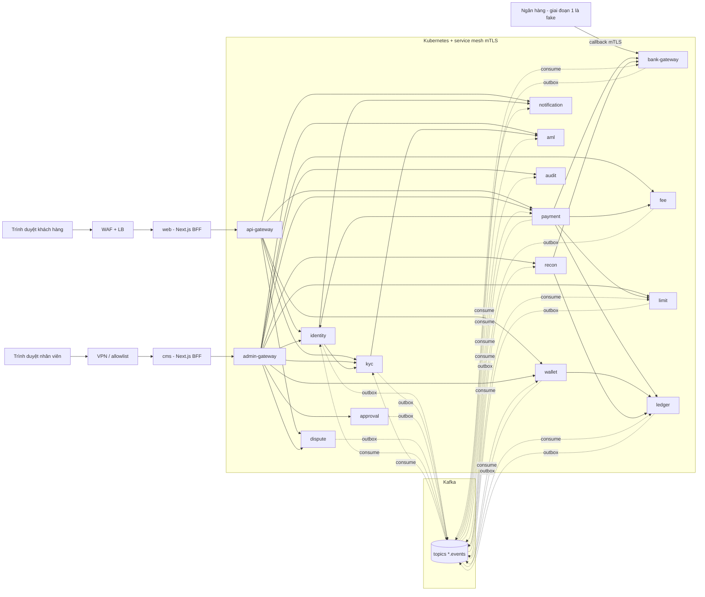
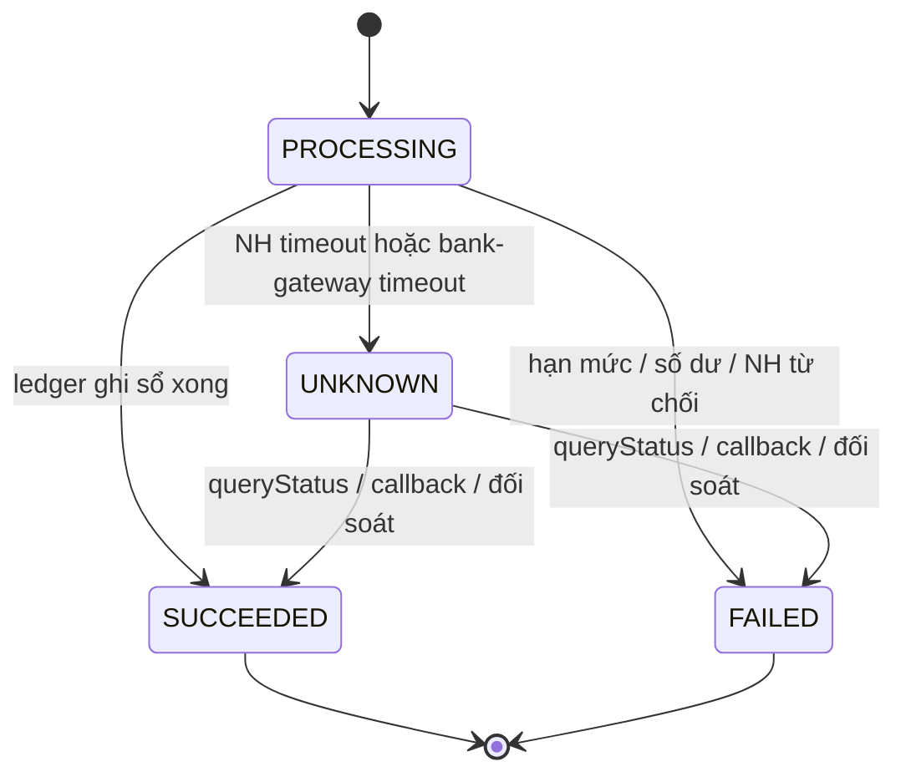
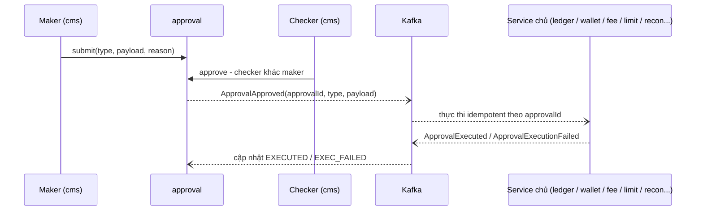

# Thiết kế chi tiết hệ thống EWallet — Giai đoạn 1 (Microservices)

- Trạng thái: Draft v0.3 — microservices ([ADR-0001](../adr/0001-microservices.md)); đã review, các thay đổi ở mục 15
- Ngày: 2026-11-04
- Đầu vào: [requirements.md v0.2](../requirements.md)
- Tài liệu đi kèm: [Data model](2026-11-04-ewallet-data-model.md) · [API, event & provider interface](2026-11-04-ewallet-api.md)

## Mục lục
1. Bối cảnh & mục tiêu · 2. Phạm vi · 3. Yêu cầu & giả định · 4. Kiến trúc tổng thể · 5. Service & ranh giới · 6. Luồng chính · 7. Giao tiếp giữa service · 8. Data model (tóm tắt) · 9. Nhất quán, lỗi & phục hồi · 10. Bảo mật · 11. Quan sát & vận hành · 12. Triển khai · 13. Phương án đã cân nhắc · 14. Rủi ro & câu hỏi mở · 15. Lịch sử review

---

## 1. Bối cảnh & mục tiêu

EWallet là ví điện tử của một tổ chức trung gian thanh toán, liên kết với tài khoản ngân hàng của khách. Giai đoạn 1 xây dựng lõi ví hoàn chỉnh theo kiến trúc **microservices**, gồm sổ cái, nạp, rút, chuyển ví–ví, hạn mức, phí và back-office. Mọi tích hợp bên thứ 3 chỉ có interface và bản fake.

Mục tiêu kỹ thuật, theo thứ tự ưu tiên:
1. **Tiền đúng tuyệt đối**: không mất, không nhân đôi, số dư không âm, sổ cái luôn cân. Đây là điều không thay đổi khi chuyển sang microservices.
2. **Truy vết được** mọi biến động tiền và mọi thao tác nhân viên, xuyên qua nhiều service.
3. **Scale độc lập** từng service theo tải; chịu được 500 TPS lúc cao điểm.
4. Tuân thủ chuẩn nền tảng của công ty (Kubernetes, Kafka, CI/CD cho từng service).

## 2. Phạm vi

- **Trong phạm vi:**
  - 14 service backend, 2 API gateway, 2 BFF Next.js (`web`, `cms`).
  - Kafka, bộ thư viện nền dùng chung (`platform`) và repo hợp đồng (`contracts`).
  - 4 interface provider (`BankGateway`, `EkycProvider`, `NotificationSender`, `AmlScreeningProvider`), mỗi cái kèm bản fake.
- **Ngoài phạm vi:** adapter thật; merchant/QR; mobile app; Open API; Napas; báo cáo NHNN theo mẫu chính thức.

## 3. Yêu cầu & giả định

| Giả định | Giá trị | Ảnh hưởng nếu sai |
|---|---|---|
| Tỷ lệ đọc/ghi lúc cao điểm | 70/30 → khoảng 150 TPS lệnh tiền | Ghi > 400 TPS thì `ledger` phải được shard theo ví (xem 14) |
| Nền tảng công ty | Có sẵn Kubernetes, Kafka (hoặc cho phép dựng), CI/CD | Nếu chưa có, M1 sẽ dài hơn đáng kể |
| Team | 4–6 dev, mỗi người sở hữu 2–3 service | Monorepo và bộ `platform` dùng chung là bắt buộc để giữ được nhịp |
| Tiền tệ | Chỉ VND | |
| Ngân hàng | 1 fake bank; thiết kế cho N ngân hàng | |

**Stack:** Java 21 LTS, Spring Boot (bản stable mới nhất khi scaffold), Spring Cloud Gateway, Spring for Apache Kafka, Spring Data JDBC/JPA, jOOQ (trong `ledger`), Flyway, Resilience4j, ShedLock; PostgreSQL 16+, Apache Kafka + Schema Registry, Redis, object storage; Kubernetes + service mesh; Next.js (App Router).

---

## 4. Kiến trúc tổng thể



| Khối | Vai trò |
|---|---|
| `web`, `cms` | BFF Next.js. Giữ session trong cookie httpOnly, chỉ gọi gateway, không chứa rule tiền |
| `api-gateway` | Spring Cloud Gateway cho khách. Xác thực JWT, rate limit (Redis), routing, giới hạn kích thước request, gắn `traceparent` |
| `admin-gateway` | Gateway riêng cho nhân viên. JWT từ IdP nhân viên, chỉ nhận traffic từ `cms` |
| 14 service | Xem mục 5. Mỗi service có DB riêng, deploy riêng, scale riêng |
| Kafka | Event giữa các service. Mỗi service publish qua outbox của chính nó |
| Service mesh | mTLS giữa mọi pod; authorization policy quy định service nào được gọi service nào (ví dụ chỉ `payment`, `wallet`, `recon` được gọi `ledger`) |

Hai nguyên tắc giữ tiền đúng khi hệ thống bị chia nhỏ:
1. **Chỉ `ledger` thay đổi số dư.** Mọi thao tác trên số dư (ghi sổ, giữ tiền, kiểm đủ tiền) nằm trong một DB transaction **trong `ledger`**. Vì vậy không có lệnh chuyển tiền nào cần transaction phân tán.
2. **Mọi lời gọi nội bộ có tác dụng phụ đều idempotent theo `orderId`/`referenceId`.** Bên gọi có thể retry đến khi nhận được câu trả lời chắc chắn. Lúc này saga chỉ phải bù trừ cho các bước *trước* `ledger` (hạn mức), và các bước đó tự an toàn khi retry.

---

## 5. Service & ranh giới

| # | Service | Trách nhiệm | DB | Gọi đồng bộ | Phát event |
|---|---|---|---|---|---|
| 1 | `identity` | Đăng ký, đăng nhập, thiết bị, token, OTP challenge, step-up, ghi nhận đồng ý (consent); phát hành JWT khách, công bố JWKS | `identity_db` | `notification` (chỉ để gửi OTP: cần nhanh, và mã OTP không được nằm trên Kafka); `kyc` (so khuôn mặt cho step-up `FACE`) | `CustomerRegistered`, `CustomerLocked` |
| 2 | `kyc` | Flow eKYC, cấp tier, duyệt thủ công; gọi `EkycProvider` | `kyc_db` | `aml` | `KycTierChanged`, `KycRejected` |
| 3 | `aml` | Sàng lọc qua `AmlScreeningProvider` + danh sách đen nội bộ, sàng lọc lại định kỳ; **giám sát giao dịch**: nghe `payment.events`, áp rule cấu hình được (giá trị lớn, velocity, chia nhỏ giao dịch), tạo cảnh báo cho RISK | `aml_db` | — | `AmlHitDetected`, `AmlAlertRaised` |
| 4 | `wallet` | Vòng đời ví (mở/khoá/phong toả/đóng); tra cứu người nhận theo SĐT (lưu bản sao dữ liệu khách nhận từ event) | `wallet_db` | `ledger` (mở tài khoản, khoá tài khoản, phong toả) | `WalletOpened`, `WalletFrozen`, `WalletClosed` |
| 5 | `ledger` | Sổ cái kép, số dư, hold, tài khoản hệ thống, trial balance. **Nơi duy nhất thay đổi số dư** | `ledger_db` (cluster riêng) | — | `JournalPosted`, `HoldPlaced/Captured/Released` |
| 6 | `limit` | Rule hạn mức 3 tầng, reservation, mức đã dùng; lưu bản sao tier của ví (từ event) | `limit_db` | — | `LimitRuleChanged` |
| 7 | `fee` | Biểu phí theo thời gian hiệu lực, báo giá phí | `fee_db` | — | `FeeRuleChanged` |
| 8 | `payment` | Lệnh nạp/rút/P2P, state machine, **saga orchestrator**, lịch sử giao dịch, resolver | `payment_db` (cluster riêng) | `fee`, `limit`, `ledger`, `bank-gateway`, `identity` (verify challenge), `wallet` (tra người nhận) | `PaymentSucceeded`, `PaymentFailed`, `PaymentUnknown` |
| 9 | `bank-gateway` | Registry `BankGateway`, liên kết ngân hàng, gọi ngân hàng, log lời gọi, nhận callback, file đối soát, số dư TK đảm bảo | `bank_db` | — (gọi ngân hàng qua adapter) | `BankLinkActivated/Revoked`, `BankTransferOutcome` |
| 10 | `recon` | Đối soát với ngân hàng T+1, kiểm tra nội bộ, TK đảm bảo, **báo cáo vận hành** (từ bản sao dữ liệu nhận qua event) | `recon_db` | `bank-gateway`, `ledger` (đọc) | `ReconDiscrepancyFound` |
| 11 | `dispute` | Tra soát/khiếu nại, SLA, phân công | `dispute_db` | `payment` (đọc lệnh) | `DisputeOpened/Resolved` |
| 12 | `approval` | Maker–checker dùng chung | `approval_db` | — | `ApprovalApproved/Rejected` |
| 13 | `audit` | Nhận event audit từ mọi service, ghi chuỗi hash, export sang WORM | `audit_db` | — | — |
| 14 | `notification` | Template, gửi qua `NotificationSender`, inbox trong web | `notification_db` | — | — |

**Các ranh giới đáng chú ý:**
- `wallet` và `ledger` tách riêng: `wallet` lo vòng đời ví và quy tắc sản phẩm; `ledger` chỉ biết tài khoản và bút toán. Khi khoá ví, `wallet` gọi đồng bộ `ledger` để khoá tài khoản. Nhờ đó `ledger` là nơi duy nhất quyết định có được trừ tiền hay không, và không có race giữa thao tác khoá ví với một lệnh trừ tiền đang chạy.
- `limit` không gọi `kyc`. Nó lưu bản sao tier của từng ví, cập nhật từ event `KycTierChanged`, để lời gọi `reserve` không phụ thuộc vào việc `kyc` có đang sống hay không.
- `recon` gánh luôn phần báo cáo vận hành, vì nó đã có bản sao mọi biến động tiền (từ `PaymentSucceeded/Failed` và `JournalPosted`). Không tạo thêm service báo cáo ở giai đoạn 1.
- Không có `backoffice` service. `cms` BFF ghép dữ liệu từ admin API của từng service, qua `admin-gateway`.

---

## 6. Luồng chính

### 6.1 Mô hình hạch toán (không đổi)

| Tài khoản | Loại | Phía tăng |
|---|---|---|
| `WALLET:<walletId>` | Liability | Credit — không được âm |
| `BANK_SETTLEMENT:<bankCode>` | Asset | Debit — mỗi ngân hàng một tài khoản |
| `FEE_REVENUE` | Revenue | Credit |
| `BANK_FEE_EXPENSE` | Expense | Debit |
| `SUSPENSE` | Liability | Credit — chỉ dùng qua maker–checker |

| Nghiệp vụ | Debit | Credit |
|---|---|---|
| Nạp `a` từ NH X, phí `f` | `BANK_SETTLEMENT:X` a | `WALLET:A` a−f, `FEE_REVENUE` f |
| Rút `a` về NH X, phí `f` | `WALLET:A` a+f | `BANK_SETTLEMENT:X` a, `FEE_REVENUE` f |
| P2P A→B `a`, phí `f` | `WALLET:A` a+f | `WALLET:B` a, `FEE_REVENUE` f |
| Điều phối thanh khoản X→Y | `BANK_SETTLEMENT:Y` | `BANK_SETTLEMENT:X` |
| Sửa sai | Bút toán đảo (`reversal_of`) | |

### 6.2 Lock & hot account (bên trong `ledger`)

Giữ nguyên cách làm của thiết kế trước, vì toàn bộ phần này nằm gọn trong một service:
- Ví khách: một dòng số dư, trừ tiền bằng `UPDATE` có điều kiện `balance - held >= amount`.
- Tài khoản hệ thống: **16 bucket**; mỗi giao dịch ghi vào một bucket ngẫu nhiên, số dư = tổng các bucket.
- Thứ tự lock: các ví theo `account_id` tăng dần → bucket hệ thống. Deadlock thì retry tối đa 3 lần.
- Isolation `READ COMMITTED`.

Vì `ledger` scale độc lập, đây là service cần tối ưu nhất: cluster Postgres riêng, pod `ledger` đặt gần DB (cùng AZ với primary), connection pool được tính toán theo tải.

### 6.3 P2P — saga do `payment` điều phối

```mermaid
sequenceDiagram
  autonumber
  participant W as web BFF + api-gateway
  participant P as payment
  participant I as identity
  participant WL as wallet
  participant F as fee
  participant L as limit
  participant G as ledger
  participant K as Kafka
  W->>P: POST /transfers (Idempotency-Key, recipientPhone, amount, expectedFee, challenge)
  P->>P: Tra order theo customer + Idempotency-Key - đã có thì trả kết quả cũ và dừng
  P->>I: verifyChallenge(otp, payloadHash, consumerRef = Idempotency-Key)
  P->>WL: getWallet(A) phải ACTIVE; resolveRecipient(phone) - ví B, trạng thái
  P->>F: quote(P2P, amount) - so với expectedFee
  P->>P: INSERT order PROCESSING, step=STARTED (unique customer + idempotency key)
  P->>L: reserve(reservationId=orderId, walletA, P2P, amount)
  alt Vượt hạn mức
    P->>P: order FAILED LIMIT_EXCEEDED
  else Đã giữ hạn mức
    P->>P: step=LIMIT_RESERVED
    P->>G: postJournal(ref=orderId, debit A, credit B, credit FEE)
    alt Ghi sổ thành công
      P->>P: order SUCCEEDED + outbox PaymentSucceeded
    else INSUFFICIENT_BALANCE / ACCOUNT_BLOCKED
      P->>P: order FAILED + outbox PaymentFailed
    else Timeout / 5xx
      P->>G: retry postJournal cùng ref (idempotent)
    end
  end
  P-->>W: kết quả
  P--)K: PaymentSucceeded / PaymentFailed
  K--)L: commit / release reservation
```
*(`notification`, `recon`, `audit` cũng nghe các event này.)*

- **Thứ tự kiểm tra là bắt buộc: tra idempotency trước mọi thứ.** Nếu kiểm OTP hay phí trước, một lần retry sau khi mất mạng sẽ nhận `CHALLENGE_INVALID`/`FEE_CHANGED` dù lệnh đã thành công, và khách sẽ chuyển lần nữa. Challenge được xác thực **idempotent theo `consumerRef`**: cùng idempotency key thì xác thực lại vẫn OK. Hai request trùng gửi song song: request sau chờ ở unique index của `payment_order`, rồi trả lại order của request trước.
- **Điểm chốt là `ledger.postJournal`.** Sau bước này lệnh chắc chắn đã thành công: tiền đã chuyển trong một DB transaction của `ledger`.
- **Bù trừ:** chỉ có một bước cần bù trừ là reservation hạn mức. `limit` tự release khi nghe `PaymentFailed`, và commit khi nghe `PaymentSucceeded`. Nếu event đến chậm, hạn mức bị giữ lâu hơn một chút, nhưng đó là hướng an toàn.
- **Khi `postJournal` timeout:** `payment` gọi lại với cùng `ref`. Nếu journal đã được ghi, `ledger` trả kết quả cũ. `payment` cũng có thể hỏi `GET /journals?ref=` để biết chắc. Sẽ không bao giờ có chuyện "ghi sổ hai lần" hay "không rõ đã ghi sổ chưa" kéo dài.
- **`payment` chết giữa saga:** order đứng ở `PROCESSING`, cột `step` cho biết đã đi tới đâu. Recovery job tiếp tục saga từ `step` đó; mọi bước đều idempotent nên chạy lại an toàn.
- Độ trễ: 5 lời gọi nội bộ, mỗi lời khoảng 3–10 ms, cộng một DB transaction trong `ledger`. p99 dưới 300 ms là khả thi, so với mục tiêu 1 s.

### 6.4 Nạp tiền

```mermaid
sequenceDiagram
  autonumber
  participant P as payment
  participant L as limit
  participant B as bank-gateway
  participant BG as BankGateway adapter
  participant G as ledger
  P->>P: INSERT order PROCESSING, external_ref, step=STARTED
  P->>L: reserve(orderId, customerId, TOPUP)
  P->>P: step = BANK_CALLED - commit TRƯỚC khi gọi
  P->>B: POST /internal/transfers/debit (externalRef, customerId, bankLinkId) - timeout 20s
  B->>B: INSERT bank_transfer (unique externalRef); kiểm link thuộc customerId và ACTIVE
  B->>BG: debit - timeout 15s, ghi bank_call_log
  BG-->>B: Success / Failed / Pending / Unknown
  B-->>P: kết quả
  alt Success
    P->>G: postJournal(ref=orderId, debit BANK_SETTLEMENT:X, credit WALLET, credit FEE) - retry đến khi xong
    P->>P: SUCCEEDED + PaymentSucceeded
  else Failed
    P->>P: FAILED + PaymentFailed
  else Unknown / Pending / timeout gọi bank-gateway
    P->>P: UNKNOWN, next_check_at + PaymentUnknown
  end
```

- Timeout của `payment → bank-gateway` (20s) luôn **lớn hơn** timeout của `bank-gateway → ngân hàng` (15s), để `bank-gateway` kịp trả `Unknown` có ghi log, thay vì `payment` tự cắt ngang.
- **Ghi `step = BANK_CALLED` trước khi gọi** là để phân định rõ: từ step này trở đi, `payment` (kể cả recovery) **chỉ được hỏi trạng thái, không bao giờ gửi lại** lệnh trừ/ghi tiền. `bank-gateway` cũng chặn gửi trùng bằng `unique(external_ref)` trên `bank_transfer`, và bản ghi này được tạo trước khi gọi ngân hàng.
- **Kiểm chủ sở hữu:** `bank-gateway` chỉ gọi ngân hàng khi `bank_link.customer_id = customerId` và link đang `ACTIVE`; ngược lại trả `Failed(BANK_LINK_INVALID)`. Không có kiểm tra này, khách A có thể nạp tiền từ tài khoản của khách B bằng cách gửi `bankLinkId` của B.
- Validation: `fee < amount` (nếu không, credit vào ví sẽ âm); ngân hàng đang `MAINTENANCE` hoặc circuit đang mở → preview trả `BANK_UNAVAILABLE`.
- **Ngân hàng đã trừ tiền nhưng `ledger` từ chối ghi có** (ví đã đóng, hoặc lỗi dữ liệu): `postJournal` chỉ được retry khi gặp **lỗi kỹ thuật**. Nếu bị từ chối về nghiệp vụ, `payment` ghi journal `debit BANK_SETTLEMENT:X / credit SUSPENSE` để sổ cái vẫn khớp với tiền thật ở ngân hàng, đặt order `SUCCEEDED` với `failureCode = CREDITED_TO_SUSPENSE`, alert P1. Vận hành sau đó chuyển tiền từ SUSPENSE về ví hoặc hoàn về ngân hàng qua maker–checker. Tiền không bị mất và không có vòng retry vô hạn.

### 6.5 Rút tiền

Giống nạp tiền, chỉ khác:
- Trước khi gọi ngân hàng: `ledger.placeHold(ref=orderId, WALLET:A, a+f)`, ghi `step = HOLD_PLACED`, rồi mới ghi `step = BANK_CALLED` như ở luồng nạp. Không đủ tiền → order `FAILED`, sau đó `limit` release.
- `Success` → `ledger.captureHold(ref, journal)`. `Failed` → `ledger.releaseHold(ref)`.
- `Unknown` → **giữ nguyên hold** cho đến khi có câu trả lời chắc chắn.

### 6.6 Resolver & callback



- **Recovery job** trong `payment`, chạy mỗi 30 giây:
  - Order `PROCESSING` cũ hơn 2 phút → tiếp tục saga theo `step`. Step **trước** `BANK_CALLED` → được chạy tiếp, kể cả gọi ngân hàng. Step **từ** `BANK_CALLED` trở đi → chỉ hỏi trạng thái, xử lý như `UNKNOWN`.
  - `bank-gateway` trả `NotFound` **ở phía nó** (không có bản ghi `bank_transfer`, tức lệnh chưa từng tới `bank-gateway`), sau ít nhất 2 lần timeout → `payment` gọi `POST /internal/transfers/{ref}/void`. `bank-gateway` ghi tombstone `VOIDED`, nên nếu lệnh đến muộn thì sẽ bị từ chối. Kết quả `VOIDED` → order `FAILED`, an toàn vì ngân hàng chắc chắn chưa được gọi. Nếu `bank-gateway` đã có bản ghi, void trả về trạng thái hiện tại và không có gì thay đổi.
  - Order `UNKNOWN` đến hạn `next_check_at` → gọi `bank-gateway GET /transfers/{externalRef}`, rồi `bank-gateway` gọi `queryStatus` của ngân hàng.
  - Backoff 1, 2, 5, 15, 30, 60 phút, sau đó mỗi giờ một lần. Quá 30 phút → alert.
- **Callback:** ngân hàng → `bank-gateway` (xác thực chữ ký, insert inbox chống trùng) → event `BankTransferOutcome` → `payment` nghe và chốt order bằng cùng đường xử lý như resolver (UPDATE có điều kiện trạng thái).
- `NOT_FOUND` không bao giờ tự là thất bại; chỉ đối soát T+1 mới được kết luận.

### 6.7 Liên kết ngân hàng, eKYC, hạn mức

- **Liên kết:** `web → bank-gateway`. Đối chiếu chính chủ cần họ tên và CCCD trong hồ sơ KYC; `bank-gateway` lưu bản sao các trường này từ event `KycTierChanged` (đã mã hoá), không gọi đồng bộ sang `kyc`. Liên kết thành công → `BankLinkActivated`.
- **eKYC:** `kyc` gọi `EkycProvider` → gọi đồng bộ `aml.screen` → `APPROVED` hoặc `PENDING_REVIEW` → event `KycTierChanged`. Các service nghe event này: `identity` (cập nhật tier của khách), `limit` (bản sao tier), `wallet`, `bank-gateway`.
- **Hạn mức:** `limit.reserve` chạy trong DB transaction của `limit`, dùng lệnh `INSERT ... ON CONFLICT DO UPDATE ... WHERE used + amt <= max` cho từng scope/kỳ. Reservation có `id = orderId`, nên gọi lại không bị trừ hai lần. Commit/release theo event của `payment`.
  - Tier được lưu **theo `customerId`** (bản sao `customer_tier`), và request reserve gửi kèm `customerId`. Lý do: `kyc` không biết `walletId`, và `KycTierChanged` có thể đến trước `WalletOpened` vì hai event nằm ở hai topic khác nhau.
  - Tier bị **hạ** (ví dụ CCCD hết hạn) sẽ có hiệu lực chậm khoảng dưới 1 giây do eventual consistency. Chấp nhận được, vì tầng trần pháp lý vẫn luôn được áp.
- **CCCD hết hạn (FR-ID-07):** job hằng ngày trong `kyc` gửi nhắc trước 30, 7 và 1 ngày. Khi hết hạn → phát `KycTierChanged(tier = RESTRICTED)`: chỉ cho rút tiền về tài khoản đã liên kết, cho đến khi khách cập nhật CCCD.
- **Step-up bằng khuôn mặt (`FACE`):** `identity` tạo challenge loại `FACE` → web chụp selfie + liveness → `identity` gọi `kyc POST /internal/face-verifications` (`checkLiveness` + `matchFace` với selfie lúc KYC) → đạt ngưỡng thì challenge chuyển `VERIFIED`. `kyc` không gọi lại `identity`, nên không tạo vòng gọi.
- **Consent (NFR-L-03):** đăng ký và eKYC yêu cầu khách đồng ý theo từng mục đích (điều khoản dịch vụ, xử lý dữ liệu sinh trắc học). `identity` lưu phiên bản điều khoản, thời điểm, IP; khách xem lại được trong `/me/consents`.

### 6.8 Maker–checker


Mỗi `type` có đúng một service chủ, ví dụ: `WALLET_ADJUSTMENT` → `ledger`, `WALLET_FREEZE` → `wallet`, `FEE_RULE_CHANGE` → `fee`. Bảng ánh xạ nằm trong `contracts`.

### 6.9 Đóng ví

Đóng ví đi qua trạng thái trung gian `CLOSING`, vì kiểm tra "không còn lệnh treo" rồi mới đóng là có race với lệnh nạp tiền đang được tạo cùng lúc:
1. `wallet` chuyển `CLOSING` và gọi `ledger` đặt `debit_blocked`. Từ đây `payment` từ chối mọi lệnh mới, vì `payment` kiểm ví `ACTIVE` cho **mọi** loại lệnh.
2. Chờ ít nhất 5 phút (dài hơn thời gian tối đa của một saga đồng bộ), rồi kiểm: số dư = 0, không còn hold, và `payment GET /internal/orders/open?walletId=` trả 0.
3. Đạt → `CLOSED`, `ledger` đặt thêm `credit_blocked`. Chưa đạt → giữ `CLOSING` và kiểm lại định kỳ. Khách vẫn rút được số dư còn lại qua luồng hỗ trợ, nếu cần.
4. Nếu vẫn lọt một lệnh nạp vào ví đã `CLOSED`, tiền sẽ vào `SUSPENSE` (6.4), không bị mất.
5. Phát `WalletClosed` → `kyc` chuyển hồ sơ sang `CLOSED` để giải phóng CCCD.

---

## 7. Giao tiếp giữa service

| Loại | Khi nào dùng | Công nghệ |
|---|---|---|
| Đồng bộ | Cần câu trả lời ngay để quyết định: verify challenge, báo giá phí, reserve hạn mức, ghi sổ, gọi ngân hàng | REST/JSON nội bộ (`/internal/**`), client sinh từ OpenAPI trong `contracts`, Spring `RestClient` + Resilience4j. Service tìm nhau qua Kubernetes DNS; mTLS do mesh lo |
| Bất đồng bộ | Thông báo "việc đã xảy ra": cập nhật bản sao dữ liệu, commit/release hạn mức, thông báo, audit, đối soát | Kafka; outbox trong từng service; consumer idempotent bằng bảng `inbox` |

**Quy tắc:**
- Lời gọi đồng bộ chỉ đi **một chiều** theo sơ đồ ở mục 5. Không gọi vòng. Chuỗi gọi dài nhất là `gateway → payment → ledger`.
- Mọi lời gọi nội bộ có tác dụng phụ đều mang id idempotent (`orderId`, `approvalId`...) và **được phép retry**.
- Timeout mặc định 2s (riêng `bank-gateway` 20s). Circuit breaker theo từng service đích. Retry tối đa 3 lần có jitter, chỉ cho lời gọi idempotent.
- **Event:** mỗi service một topic `<service>.events`, key là id của aggregate để giữ thứ tự theo từng aggregate. Envelope theo CloudEvents (`id`, `type`, `source`, `time`, `traceparent`), payload JSON Schema đăng ký trên Schema Registry, CI kiểm tra tương thích ngược.
- **Outbox:** bảng `outbox` trong DB của service, ghi cùng transaction nghiệp vụ. Relay trong `platform` starter đọc các dòng chưa publish (`FOR UPDATE SKIP LOCKED`, batch), gửi lên Kafka bằng producer idempotent (`acks=all`), rồi đánh dấu `published_at`. Nếu công ty đã chuẩn hoá CDC thì thay relay bằng Debezium outbox router. Giao nhận at-least-once.
- **Thứ tự & version:** relay chạy nhiều pod và các transaction commit không theo thứ tự, nên event của cùng một aggregate **có thể đến lệch thứ tự**. Mỗi event mang `aggregateversion` (tăng theo từng thay đổi của aggregate). Consumer cập nhật bản sao dữ liệu chỉ khi `version > version đang lưu`; event cũ hơn thì bỏ qua. Các handler kiểu "hành động" (commit/release hạn mức, gửi thông báo) đã idempotent nên không phụ thuộc thứ tự.
- **Consumer:** insert `inbox(event_id)` cùng transaction xử lý; trùng thì bỏ qua. Retry 3 lần có backoff, sau đó đẩy vào topic `<topic>.dlt` và alert. Có công cụ replay từ DLT.

---

## 8. Data model (tóm tắt)

DDL chi tiết xem [2026-11-04-ewallet-data-model.md](2026-11-04-ewallet-data-model.md).

- **Mỗi service một database**, chỉ service đó có credential. Không service nào đọc DB của service khác.
- Cluster Postgres:

| Cluster | Database | Lý do |
|---|---|---|
| 1 | `ledger_db` | Riêng, HA đồng bộ. Ghi nhiều nhất và cần đúng nhất |
| 2 | `payment_db` | Riêng. Ghi nhiều, lịch sử giao dịch lớn |
| 3 | 12 DB còn lại | Dùng chung cluster để tiết kiệm chi phí; mỗi DB một user riêng |

- Bảng dùng chung trong mỗi service: `outbox`, `inbox`, `shedlock`.
- Bản sao dữ liệu (read model nhận qua event):
  - `wallet.customer_directory`: SĐT và tên đã che, để tra người nhận.
  - `limit.customer_tier`.
  - `bank-gateway.kyc_identity`: tên và CCCD dạng hash, để đối chiếu chính chủ.
  - `recon.payment_projection` và `recon.journal_projection`.
- Bảo đảm chống trùng vẫn giữ: `payment_order (customer_id, idempotency_key)` unique; `journal (reference_type, reference_id, purpose)` unique; `hold.reference_id` unique; `limit_reservation.id` = `orderId`.

## 9. Nhất quán, lỗi & phục hồi

| Chủ đề | Cách làm |
|---|---|
| Transaction | Chỉ có transaction cục bộ trong từng service. Những gì cần nguyên tử về tiền đều nằm trong `ledger` |
| Saga | Orchestration do `payment` điều phối, lưu trạng thái và `step` trong `payment_order`. Bước duy nhất cần bù trừ là reservation hạn mức (xử lý qua event) |
| Nhất quán của bản sao dữ liệu | Eventual consistency, thường dưới 1 giây. Các quyết định về tiền **không** dựa vào bản sao: số dư lấy từ `ledger`, trạng thái ví khoá do `ledger` kiểm. Bản sao chỉ dùng cho tra cứu, hiển thị, và đối chiếu chính chủ |
| Lời gọi ngân hàng | Như thiết kế trước: không auto-retry `debit`/`credit`; `Unknown` → resolver; đối soát T+1 |
| Service phụ thuộc chết | `fee` chết → không tạo được lệnh mới (an toàn). `notification`/`audit` chết → event dồn lại trong Kafka, giao dịch không bị ảnh hưởng. `ledger` chết → mọi lệnh tiền dừng; đây là service được ưu tiên HA cao nhất |
| Kafka chết | Outbox giữ event trong DB của từng service, relay đẩy lại khi Kafka sống. Giao dịch đồng bộ vẫn chạy; reservation hạn mức commit/release chậm hơn |
| Đối soát nội bộ | `recon` hằng ngày: (1) `ledger` trial balance Σ D = Σ C; (2) mỗi order `SUCCEEDED` có đúng một journal và ngược lại, so giữa projection của `payment` và `ledger`; (3) Σ ví ≤ Σ TK đảm bảo; (4) không còn reservation treo quá 24 giờ |
| Backup & DR | PITR cho mọi cluster; Kafka replication factor 3, `min.insync.replicas=2`, retention 7 ngày; diễn tập khôi phục hằng quý |

## 10. Bảo mật

- **Biên ngoài:** WAF → `api-gateway` xác thực JWT (JWKS của `identity`), rate limit; `admin-gateway` chỉ nhận traffic từ `cms` trong VPN; callback đi ingress riêng có mTLS và allowlist, thẳng vào `bank-gateway`.
- **Bên trong (zero trust):**
  - Service mesh mTLS cho mọi kết nối pod–pod.
  - **AuthorizationPolicy** của mesh liệt kê service nào được gọi service nào. Ví dụ `ledger` chỉ nhận từ `payment`, `wallet`, `recon`; `bank-gateway /transfers` chỉ nhận từ `payment`.
  - Service vẫn tự xác thực lại JWT của người dùng được gateway chuyển tiếp, để kiểm ownership: user A không thao tác được ví B.
  - `/internal/**` không bao giờ được expose qua gateway.
- **Xác thực khách** (`identity`): Argon2id, OTP 6 số lưu hash, access JWT 5 phút ký ES256, refresh token xoay vòng với phát hiện dùng lại. `web` BFF giữ token trong cookie httpOnly.
- **Back-office:** OIDC qua IdP nhân viên có MFA, RBAC theo role (`CS_AGENT`, `OPS`, `RECON`, `RISK`, `FINANCE`, `ADMIN`). Xem dữ liệu chưa che phải qua endpoint `/reveal` và có audit.
- **Dữ liệu:**
  - AES-256-GCM envelope với KMS cho CCCD, link token, số tài khoản; HMAC để tra cứu.
  - Mỗi service một DB user, quyền tối thiểu. `ledger.entry` và `audit_log` bị `REVOKE UPDATE, DELETE`.
  - **Event Kafka không chứa dữ liệu nhạy cảm dạng rõ.** CCCD chỉ đi dưới dạng hash; tên đầy đủ chỉ có trong topic `kyc.events`, và topic này có ACL giới hạn consumer. Kafka có ACL theo service và mã hoá khi truyền (TLS).
- **Audit:** mỗi service publish `AuditRecorded` qua outbox; `audit` ghi chuỗi hash và export WORM hằng ngày. Thao tác của nhân viên được audit tại service xử lý chứ không chỉ ở gateway.
- **Fake provider:** marker `FakeProvider` cộng kiểm tra lúc khởi động trong `platform` starter: ứng dụng fail nếu profile `prod` đang có bean fake.

## 11. Quan sát & vận hành

- **Tracing phân tán là bắt buộc.** OpenTelemetry agent ở mọi service; `traceparent` đi theo cả HTTP và header của Kafka; xem trace bằng Tempo hoặc Jaeger. Mỗi order có `traceId` trên CMS để mở trace của lệnh đó.
- **Metric:**
  - Nghiệp vụ: như thiết kế trước (`payment_orders_total`, `payment_unknown_open`, `recon_discrepancies_open`, `safeguard_gap_vnd`...).
  - Theo từng service: RED (rate, errors, duration) và trạng thái circuit breaker.
  - Kafka: **consumer lag theo consumer group**, số event trong DLT, outbox tồn đọng theo service.
- **Alert:**

| Mức | Điều kiện |
|---|---|
| P1 | Sổ cái lệch; Σ ví > TK đảm bảo; order `SUCCEEDED` mà không có journal (hoặc ngược lại); `ledger` hoặc `payment` có lỗi 5xx > 2% |
| P2 | Order `UNKNOWN` > 30 phút; consumer lag > 5 phút; DLT có event mới; outbox tồn > 1.000; circuit breaker mở |
| P3 | TK đảm bảo dưới ngưỡng; tra soát sắp quá SLA |

- **Log:** JSON có `traceId`, `orderId`, `service`; masking dữ liệu nhạy cảm ở starter của `platform`.
- **Runbook:** ngân hàng sập, sổ cái lệch, Kafka chết, replay DLT, `ledger` failover, xoay khoá JWT.

## 12. Triển khai

### 12.1 Tổ chức mã nguồn: monorepo

```
source-code/
├── platform/            # Gradle BOM + starter dùng chung: security, outbox/inbox, kafka, observability,
│                        #   ProblemDetail, Money, masking, FakeProvider guard
├── contracts/           # OpenAPI nội bộ + JSON Schema event + bảng ánh xạ approval type → service
├── services/
│   ├── identity/  kyc/  aml/  wallet/  ledger/  limit/  fee/
│   ├── payment/  bank-gateway/  recon/  dispute/  approval/  audit/  notification/
├── gateways/  api-gateway/  admin-gateway/
├── frontend/  (pnpm workspace: apps/web, apps/cms, packages/api-client)
└── deploy/    (Helm chart chung + values theo service, theo môi trường)
```

Lý do chọn monorepo: 14 service mà chỉ có 4–6 người. Monorepo cho phép đổi hợp đồng (OpenAPI/event) và cập nhật mọi bên dùng trong cùng một PR. Mỗi service vẫn build, test và deploy riêng nhờ CI lọc theo đường dẫn.

### 12.2 Hạ tầng & năng lực ban đầu (giả định, cần load test)

| Thành phần | Cấu hình | Ghi chú |
|---|---|---|
| `payment` | 4 pod, HPA 4–12 | Scale theo RPS |
| `ledger` | 3 pod, HPA 3–8 | Scale theo RPS; trần thật nằm ở DB |
| `api-gateway` | 3 pod, HPA | |
| `identity`, `limit`, `fee`, `wallet`, `bank-gateway` | 2–3 pod mỗi service | Nằm trên đường đi của lệnh tiền |
| `kyc`, `aml`, `recon`, `dispute`, `approval`, `audit`, `notification`, `admin-gateway` | 2 pod mỗi service | Tối thiểu cho HA |
| `web` / `cms` | 3 / 2 pod | |
| Postgres | Cluster 1 và 2: 8 vCPU / 32 GB, HA đồng bộ + 1 replica. Cluster 3: 4 vCPU / 16 GB, HA | |
| Kafka | 3 broker (managed, hoặc Strimzi trên K8s), Schema Registry | |
| Redis | Managed, HA | Rate limit ở gateway, đếm OTP |
| Service mesh | Istio hoặc Linkerd, theo chuẩn công ty | |

### 12.3 CI/CD & môi trường

- CI cho từng service: build → unit test → integration test (Testcontainers: Postgres, Kafka) → **contract test** (consumer-driven, bằng Pact hoặc Spring Cloud Contract) → kiểm tra tương thích schema event → quét bảo mật → build image → deploy.
- CD theo GitOps (Argo CD hoặc Flux) dùng Helm chart chung trong `deploy/`. Rolling update; canary cho `payment` và `ledger`.
- Môi trường: `local` (docker compose chạy toàn bộ, hoặc chỉ một nhóm service; mọi provider là fake) → `dev` → `staging` → `prod`.
- Migration DB: Flyway riêng cho từng service, theo trình tự expand → migrate → contract. Thay đổi hợp đồng API/event chỉ được thêm, không được xoá; muốn phá tương thích thì phải tăng version.

### 12.4 Thứ tự xây dựng

| Mốc | Nội dung |
|---|---|
| M1 | **Nền tảng:** monorepo, `platform` starter, `contracts`, K8s + mesh + Kafka + Schema Registry + observability, CI/CD, Helm. Dựng `api-gateway` và `identity` |
| M2 | `ledger` (kèm test đồng thời), `wallet`, `fee`, `limit` |
| M3 | `payment` P2P (saga + recovery), lịch sử giao dịch, web: số dư, lịch sử, chuyển tiền |
| M4 | `bank-gateway` (interface + fake), liên kết ngân hàng, nạp, rút, resolver, callback |
| M5 | `kyc` + `aml` (interface + fake), `notification` |
| M6 | `approval`, `audit`, `dispute`, `recon`, `admin-gateway`, CMS |
| M7 | Load test 500 TPS, chaos test (kill `ledger`/`payment` giữa saga, Kafka chết, ngân hàng timeout), pentest, viết runbook |

So với thiết kế modular monolith, có thêm một mốc M1 chỉ cho nền tảng. Đây là chi phí cố định của microservices.

**Test bắt buộc cho các phần liên quan đến tiền** (ngoài các test của thiết kế trước):
- Kill `payment` ở từng `step` của saga → recovery chốt đúng, không ghi sổ hai lần.
- `ledger` timeout sau khi đã commit → `payment` retry nhận lại đúng journal cũ.
- Event `PaymentFailed` bị giao hai lần → `limit` chỉ release một lần.
- Kafka chết 10 phút → không mất event, hạn mức về đúng sau khi Kafka sống lại.

## 13. Phương án đã cân nhắc

| Phương án | Kết luận |
|---|---|
| Modular monolith (thiết kế v0.1) | Đơn giản hơn, nhưng không đáp ứng yêu cầu scale độc lập và chuẩn nền tảng của công ty → thay bằng microservices ([ADR-0001](../adr/0001-microservices.md)) |
| Chia thô khoảng 7 service (gộp ledger+wallet+limit+fee) | Ít hop và ít saga hơn. Không chọn vì yêu cầu scale độc lập, và thiết kế này đã giữ phần nguyên tử về tiền trong một mình `ledger`. Nếu vận hành 14 service quá nặng, có thể gộp `fee` và `limit` vào `payment` mà không ảnh hưởng tính đúng của tiền |
| `wallet` giữ số dư, P2P là saga giữa hai ví | Phải bù trừ khi đã trừ A nhưng cộng B thất bại, và có khoảng thời gian tiền "nằm giữa đường". Không chọn: số dư của mọi tài khoản nằm trong `ledger` |
| Choreography (service tự phản ứng theo event, không có điều phối) | Khó biết một lệnh đang ở đâu và khó debug. Chọn orchestration do `payment` điều phối |
| gRPC cho giao tiếp nội bộ | Nhanh hơn REST, nhưng thêm toolchain proto. REST + OpenAPI đủ nhanh ở 500 TPS; có thể chuyển `payment → ledger` sang gRPC nếu đo thấy cần |
| Distributed transaction (2PC/XA) | Không chọn: khoá tài nguyên xuyên service, khó vận hành, ít driver hiện đại hỗ trợ tốt |
| Debezium CDC cho outbox | Tốt nếu công ty đã có Kafka Connect. Mặc định dùng relay trong ứng dụng để giảm số thành phần phải vận hành |
| Elasticsearch cho tìm kiếm trong CMS | Chưa cần: mỗi service tự tìm trên dữ liệu của mình bằng index Postgres. Thêm khi cần tìm full-text xuyên service (có thể nạp dữ liệu từ Kafka) |

## 14. Rủi ro & câu hỏi mở

Câu hỏi mở được theo dõi ở [open-questions.md](../open-questions.md) (Q1 = OQ-027, R5 = OQ-006).

| # | Rủi ro / câu hỏi | Hướng xử lý |
|---|---|---|
| R1 | 14 service với 4–6 người: chi phí vận hành và nhận thức (cognitive load) cao | `platform` starter và Helm chart chung để mỗi service mới gần như không có boilerplate; dashboard chung; cân nhắc gộp `fee`/`limit` vào `payment` nếu cần (mục 13) |
| R2 | Độ trễ cộng dồn qua nhiều hop | Theo dõi p99 theo từng hop; `fee` có thể cache rule ở `payment` (nghe `FeeRuleChanged`) để bỏ một hop |
| R3 | `ledger` là điểm nghẽn và single point of failure về tiền | HA đồng bộ, canary deploy, scale theo chiều dọc trước. Khi ghi > 400 TPS → shard theo `walletId`; P2P khác shard sẽ cần saga nội bộ trong `ledger` (tài liệu riêng khi cần) |
| R4 | Phá tương thích hợp đồng API/event giữa các service | Contract test + kiểm tra schema trong CI; chỉ được thêm, không được xoá |
| R5 | Các con số pháp lý chưa chốt; yêu cầu đặt dữ liệu tại Việt Nam | Như trước: cấu hình được; chờ Pháp chế để chọn cloud. Chú ý Kafka managed có thể không có ở cloud trong nước → dùng Strimzi |
| R6 | Gửi OTP phụ thuộc đồng bộ vào `notification`: `notification` sập thì không ai đăng nhập được từ thiết bị mới hay xác nhận giao dịch | `notification` tối thiểu 2 pod, nằm trong nhóm alert P1 cùng `identity` |
| R7 | Topic audit 1 partition (để chuỗi hash có thứ tự) | Ở khoảng 1.000 event/giây vẫn ổn khi ghi batch; theo dõi consumer lag. Vượt ngưỡng → chuỗi hash theo từng nguồn (mỗi service một chuỗi, một partition) |
| R8 | Sao kê PDF (FR-HS-06, mức S) và báo cáo NHNN theo mẫu chưa được thiết kế | Để giai đoạn sau; `recon` đã có đủ dữ liệu |
| Q1 | Công ty đã chuẩn hoá mesh nào (Istio/Linkerd), Kafka managed hay tự dựng, CI/CD nào? | Điền vào 12.2 và 12.3 khi có câu trả lời |

## 15. Lịch sử review

| Phiên bản | Thay đổi sau review 2026-11-04 |
|---|---|
| v0.3 | 🔴 Tra idempotency trước khi kiểm challenge/phí; challenge idempotent theo `consumerRef` (6.3) |
| | 🔴 Ghi `step = BANK_CALLED` trước khi gọi ngân hàng; thêm bảng `bank_transfer` với `unique(external_ref)`; recovery không bao giờ gửi lại (6.4, 6.6) |
| | 🔴 `bank-gateway` kiểm liên kết ngân hàng thuộc đúng `customerId` (6.4) |
| | 🔴 Ngân hàng đã trừ tiền mà `ledger` từ chối → ghi vào SUSPENSE thay vì retry vô hạn; đóng ví qua trạng thái `CLOSING` (6.4, 6.9) |
| | 🟠 Event có `aggregateversion`; tier lưu theo `customerId`; AML giám sát giao dịch; consent; CCCD hết hạn; step-up `FACE`; void lệnh chưa từng tới ngân hàng; quy ước response sau khi tạo order; `kyc` nghe `WalletClosed` |
| | 🟡 Kiểm `fee < amount`; trả `BANK_UNAVAILABLE` ở preview; rủi ro R6–R8 |
