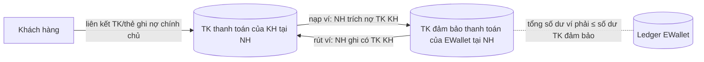

# Yêu cầu hệ thống Ví điện tử EWallet

- Trạng thái: Draft v0.2 — cần các bên (Product, Pháp chế, Vận hành, Ngân hàng đối tác) xác nhận
- Ngày: 2026-11-04
- Mô hình: Tổ chức trung gian thanh toán (fintech) cung ứng dịch vụ ví điện tử, liên kết core banking của một hoặc nhiều ngân hàng
- Phạm vi giai đoạn 1: Khách hàng cá nhân (B2C) + Back-office (CMS). Kênh: Web (Next.js). Hạ tầng: Cloud
- Giai đoạn 1 **không tích hợp bên thứ 3 thật** (NH, eKYC, thông báo, sàng lọc AML): chỉ định nghĩa interface (mục 8), kèm bản giả lập (fake) dùng cho dev/test. Tích hợp thật làm ở giai đoạn sau, bằng cách viết adapter cho interface có sẵn
- Ngoài phạm vi giai đoạn 1: Merchant/thanh toán QR, Mobile app, Open API cho đối tác, chuyển liên ngân hàng qua Napas

Ký hiệu ưu tiên: **M** = Must (bắt buộc cho go-live), **S** = Should, **C** = Could.
Mục đánh dấu ⚖️ là yêu cầu pháp lý — **Pháp chế phải xác nhận số liệu và văn bản hiện hành** trước khi chốt.

---

## 1. Bối cảnh mô hình tiền

- Tiền thật của khách nằm trên **tài khoản đảm bảo thanh toán** của EWallet tại ngân hàng đối tác. Ledger nội bộ ghi nhận phần tiền của từng ví.
- Ví không phát sinh lãi và không cấp tín dụng ⚖️.

---

## 2. Yêu cầu chức năng — Khách hàng (B2C)

### 2.1 Đăng ký, định danh (eKYC), đăng nhập
| ID | Yêu cầu | Ưu tiên |
|---|---|---|
| FR-ID-01 | Đăng ký bằng số điện thoại, xác thực OTP | M |
| FR-ID-02 | eKYC: chụp CCCD gắn chip/đọc NFC hoặc đối chiếu qua nguồn dữ liệu dân cư, kèm sinh trắc học khuôn mặt (liveness) ⚖️ | M |
| FR-ID-03 | Mỗi người chỉ được có một ví trên mỗi tổ chức cung ứng (khi quy định yêu cầu) ⚖️; chặn trùng CCCD | M |
| FR-ID-04 | Phân cấp tài khoản theo mức định danh; hạn mức giao dịch theo cấp | M |
| FR-ID-05 | Đăng nhập bằng mật khẩu + OTP/2FA; ghi nhận thiết bị, cảnh báo khi đăng nhập từ thiết bị mới | M |
| FR-ID-06 | Quên/đổi mật khẩu, đổi số điện thoại (phải xác thực lại sinh trắc học) | M |
| FR-ID-07 | Cập nhật thông tin khi CCCD hết hạn; khoá giao dịch nếu giấy tờ hết hạn ⚖️ | S |
| FR-ID-08 | Đóng ví theo yêu cầu: chỉ cho phép khi số dư = 0 hoặc sau khi rút hết về TK liên kết | M |

### 2.2 Liên kết ngân hàng
| ID | Yêu cầu | Ưu tiên |
|---|---|---|
| FR-LK-01 | Liên kết ví với TK thanh toán/thẻ ghi nợ của **chính chủ** tại NH đối tác; đối chiếu họ tên + số CCCD giữa ví và NH ⚖️ | M |
| FR-LK-02 | Ví chỉ được nạp/rút sau khi đã liên kết thành công ít nhất một nguồn ⚖️ | M |
| FR-LK-03 | Luồng xác thực liên kết do NH thực hiện (OTP của NH hoặc redirect sang trang NH); EWallet nhận token liên kết, **không lưu** số thẻ đầy đủ | M |
| FR-LK-04 | Huỷ liên kết từ phía ví và nhận thông báo huỷ từ phía NH (callback) | M |
| FR-LK-05 | Hỗ trợ nhiều ngân hàng; cấu hình thêm NH không cần sửa code luồng chính | S |

### 2.3 Nạp tiền (Top-up) từ tài khoản liên kết
| ID | Yêu cầu | Ưu tiên |
|---|---|---|
| FR-TU-01 | Nạp tiền: NH trích nợ TK khách → ghi có TK đảm bảo → ghi có ví | M |
| FR-TU-02 | Idempotent: bấm lại hoặc retry không được trừ tiền hai lần | M |
| FR-TU-03 | Xử lý trạng thái UNKNOWN khi NH timeout: không báo "thất bại" cho khách, truy vấn lại trạng thái hoặc chờ đối soát | M |
| FR-TU-04 | Kiểm tra số tiền tối thiểu/tối đa, hạn mức ngày/tháng | M |
| FR-TU-05 | Không cho nạp ví từ thẻ tín dụng ⚖️ | M |

### 2.4 Rút tiền (Withdraw) về tài khoản liên kết
| ID | Yêu cầu | Ưu tiên |
|---|---|---|
| FR-WD-01 | Rút về TK/thẻ đã liên kết của chính chủ | M |
| FR-WD-02 | Tạm giữ (hold) số tiền khi gửi lệnh sang NH; trừ hẳn khi NH xác nhận, hoàn lại khi NH xác nhận thất bại | M |
| FR-WD-03 | Phí rút (nếu có) hiển thị trước khi xác nhận | M |

### 2.5 Chuyển tiền ví–ví (trong EWallet)
| ID | Yêu cầu | Ưu tiên |
|---|---|---|
| FR-P2P-01 | Chuyển tiền đến ví khác theo số điện thoại; hiển thị tên người nhận (đã che một phần) trước khi xác nhận | M |
| FR-P2P-02 | Thực hiện trong một transaction nội bộ, ghi sổ kép, số dư không bao giờ âm | M |
| FR-P2P-03 | Lời nhắn chuyển tiền; chặn nội dung chứa ký tự nguy hiểm | S |
| FR-P2P-04 | Xác thực tăng cường (OTP/sinh trắc học) khi vượt ngưỡng giá trị ⚖️ | M |

### 2.6 Lịch sử, thông báo, hỗ trợ
| ID | Yêu cầu | Ưu tiên |
|---|---|---|
| FR-HS-01 | Xem số dư theo thời gian thực | M |
| FR-HS-02 | Lịch sử giao dịch: lọc theo thời gian, loại, trạng thái; phân trang | M |
| FR-HS-03 | Chi tiết giao dịch: mã giao dịch, mã tham chiếu NH, phí, trạng thái | M |
| FR-HS-04 | Thông báo biến động số dư (email/SMS/web push) | M |
| FR-HS-05 | Gửi yêu cầu tra soát/khiếu nại từ một giao dịch cụ thể; theo dõi trạng thái xử lý | M |
| FR-HS-06 | Xuất sao kê PDF theo kỳ | S |

---

## 3. Yêu cầu chức năng — Back-office

| ID | Yêu cầu | Ưu tiên |
|---|---|---|
| FR-BO-01 | Đăng nhập back-office riêng, bắt buộc 2FA, giới hạn IP/VPN | M |
| FR-BO-02 | Phân quyền theo vai trò (CSKH, Vận hành, Đối soát, Kiểm soát rủi ro, Admin); nguyên tắc quyền tối thiểu | M |
| FR-BO-03 | Tra cứu khách hàng/ví/giao dịch; dữ liệu nhạy cảm che mặc định, xem đầy đủ phải có quyền và được ghi log | M |
| FR-BO-04 | Khoá/mở khoá ví, phong toả một phần số dư theo yêu cầu cơ quan có thẩm quyền ⚖️ | M |
| FR-BO-05 | Thao tác có ảnh hưởng tiền (điều chỉnh, hoàn tiền thủ công) theo **maker–checker**: một người tạo, người khác duyệt | M |
| FR-BO-06 | Xử lý tra soát/khiếu nại: phân công, SLA, lịch sử xử lý ⚖️ (thời hạn theo quy định) | M |
| FR-BO-07 | Đối soát: xem kết quả đối soát với từng NH, danh sách giao dịch lệch, xử lý và đóng lệch | M |
| FR-BO-08 | Duyệt eKYC thủ công cho hồ sơ bị hệ thống đánh dấu nghi vấn | M |
| FR-BO-09 | Cấu hình hạn mức, biểu phí, ngưỡng xác thực tăng cường (có maker–checker và lịch sử phiên bản) | M |
| FR-BO-10 | Báo cáo vận hành: số giao dịch, giá trị, tỷ lệ lỗi theo NH; xuất CSV | M |
| FR-BO-11 | Báo cáo định kỳ gửi NHNN ⚖️ (mẫu và tần suất do Pháp chế cung cấp) | M |
| FR-BO-12 | Audit log mọi thao tác back-office: ai, lúc nào, IP, dữ liệu trước/sau; không sửa xoá được | M |

---

## 4. Yêu cầu tích hợp Core Banking / Ngân hàng đối tác

| ID | Yêu cầu | Ưu tiên |
|---|---|---|
| IR-01 | Danh mục API cần NH cung cấp: liên kết/huỷ liên kết, trích nợ (nạp), ghi có (rút), truy vấn trạng thái giao dịch, truy vấn số dư TK đảm bảo, file/API đối soát | M |
| IR-02 | Giao thức theo NH (REST/SOAP/ISO 8583/ISO 20022); có lớp adapter cho từng NH, nghiệp vụ không phụ thuộc định dạng của NH | M |
| IR-03 | Bảo mật kênh: mTLS hoặc VPN site-to-site, ký số/mã hoá message theo chuẩn của NH, IP whitelist | M |
| IR-04 | Mỗi lệnh gửi NH có mã tham chiếu duy nhất (`external_ref`) để NH chống trùng và để đối soát | M |
| IR-05 | Timeout rõ ràng cho từng API; chỉ retry các lệnh an toàn khi retry; timeout → UNKNOWN → truy vấn trạng thái | M |
| IR-06 | Nhận callback/notification từ NH: xác thực chữ ký, xử lý idempotent, trả lời đúng hợp đồng | M |
| IR-07 | Lưu toàn bộ request/response thô với NH (đã che dữ liệu nhạy cảm) phục vụ tra soát | M |
| IR-08 | Xử lý khi NH bảo trì hoặc ngoài giờ: tạm ngắt luồng của NH đó (circuit breaker), báo khách, không mất lệnh | M |
| IR-09 | Đối soát cuối ngày (T+1) theo file NH và đối soát định kỳ trong ngày (nếu NH hỗ trợ API) | M |
| IR-10 | Giám sát hằng ngày: tổng số dư mọi ví ≤ số dư TK đảm bảo thanh toán; lệch thì cảnh báo ngay ⚖️ | M |
| IR-11 | Môi trường sandbox/UAT của NH để kiểm thử end-to-end trước go-live; kịch bản nghiệm thu với NH | M |
| IR-12 | **Fake bank** (chỉ dev/test): implement interface `BankGateway` (IR-13), chọn được kết quả thành công, thất bại, timeout, callback trùng để kiểm thử các nhánh lỗi. Không phải hệ thống giả lập riêng | M |
| IR-13 | **Interface `BankGateway`** chuẩn hoá — đặc tả ở mục 8.2. Thêm NH thật = viết thêm adapter, không sửa nghiệp vụ | M |
| IR-14 | Ledger hỗ trợ **nhiều TK đảm bảo thanh toán** (mỗi NH một tài khoản); thêm NH = thêm cấu hình, không đổi schema (xem 7.1) | M |

---

## 5. Yêu cầu phi chức năng

### 5.1 Hiệu năng & quy mô *(Product đã xác nhận 500k users, 500 TPS)*
| ID | Yêu cầu |
|---|---|
| NFR-P-01 | 500.000 người dùng; **500 TPS lúc cao điểm** (tính cả đọc và ghi; tỷ lệ đọc/ghi cần đo, giả định khoảng 70/30) |
| NFR-P-01a | Các tài khoản sổ cái bị ghi liên tục (TK thanh toán bù trừ theo NH, TK doanh thu phí) không được thành điểm nghẽn do lock khi có 500 TPS — thiết kế phải giải quyết bài toán "hot account" |
| NFR-P-02 | API nội bộ (số dư, lịch sử) p99 < 300 ms; giao dịch P2P p99 < 1 s; giao dịch qua NH phụ thuộc SLA của NH |
| NFR-P-03 | Lịch sử giao dịch truy vấn nhanh với ví có hơn 100.000 giao dịch |

### 5.2 Sẵn sàng & phục hồi
| ID | Yêu cầu |
|---|---|
| NFR-A-01 | Availability ≥ 99,9% hằng tháng (trừ bảo trì có thông báo) |
| NFR-A-02 | RPO = 0 cho dữ liệu sổ cái (replication đồng bộ); RTO ≤ 1 giờ |
| NFR-A-03 | Backup hằng ngày, có kiểm tra khôi phục định kỳ; có phương án DR ⚖️ |
| NFR-A-04 | Triển khai không downtime (rolling); migration DB tương thích ngược |

### 5.3 Tính đúng đắn của tiền
| ID | Yêu cầu |
|---|---|
| NFR-C-01 | Sổ cái kép (double-entry), bút toán chỉ được thêm mới; sửa sai bằng bút toán đảo |
| NFR-C-02 | Không giao dịch nào làm số dư âm, kể cả khi có nhiều request đồng thời |
| NFR-C-03 | Mọi API ghi tiền đều idempotent |
| NFR-C-04 | Kiểm tra tự động hằng ngày: sổ cái cân; số dư từng ví = tổng bút toán |
| NFR-C-05 | Lưu tiền bằng số nguyên (đồng); quy tắc làm tròn phí được văn bản hoá |

### 5.4 Bảo mật ⚖️
| ID | Yêu cầu |
|---|---|
| NFR-S-01 | Mã hoá dữ liệu khi truyền (TLS 1.2+) và khi lưu (CCCD, số TK, ảnh eKYC) |
| NFR-S-02 | Phiên web: cookie httpOnly/Secure, tự đăng xuất khi không hoạt động, chống CSRF/XSS, có CSP |
| NFR-S-03 | Rate limit theo người dùng/IP/thiết bị; khoá tạm khi nhập sai OTP/mật khẩu nhiều lần |
| NFR-S-04 | Quản lý secret tập trung (Vault/KMS); không để secret trong code hoặc log |
| NFR-S-05 | Pentest độc lập trước go-live và định kỳ; quét lỗ hổng trong CI |
| NFR-S-06 | Đáp ứng yêu cầu an toàn hệ thống thông tin theo cấp độ (Luật ATTT, hồ sơ đề xuất cấp độ) |

### 5.5 Tuân thủ ⚖️ *(Pháp chế xác nhận văn bản hiện hành)*
| ID | Yêu cầu |
|---|---|
| NFR-L-01 | Tuân thủ quy định về thanh toán không dùng tiền mặt và dịch vụ trung gian thanh toán của NHNN (điều kiện ví, liên kết, hạn mức tháng của ví cá nhân, TK đảm bảo thanh toán) |
| NFR-L-02 | Phòng chống rửa tiền: nhận biết khách hàng, sàng lọc danh sách đen/cấm vận, phát hiện và báo cáo giao dịch đáng ngờ, báo cáo giao dịch giá trị lớn |
| NFR-L-03 | Bảo vệ dữ liệu cá nhân: thu thập có đồng ý, mục đích rõ ràng, quyền truy cập/xoá của chủ thể dữ liệu, đánh giá tác động xử lý dữ liệu |
| NFR-L-04 | Xác thực giao dịch trực tuyến theo ngưỡng giá trị (OTP/sinh trắc học) theo quy định NHNN |
| NFR-L-05 | Lưu trữ chứng từ và log giao dịch đủ thời hạn luật định; dữ liệu đặt tại Việt Nam nếu quy định yêu cầu |

### 5.6 Quan sát & vận hành
| ID | Yêu cầu |
|---|---|
| NFR-O-01 | Log tập trung, có correlation ID xuyên suốt Web → Backend → NH |
| NFR-O-02 | Metric nghiệp vụ: số giao dịch theo trạng thái, tỷ lệ lỗi/timeout theo NH, số giao dịch UNKNOWN tồn đọng |
| NFR-O-03 | Cảnh báo: lệch đối soát, lệch TK đảm bảo, tỷ lệ lỗi NH tăng, giao dịch UNKNOWN quá N phút |
| NFR-O-04 | Runbook cho các sự cố: NH sập, lệch tiền, rò rỉ dữ liệu |

### 5.7 Trải nghiệm Web
| ID | Yêu cầu |
|---|---|
| NFR-UX-01 | Responsive (dùng được trên trình duyệt mobile); hỗ trợ trình duyệt phổ biến 2 phiên bản gần nhất |
| NFR-UX-02 | Tiếng Việt mặc định; định dạng tiền `1.000.000 ₫`; giờ Việt Nam |
| NFR-UX-03 | Accessibility WCAG 2.1 AA cho các luồng chính |

---

## 6. Quyết định đã chốt & câu hỏi còn mở

Các câu còn mở (❓) được theo dõi ở [open-questions.md](open-questions.md): Q4 = OQ-001, Q7 = OQ-005, Q8 = OQ-006.

| # | Chủ đề | Trạng thái |
|---|---|---|
| Q1 | Ngân hàng đối tác | ✅ Chưa có NH. Giai đoạn 1 chỉ có interface `BankGateway` + fake (8.2) |
| Q2 | Mô hình TK đảm bảo thanh toán | ✅ Mỗi NH một TK đảm bảo (7.1) |
| Q3 | Biểu phí | ✅ Cấu hình trên CMS (FR-BO-09); mô hình phí ở 7.3 |
| Q4 | Hạn mức & xác thực tăng cường | ✅ Mô hình 3 tầng, cấu hình trên CMS (7.2). ❓ Pháp chế/Rủi ro điền con số trước go-live |
| Q5 | Nhà cung cấp eKYC | ✅ Giai đoạn 1 chỉ có interface `EkycProvider` + fake (8.3). Chọn nhà cung cấp ở giai đoạn sau |
| Q6 | Quy mô | ✅ 500k users, 500 TPS (5.1) |
| Q7 | Thời hạn tra soát & lưu trữ | ✅ Theo đề xuất ở 7.5, cấu hình được. ❓ Pháp chế xác nhận trần luật định |
| Q8 | Hạ tầng | ✅ Cloud. ❓ Còn mở: dữ liệu có bắt buộc đặt tại Việt Nam không → quyết định chọn cloud trong nước hay region nước ngoài (Pháp chế) |
| Q9 | Kênh thông báo | ✅ Giai đoạn 1 chỉ có interface `NotificationSender` + fake (8.4) |
| Q10 | Chuyển liên ngân hàng (Napas) | ✅ Ngoài phạm vi giai đoạn 1 |

---

## 7. Đề xuất chi tiết

### 7.1 Tài khoản đảm bảo thanh toán (Q2)

**Bản chất:** ví điện tử không phải tài khoản ngân hàng. Khi khách nạp 1 triệu vào ví, 1 triệu tiền thật được chuyển vào tài khoản đảm bảo thanh toán của EWallet tại NH. Con số "1 triệu trong ví" chỉ là ghi nhận trong sổ cái của EWallet. Quy định ⚖️ yêu cầu tổng số dư tất cả các ví không được lớn hơn số dư tài khoản đảm bảo, để nếu EWallet phá sản thì tiền của khách vẫn còn.

**Khi có nhiều NH**, có hai cách:

| | A. Một TK đảm bảo duy nhất (tại NH X) | B. Mỗi NH đối tác một TK đảm bảo (đề xuất) |
|---|---|---|
| Khách ở NH Y nạp tiền | Tiền chuyển liên NH từ Y sang X: chậm hơn, mất phí, thêm điểm lỗi | Chuyển nội bộ NH Y (TK khách → TK đảm bảo tại Y): nhanh, rẻ |
| Khách rút về NH Y | Chuyển liên NH từ X sang Y | Chuyển nội bộ NH Y, **nếu** TK đảm bảo tại Y đủ tiền |
| Vấn đề mới | Phụ thuộc vào một NH | **Điều phối thanh khoản**: TK đảm bảo tại Y có thể cạn (khách nạp ở X nhưng rút về Y) → Tài chính phải chuyển tiền giữa các TK đảm bảo, cần báo cáo và cảnh báo khi số dư thấp |
| Đối soát | Một nguồn | Đối soát riêng từng NH |

**Đề xuất:** chọn B (cách các ví lớn thường làm). Yêu cầu kéo theo:
- Sổ cái có một tài khoản bù trừ cho mỗi NH (`bank_settlement_<bank>`) phản chiếu TK đảm bảo tại NH đó.
- FR-BO-13 (M): Màn hình số dư TK đảm bảo theo từng NH; cảnh báo khi dưới ngưỡng; ghi nhận lệnh chuyển tiền điều phối giữa các TK đảm bảo (maker–checker).
- Giai đoạn 1 có một NH giả lập, nhưng schema và ledger thiết kế cho N NH ngay từ đầu (IR-14), vì sửa sổ cái sau khi đã chạy rất tốn kém.

### 7.2 Mô hình hạn mức (Q4)

Hạn mức có ba tầng. Một giao dịch phải qua **cả ba** tầng:

1. **Trần pháp lý** ⚖️: giới hạn do NHNN quy định cho ví cá nhân. Theo hiểu biết của tôi là tổng giá trị giao dịch qua ví cá nhân tối đa 100 triệu đồng/tháng, **chưa được xác minh** — Pháp chế phải đối chiếu văn bản hiện hành. Tầng này cấu hình trên CMS chỉ để Pháp chế cập nhật khi luật đổi; không ai được đặt vượt.
2. **Hạn mức theo cấp định danh** (quyết định của Product/Rủi ro, ≤ trần pháp lý). Số dưới đây là **ví dụ** để minh hoạ cấu trúc, không phải số khuyến nghị:

| Cấp | Điều kiện | Mỗi giao dịch | Mỗi ngày | Mỗi tháng |
|---|---|---|---|---|
| 0 — Chưa KYC | Chỉ SĐT | Không được giao dịch tiền | — | — |
| 1 — eKYC cơ bản | OCR CCCD + liveness | 5 tr | 20 tr | 50 tr |
| 2 — eKYC đầy đủ | Xác thực CCCD gắn chip/nguồn dữ liệu dân cư + đã liên kết NH | 20 tr | 50 tr | = trần pháp lý |

3. **Ngưỡng xác thực tăng cường**: không chặn giao dịch mà yêu cầu thêm bước xác thực. Ví dụ: OTP cho mọi giao dịch chuyển/rút; sinh trắc học khuôn mặt khi một giao dịch vượt X hoặc tổng trong ngày vượt Y ⚖️ (Pháp chế xác nhận NHNN có áp ngưỡng bắt buộc cho ví hay không).

Yêu cầu hệ thống:
- FR-LIM-01 (M): Hạn mức cấu hình trên CMS theo bộ (cấp KYC × loại giao dịch × kỳ: giao dịch/ngày/tháng); có maker–checker và lịch sử phiên bản.
- FR-LIM-02 (M): Kiểm tra hạn mức **nguyên tử** cùng lúc với giao dịch — hai giao dịch song song không được cùng lọt qua khi cộng lại vượt hạn mức.
- FR-LIM-03 (M): Kỳ ngày/tháng tính theo giờ Việt Nam; giao dịch thất bại hoặc đã hoàn tiền thì trả lại hạn mức.
- FR-LIM-04 (S): Hạn mức riêng cho từng khách (giảm khi nghi ngờ gian lận, tăng theo phê duyệt).
- FR-LIM-05 (M): Thông báo rõ cho khách: hạn mức còn lại, lý do bị từ chối.

### 7.3 Mô hình phí (Q3)
- FR-FEE-01 (M): Phí cấu hình trên CMS theo loại giao dịch (nạp/rút/P2P) × NH × khoảng giá trị: phí cố định, phần trăm, hoặc kết hợp, có mức tối thiểu/tối đa.
- FR-FEE-02 (M): Cấu hình có thời điểm hiệu lực; giao dịch dùng biểu phí tại thời điểm tạo và lưu lại phí đã áp dụng.
- FR-FEE-03 (M): Quy tắc làm tròn cấu hình được (mặc định làm tròn lên đến đồng).
- FR-FEE-04 (S): Theo dõi riêng phí NH thu EWallet (chi phí) và phí EWallet thu khách (doanh thu) để báo cáo lãi lỗ.

### 7.4 eKYC (Q5)

**Giới hạn quan trọng của kênh Web:** trình duyệt **không đọc được chip NFC** trên CCCD. Trên web chỉ làm được OCR ảnh CCCD + liveness qua webcam. Cách đọc chip là cách xác thực mạnh nhất, và quy định ⚖️ có thể yêu cầu nó cho một số cấp hoặc giao dịch. Các hướng xử lý:
- (a) Web dùng eKYC cấp 1 (OCR + liveness); cấp 2 đối chiếu qua API xác thực với nguồn dữ liệu dân cư/VNeID nếu nhà cung cấp hỗ trợ.
- (b) Làm một mobile app nhỏ chỉ để eKYC (đọc chip), quét QR từ web để chuyển sang app.
→ Pháp chế xác nhận cấp nào bắt buộc đọc chip, sau đó Product chọn hướng.

**Nhà cung cấp eKYC** (đều có OCR CCCD, so khớp khuôn mặt, liveness, SDK web): VNPT eKYC, FPT.AI eKYC, Viettel AI eKYC, và các nhà cung cấp độc lập. Tiêu chí chọn: có SDK web, có kết nối xác thực với nguồn dữ liệu dân cư, giá theo lượt, độ chính xác chống giả mạo (ảnh in, màn hình, deepfake), lưu dữ liệu tại Việt Nam.

**Đề xuất:**
- FR-KYC-01 (M): Interface `EkycProvider` (`ocrIdCard`, `checkLiveness`, `matchFace`, `verifyWithNationalDb`); giai đoạn 1 dùng **adapter giả lập** để phát triển. Chọn nhà cung cấp thật song song, POC 2 nhà cung cấp trước khi ký hợp đồng.
- FR-KYC-02 (M): Lưu kết quả và điểm tin cậy từ nhà cung cấp; dưới ngưỡng thì chuyển sang duyệt thủ công (FR-BO-08).
- FR-KYC-03 (M): Ảnh CCCD và ảnh khuôn mặt mã hoá khi lưu, truy cập có log (dữ liệu cá nhân nhạy cảm ⚖️).

### 7.5 Tra soát & lưu trữ (Q7) — *đề xuất, Pháp chế xác nhận trần luật định*

**Tra soát/khiếu nại (SLA nội bộ):**
| Bước | Đề xuất |
|---|---|
| Tiếp nhận | Ngay khi khách gửi; tự động cấp mã yêu cầu |
| Phản hồi ban đầu | ≤ 1 ngày làm việc |
| Giao dịch chỉ trong ví (P2P, phí) | Xử lý xong ≤ 5 ngày làm việc |
| Giao dịch liên quan NH | Xử lý xong ≤ 15 ngày làm việc (phụ thuộc SLA tra soát của NH) |
| Quá hạn | Tự động chuyển cấp quản lý; cảnh báo trước 1 ngày |

SLA nội bộ phải **≤ thời hạn luật định** ⚖️. Hệ thống cấu hình SLA trên CMS để chỉnh khi Pháp chế chốt.

**Lưu trữ (đề xuất):**
| Loại dữ liệu | Thời gian | Ghi chú |
|---|---|---|
| Sổ cái, giao dịch, chứng từ | 10 năm | Theo nghĩa vụ lưu chứng từ kế toán ⚖️ |
| Hồ sơ KYC, dữ liệu phòng chống rửa tiền | Tối thiểu 5 năm kể từ khi đóng ví/kết thúc giao dịch ⚖️ | Theo Luật Phòng, chống rửa tiền |
| Audit log back-office | 10 năm | |
| Log kỹ thuật (ứng dụng) | 90 ngày lưu nóng, 1 năm lưu trữ lạnh | Đã che dữ liệu nhạy cảm |
| Request/response thô với NH | Bằng thời hạn giao dịch | Phục vụ tra soát |

- NFR-L-06 (M): Phân tầng lưu trữ: 1–2 năm gần nhất trong DB chính, phần cũ hơn chuyển sang lưu trữ lạnh (object storage không sửa xoá được, ví dụ WORM); vẫn tra cứu được khi cần.
- NFR-L-07 (M): Tự động xoá hoặc ẩn danh dữ liệu cá nhân khi hết hạn lưu trữ và không còn nghĩa vụ pháp lý (bảo vệ dữ liệu cá nhân).

---

## 8. Interface nhà cung cấp bên thứ 3 (giai đoạn 1)

Giai đoạn 1 chỉ định nghĩa interface và một bản **fake** cho mỗi interface. Nghiệp vụ ví chỉ làm việc qua interface, nên khi có nhà cung cấp thật chỉ cần viết thêm adapter, không phải sửa luồng nghiệp vụ.

Dưới đây là đặc tả ở mức hợp đồng (operation, dữ liệu vào/ra, trạng thái). Chữ ký Java cụ thể sẽ chốt ở bước thiết kế.

### 8.1 Quy tắc chung cho mọi provider

| ID | Yêu cầu | Ưu tiên |
|---|---|---|
| PR-01 | Interface dùng kiểu dữ liệu của EWallet (`Money`, `CustomerId`...), không lộ kiểu hay mã lỗi riêng của nhà cung cấp; adapter tự chuyển đổi | M |
| PR-02 | Mọi lời gọi ra ngoài đều có timeout cấu hình được. Kết quả chia rõ thành **lỗi nghiệp vụ** (bị từ chối) và **lỗi kỹ thuật** (timeout, mất kết nối) | M |
| PR-03 | Lời gọi có tác dụng phụ (trừ tiền, gửi tin) nhận một khoá duy nhất (`externalRef` / `idempotencyKey`), để gọi lại không bị thực hiện hai lần | M |
| PR-04 | Ghi log request/response của mọi lời gọi, kèm correlation ID; dữ liệu nhạy cảm phải được che | M |
| PR-05 | Chọn implementation bằng cấu hình theo môi trường. **Fake bị cấm ở production**: ứng dụng từ chối khởi động nếu prod đang cấu hình fake | M |
| PR-06 | Fake chạy trong bộ nhớ, không cần mạng; test chọn được kết quả trả về (thành công, thất bại, timeout...) để kiểm thử các nhánh lỗi | M |
| PR-07 | Mỗi interface có bộ **contract test** dùng chung; fake và mọi adapter thật sau này đều phải pass | S |

### 8.2 `BankGateway` — tích hợp ngân hàng (thay cho IR-13)

| Operation | Vào | Ra |
|---|---|---|
| `initiateLink` | khách hàng (họ tên, CCCD), loại nguồn (TK/thẻ ghi nợ), thông tin TK/thẻ | `PENDING_OTP` / `REDIRECT(url)` / `FAILED(lý do)` |
| `confirmLink` | mã phiên liên kết, OTP | `SUCCESS(linkToken, tên chủ TK, số TK đã che)` / `FAILED` |
| `unlink` | `linkToken` | `SUCCESS` / `FAILED` |
| `debit` (nạp ví) | `externalRef`, `linkToken`, số tiền | `SUCCESS(bankRef)` / `FAILED(lý do)` / `PENDING` / `UNKNOWN` |
| `credit` (rút ví) | `externalRef`, `linkToken`, số tiền | như `debit` |
| `queryStatus` | `externalRef` | `SUCCESS` / `FAILED` / `PENDING` / `NOT_FOUND` |
| `parseCallback` | header + body thô từ NH | sự kiện đã xác thực chữ ký (kết quả giao dịch, NH huỷ liên kết) hoặc lỗi chữ ký |
| `fetchReconciliation` | ngày | danh sách giao dịch theo NH (`externalRef`, `bankRef`, số tiền, trạng thái) |
| `getSafeguardBalance` | — | số dư TK đảm bảo tại NH này |

- Mỗi NH là một implementation, định danh bằng `bankCode`. Nghiệp vụ lấy đúng implementation qua registry theo `bankCode` (đáp ứng Q2: mỗi NH một TK đảm bảo).
- **Fake:** cấu hình được kết quả cho từng lời gọi; mô phỏng được callback đến trễ, callback trùng, và file đối soát có dòng lệch.

### 8.3 `EkycProvider` — định danh điện tử

| Operation | Vào | Ra |
|---|---|---|
| `ocrIdCard` | ảnh mặt trước, mặt sau CCCD | các trường đọc được (số CCCD, họ tên, ngày sinh, ngày hết hạn...) + điểm tin cậy từng trường; cờ nghi ngờ giả mạo |
| `checkLiveness` | ảnh/video selfie | `LIVE` / `SPOOF` + điểm |
| `matchFace` | ảnh trên CCCD, ảnh selfie | điểm khớp |
| `verifyWithNationalDb` *(tuỳ chọn)* | số CCCD, họ tên, ngày sinh | `MATCH` / `MISMATCH` / `UNAVAILABLE` |

- Mỗi provider khai báo các operation nó hỗ trợ (ví dụ có `verifyWithNationalDb` hay không); hệ thống xét cấp KYC theo những gì provider đó làm được.
- Ngưỡng điểm để duyệt tự động cấu hình trên CMS; dưới ngưỡng thì chuyển sang duyệt thủ công (FR-BO-08).
- **Fake:** trả lại dữ liệu do test đưa vào; giả lập được các kết quả giả mạo, không khớp khuôn mặt, điểm thấp.

### 8.4 `NotificationSender` — gửi thông báo

| Operation | Vào | Ra |
|---|---|---|
| `send` | kênh (`EMAIL` / `SMS` / `WEB_PUSH`), người nhận, mã template, tham số, `idempotencyKey` | `ACCEPTED(providerMessageId)` / `REJECTED(lý do)` / `FAILED(có thể retry)` |
| `supports` | kênh | có / không |

- Mỗi kênh có thể dùng một provider khác nhau. Template và nội dung do EWallet quản lý (cấu hình trên CMS); provider chỉ lo gửi đi.
- Thông báo được gửi bất đồng bộ qua outbox, nên lỗi gửi tin không làm hỏng giao dịch tiền.
- Mã OTP do EWallet tự sinh và tự kiểm tra; provider chỉ chuyển tin.
- **Fake:** lưu tin đã gửi trong bộ nhớ để test đọc lại (ví dụ lấy OTP trong test end-to-end). Trên môi trường dev có thể xem các tin đã gửi qua một trang nội bộ.

### 8.5 `AmlScreeningProvider` — sàng lọc phòng chống rửa tiền

| Operation | Vào | Ra |
|---|---|---|
| `screen` | họ tên, ngày sinh, số giấy tờ, quốc tịch | `CLEAR` / `POTENTIAL_MATCH(danh sách khớp)` / `ERROR` |

- Gọi khi khách hoàn tất eKYC và sàng lọc lại định kỳ khi danh sách cập nhật. Kết quả `POTENTIAL_MATCH` hoặc `ERROR` thì chuyển sang duyệt thủ công; không tự động cho qua.
- Danh sách đen nội bộ quản lý trên CMS và luôn được kiểm, kể cả khi provider bên ngoài gặp lỗi.
- **Fake:** cấu hình được tên hoặc số giấy tờ trả về `POTENTIAL_MATCH`.

### 8.6 Ngoài phạm vi interface
Hạ tầng cloud (object storage cho ảnh KYC, KMS, email SMTP của cloud) dùng trực tiếp qua SDK/Spring của nền tảng, không bọc thêm interface "provider", vì đây không phải đối tác nghiệp vụ cần thay thế.
