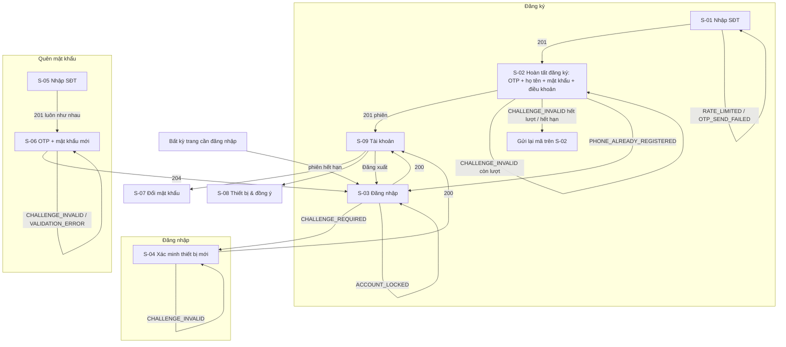

# UI — F-ACC-01 Đăng ký & đăng nhập

| | |
|---|---|
| Trạng thái | Draft |
| Phiên bản | 0.1 |
| Ngày | 2026-11-11 |
| SRS | [F-ACC-01](../../srs/features/F-ACC-01-dang-ky-dang-nhap.md) v0.5 |
| Hợp đồng | [identity/public.yaml](../../../source-code/contracts/openapi/identity/public.yaml) v0.2.1 |
| Bề mặt | Web khách hàng |
| Design system | [docs/ui/design-system.md](../design-system.md) |

## 1. Mục tiêu & người dùng
- Khách hàng cá nhân, đa số dùng trình duyệt điện thoại; lần đầu dùng ví hoặc quay lại sau một thời gian.
- Mục tiêu: đăng ký xong trong **2 màn hình** (SĐT → hoàn tất); đăng nhập từ thiết bị đã biết trong **1 màn hình**.
- Ràng buộc bảo mật quyết định giao diện:
  - Không bao giờ cho biết SĐT có tài khoản hay không, ở đăng ký, đăng nhập và quên mật khẩu (FR-02, FR-16, FR-32).
  - Token chỉ nằm trong cookie httpOnly do BFF giữ; trình duyệt không thấy token (FR-29).

## 2. User flow


## 3. Danh sách màn hình
| ID | Tên | Loại | Route | Ghi chú |
|---|---|---|---|---|
| F-ACC-01.S-01 | Đăng ký: nhập SĐT | Trang | `/register` | |
| F-ACC-01.S-02 | Hoàn tất đăng ký | Trang | `/register/complete` | OTP chung màn hình với mật khẩu, xem quyết định D1 |
| F-ACC-01.S-03 | Đăng nhập | Trang | `/login` | Trang mặc định khi chưa đăng nhập |
| F-ACC-01.S-04 | Xác minh thiết bị mới | Trang | `/login/verify` | |
| F-ACC-01.S-05 | Quên mật khẩu: nhập SĐT | Trang | `/forgot-password` | |
| F-ACC-01.S-06 | Đặt mật khẩu mới | Trang | `/forgot-password/reset` | |
| F-ACC-01.S-07 | Đổi mật khẩu | Trang | `/account/password` | Cần đăng nhập |
| F-ACC-01.S-08 | Thiết bị & đồng ý | Trang | `/account/security` | Cần đăng nhập |
| F-ACC-01.S-09 | Tài khoản (tạm) | Trang | `/account` | Trang sau đăng nhập, xem D4 |
| F-ACC-01.S-10 | Đổi số điện thoại | Trang | — | **Chưa thiết kế**: cần luồng khuôn mặt của F-ACC-02 (OQ-028) |

### Quyết định UX không hiển nhiên
- **D1 — OTP nằm cùng màn hình với mật khẩu (S-02, S-06).** API không có bước "chỉ xác minh OTP"; OTP chỉ được kiểm khi gửi cả form (`register/verify`, `password/reset`). Tách OTP thành màn hình riêng sẽ làm khách tưởng mã đã đúng rồi mới báo sai ở bước sau. Server kiểm định dạng, mật khẩu và điều khoản trước OTP (BR-06), nên điền sai mật khẩu không tốn lượt nhập mã.
- **D2 — Gửi lại mã ở S-04 cần gọi lại `login`.** Hợp đồng không có endpoint gửi lại riêng cho thiết bị mới. Client giữ SĐT và mật khẩu khách vừa nhập **trong bộ nhớ của trang** (state React, không lưu `localStorage`, không gửi đi đâu khác), xoá khi rời trang hoặc khi xong.
- **D3 — Thông điệp đăng ký và quên mật khẩu không tiết lộ SĐT có tài khoản.** S-02 luôn nói "Nếu số này hợp lệ, mã sẽ được gửi tới…"; khách đã có tài khoản sẽ nhận tin nhắn hướng dẫn đăng nhập thay vì mã (EV-04).
- **D4 — S-09 là trang tạm.** Chưa có SRS cho trang chủ ví (số dư, lịch sử); S-09 chỉ có lối vào S-07, S-08 và nút đăng xuất. Không hiển thị họ tên hay SĐT vì chưa có `GET /me` (OQ-048).

## 4. Chi tiết màn hình

Bố cục chung của mọi trang chưa đăng nhập: logo ở trên, một `Card` `max-w-md` căn giữa, nút chính rộng toàn khung `h-11`, liên kết phụ dưới nút. Mọi form dùng `Form` (react-hook-form + Zod); lỗi theo field hiện ngay dưới ô (`FormMessage`), lỗi chung hiện bằng `Alert` trên đầu form. Nút gửi dùng `SubmitButton`: khoá ngay khi bấm, không nhận click tiếp cho tới khi có phản hồi.

### F-ACC-01.S-01 — Đăng ký: nhập SĐT
**Mục đích:** bắt đầu đăng ký và gửi mã xác thực.

```
┌────────────────────────────────┐
│            EWallet             │
├────────────────────────────────┤
│ Tạo tài khoản                  │
│ Số điện thoại                  │
│ ┌────────────────────────────┐ │
│ │ 0900 000 001               │ │
│ └────────────────────────────┘ │
│ [         Tiếp tục          ]  │
│                                │
│ Đã có tài khoản? Đăng nhập     │
└────────────────────────────────┘
```

**Thành phần:** `Input` (`type="tel"`, `inputMode="tel"`, `autoComplete="tel"`), `SubmitButton`, liên kết tới S-03.

**Dữ liệu & tương tác**
- Client kiểm định dạng trước khi gửi: `0` + 9 chữ số hoặc `+84` + 9 chữ số. Client **bỏ khoảng trắng và dấu chấm** trước khi gửi, vì server chưa nhận (OQ-016); hiển thị thì nhóm 4-3-3.
- `POST /api/v1/auth/register {phone}` → `201 Challenge`. Lưu `challengeId`, `expiresAt`, `resendAfter`, `attemptsRemaining`, `destinationMasked` và SĐT vào `sessionStorage` của tab (để tải lại S-02 không mất), rồi sang S-02.

**Trạng thái**
| Trạng thái | Hiển thị |
|---|---|
| Đang tải / Rỗng | — (form tĩnh) |
| Lỗi nhập liệu | Dưới ô: `phone.invalid` |
| Đang gửi | `SubmitButton` spinner "Đang gửi mã…" |
| `RATE_LIMITED` | `Alert`: `error.rateLimited` với số giây từ `Retry-After` |
| `OTP_SEND_FAILED` | `Alert`: `error.otpSendFailed`, nút vẫn bấm lại được |
| Mất mạng / timeout | `Alert`: `error.network`; giữ SĐT đã nhập |
| Không có quyền | — (không cần đăng nhập) |

**Truy vết:** FR-01, FR-02, FR-13, FR-14, BR-01 · AC-01..03, AC-16, AC-17.

### F-ACC-01.S-02 — Hoàn tất đăng ký
**Mục đích:** nhập mã, họ tên, mật khẩu và đồng ý điều khoản để tạo tài khoản.

```
┌────────────────────────────────┐
│ ← Hoàn tất đăng ký             │
├────────────────────────────────┤
│ Nếu số 0900 *** 001 hợp lệ,    │
│ mã 6 chữ số đã được gửi tới đó.│
│ ┌──┐┌──┐┌──┐ ┌──┐┌──┐┌──┐      │
│ └──┘└──┘└──┘ └──┘└──┘└──┘      │
│ Mã hết hạn sau 02:45           │
│ Chưa nhận được mã? Gửi lại 0:30│
│                                │
│ Họ và tên                      │
│ ┌────────────────────────────┐ │
│ └────────────────────────────┘ │
│ Mật khẩu                    👁 │
│ ┌────────────────────────────┐ │
│ └────────────────────────────┘ │
│ Ít nhất 8 ký tự, khác số ĐT.   │
│ ☐ Tôi đồng ý với Điều khoản    │
│   sử dụng                      │
│ [       Tạo tài khoản       ]  │
└────────────────────────────────┘
```

**Thành phần:** `InputOTP` 6 ô (`inputMode="numeric"`, `autoComplete="one-time-code"`), `Input` họ tên (`autoComplete="name"`, `maxLength=128`), `Input` mật khẩu (`type="password"`, `autoComplete="new-password"`, nút hiện/ẩn có `aria-label`), `Checkbox` điều khoản, `SubmitButton`.

**Dữ liệu & tương tác**
- Gửi `POST /api/v1/auth/register/verify {challengeId, otp, password, fullName, termsVersion, deviceFingerprint}`. `termsVersion` lấy từ cấu hình của web (chờ OQ-050); không tích ô đồng ý thì **không gửi** `termsVersion` và nút vẫn bấm được: server trả `CONSENT_REQUIRED`, client hiện lỗi ở ô đồng ý.
- **Không tự gửi khi đủ 6 số** (khác F-PAY-03.S-03): form còn các ô khác.
- Đếm ngược theo `expiresAt`; hết hạn thì khoá ô mã, hiện `otp.expired` và nút "Gửi lại mã".
- "Gửi lại mã" khả dụng từ `resendAfter`: gọi lại `POST /auth/register` với SĐT đã lưu, thay `challengeId`, xoá ô mã. Các ô khác giữ nguyên.
- Gợi ý mật khẩu lấy số tối thiểu từ cấu hình của web, cùng giá trị với `auth.password.min-length` (OQ-035). Client chỉ gợi ý; server quyết định.
- Thành công `201`: BFF đặt cookie, xoá `sessionStorage`, chuyển tới S-09.

**Trạng thái**
| Trạng thái | Hiển thị |
|---|---|
| Tải lại trang khi chưa có challenge | Quay về S-01 |
| Lỗi nhập liệu (client) | Dưới từng ô |
| `VALIDATION_ERROR` có `errors[]` | Gắn lỗi vào ô theo `errors[].field` (`password`, `fullName`) |
| `CONSENT_REQUIRED` | Dưới ô đồng ý: `consent.required` |
| `CHALLENGE_INVALID` + `attemptsRemaining` > 0 | Dưới ô mã: `otp.error.invalid` + `otp.attemptsLeft`; xoá 6 ô, focus ô đầu |
| `CHALLENGE_INVALID` không còn lượt hoặc không có `attemptsRemaining` | Dưới ô mã: `otp.error.exhausted`; khoá ô mã, chỉ còn "Gửi lại mã" |
| `PHONE_ALREADY_REGISTERED` | `Alert`: `register.alreadyRegistered` + nút "Đăng nhập" |
| `RATE_LIMITED` | `Alert`: `error.rateLimited` |
| Đang gửi | `SubmitButton` "Đang tạo tài khoản…" |
| Mất mạng / timeout | `Alert`: `register.networkUncertain` với nút "Đăng nhập": tài khoản có thể đã được tạo (FR-08) |

**Accessibility:** nhóm OTP có nhãn "Mã xác thực 6 chữ số"; đếm ngược chỉ thông báo qua `aria-live="polite"` khi còn 30 giây và khi hết hạn; lỗi field liên kết bằng `aria-describedby`; liên kết "Điều khoản sử dụng" mở trong tab mới có chữ "(mở tab mới)" cho trình đọc màn hình.

**Truy vết:** FR-03..FR-12, BR-02, BR-03, BR-06 · AC-04..AC-06, AC-10, AC-11, AC-14, AC-15.

### F-ACC-01.S-03 — Đăng nhập
```
┌────────────────────────────────┐
│ Đăng nhập                      │
│ Số điện thoại                  │
│ ┌────────────────────────────┐ │
│ └────────────────────────────┘ │
│ Mật khẩu                    👁 │
│ ┌────────────────────────────┐ │
│ └────────────────────────────┘ │
│                Quên mật khẩu?  │
│ [         Đăng nhập         ]  │
│ Chưa có tài khoản? Đăng ký     │
└────────────────────────────────┘
```

**Thành phần:** `Input` SĐT, `Input` mật khẩu (`autoComplete="current-password"`), `SubmitButton`, liên kết S-05 và S-01.

**Dữ liệu & tương tác**
- `POST /api/v1/auth/login {phone, password, deviceFingerprint}`.
  - `200` → BFF đặt cookie → S-09 (hoặc trang khách định vào trước khi bị chuyển về đăng nhập, chỉ chấp nhận đường dẫn nội bộ bắt đầu bằng `/`).
  - `422 CHALLENGE_REQUIRED` → sang S-04 với dữ liệu challenge trong `params`; SĐT và mật khẩu giữ trong state (D2).
- Sai mật khẩu: xoá ô mật khẩu, giữ SĐT, focus ô mật khẩu.

**Trạng thái**
| Trạng thái | Hiển thị |
|---|---|
| `INVALID_CREDENTIALS` | `Alert`: `login.invalid` (một câu cho cả sai SĐT lẫn sai mật khẩu) |
| `ACCOUNT_TEMP_LOCKED` | `Alert`: `login.tempLocked` với đếm ngược `mm:ss` từ `params.retryAfterSeconds`; khoá nút tới khi hết |
| `ACCOUNT_LOCKED` | `Alert`: `login.locked` |
| `RATE_LIMITED` | `Alert`: `error.rateLimited` |
| `OTP_SEND_FAILED` | `Alert`: `error.otpSendFailed` |
| Đang gửi | `SubmitButton` "Đang đăng nhập…" |
| Phiên vừa hết hạn (đến từ trang khác) | `Alert` thông tin: `session.expired` |
| Mất mạng | `Alert`: `error.network` |

**Truy vết:** FR-15..FR-20, BR-05 · AC-18..AC-23, AC-25, AC-26.

### F-ACC-01.S-04 — Xác minh thiết bị mới
```
┌────────────────────────────────┐
│ ← Xác minh thiết bị mới        │
│ Bạn đang đăng nhập trên thiết  │
│ bị mới. Nhập mã gửi tới        │
│ 0900 *** 001.                  │
│ ┌──┐┌──┐┌──┐ ┌──┐┌──┐┌──┐      │
│ └──┘└──┘└──┘ └──┘└──┘└──┘      │
│ Mã hết hạn sau 02:45           │
│ Chưa nhận được mã? Gửi lại 0:30│
│ [         Xác nhận          ]  │
└────────────────────────────────┘
```

**Tương tác:** đủ 6 số thì tự gửi `POST /api/v1/auth/login/verify {challengeId, otp, deviceFingerprint}` đúng một lần (giống F-PAY-03.S-03); `200` → S-09. "Gửi lại mã" gọi lại `login` (D2) và lấy challenge mới từ `params`. Tải lại trang làm mất mật khẩu trong state: quay về S-03.

**Trạng thái:** như ô mã của S-02 (`otp.error.invalid`, `otp.error.exhausted`, `otp.expired`); `ACCOUNT_LOCKED` → `Alert` `login.locked`; mất mạng → `Alert` `error.network`.

**Truy vết:** FR-20..FR-22 · AC-23, AC-24.

### F-ACC-01.S-05 — Quên mật khẩu: nhập SĐT
Bố cục như S-01, tiêu đề "Quên mật khẩu", nút "Gửi mã". Gọi `POST /api/v1/auth/password/forgot`; luôn sang S-06 khi `201` (D3). Lỗi: `VALIDATION_ERROR`, `RATE_LIMITED`, `OTP_SEND_FAILED` như S-01.

**Truy vết:** FR-32 · AC-35.

### F-ACC-01.S-06 — Đặt mật khẩu mới
Bố cục như S-02 nhưng chỉ có ô mã, ô "Mật khẩu mới" và nút "Đặt mật khẩu". Câu dẫn: `forgot.sentTo`. Gọi `POST /api/v1/auth/password/reset {challengeId, otp, newPassword}`.
- `204` → S-03 với `Alert` thành công `forgot.done`. Mọi phiên khác đã bị đăng xuất (FR-33): câu `forgot.done` nói rõ.
- Lỗi: như ô mã của S-02; `VALIDATION_ERROR` gắn vào ô mật khẩu.

**Truy vết:** FR-33, BR-06 · AC-36, AC-37.

### F-ACC-01.S-07 — Đổi mật khẩu
```
┌────────────────────────────────┐
│ ← Đổi mật khẩu                 │
│ Mật khẩu hiện tại           👁 │
│ ┌────────────────────────────┐ │
│ Mật khẩu mới                👁 │
│ ┌────────────────────────────┐ │
│ [       Đổi mật khẩu        ]  │
└────────────────────────────────┘
```
Gọi `POST /api/v1/me/password`. `204` → về S-09 với toast `password.changed` ("các thiết bị khác đã được đăng xuất").

| Trạng thái | Hiển thị |
|---|---|
| `INVALID_CREDENTIALS` | Dưới ô mật khẩu hiện tại: `password.currentWrong`. **Không** coi là hết phiên dù HTTP là 401 (phân biệt bằng `code`) |
| `VALIDATION_ERROR` | Dưới ô mật khẩu mới (chính sách, hoặc trùng mật khẩu cũ) |
| `ACCOUNT_TEMP_LOCKED` | `Alert`: `login.tempLocked` |
| `UNAUTHENTICATED`, `TOKEN_EXPIRED` không làm mới được | Chuyển về S-03 với `session.expired` |

**Truy vết:** FR-34, BR-07, BR-08 · AC-38.

### F-ACC-01.S-08 — Thiết bị & đồng ý
```
┌────────────────────────────────┐
│ ← Bảo mật tài khoản            │
│ Thiết bị đang đăng nhập        │
│ ┌────────────────────────────┐ │
│ │ Chrome trên Windows        │ │
│ │ Thiết bị này · 11/11 08:30 │ │
│ ├────────────────────────────┤ │
│ │ Safari trên iPhone         │ │
│ │ 01/11 09:10      [Gỡ bỏ]   │ │
│ └────────────────────────────┘ │
│ Điều khoản đã đồng ý           │
│ Điều khoản sử dụng · 2026-11   │
│ Đồng ý lúc 04/11/2026 14:30    │
└────────────────────────────────┘
```

**Dữ liệu:** `GET /api/v1/me/devices` (`label` vắng mặt → "Thiết bị không rõ tên"; `lastSeenAt` định dạng `dd/MM HH:mm`); `GET /api/v1/me/consents` (`purpose` lạ → hiện nguyên mã, không lỗi).

**Tương tác:** "Gỡ bỏ" → `AlertDialog` xác nhận `devices.removeConfirm` → `DELETE /api/v1/me/devices/{deviceId}` → xoá dòng. Thiết bị hiện tại không có nút "Gỡ bỏ" (dùng "Đăng xuất" ở S-09) `[Giả định]`.

| Trạng thái | Hiển thị |
|---|---|
| Đang tải | `Skeleton` 2 dòng mỗi phần |
| Rỗng (đồng ý) | `consents.empty` |
| Lỗi tải | `ErrorState` + nút "Thử lại" |
| `NOT_FOUND` khi gỡ | Toast `devices.alreadyRemoved`, tải lại danh sách |
| Phiên hết hạn | Về S-03 |

**Truy vết:** FR-38..FR-40 · AC-45..AC-47.

### F-ACC-01.S-09 — Tài khoản (tạm)
Tiêu đề "Tài khoản", ba mục: "Đổi mật khẩu" (S-07), "Bảo mật tài khoản" (S-08), nút phụ "Đăng xuất" (`POST /api/v1/auth/logout`, xoá cookie, về S-03). Không hiển thị dữ liệu khách (D4).

**Truy vết:** FR-28 · AC-31.

## 5. Ánh xạ lỗi
| Mã (SRS §6) | Nơi hiển thị | Khoá nội dung | Hành động cho khách |
|---|---|---|---|
| `VALIDATION_ERROR` | Dưới ô theo `errors[].field`; không có field thì `Alert` | `error.validation` | Sửa |
| `INVALID_CREDENTIALS` | `Alert` S-03; dưới ô mật khẩu hiện tại S-07 | `login.invalid`, `password.currentWrong` | Nhập lại / "Quên mật khẩu?" |
| `ACCOUNT_TEMP_LOCKED` | `Alert` S-03, S-07 | `login.tempLocked` | Chờ hết đếm ngược |
| `ACCOUNT_LOCKED` | `Alert` S-03, S-04 | `login.locked` | Liên hệ hỗ trợ |
| `CHALLENGE_REQUIRED` | Không hiển thị: chuyển sang S-04 | — | Nhập mã |
| `CHALLENGE_INVALID` | Dưới ô mã S-02, S-04, S-06 | `otp.error.invalid` / `otp.error.exhausted` | Nhập lại / gửi lại mã |
| `CONSENT_REQUIRED` | Dưới ô đồng ý S-02 | `consent.required` | Tích đồng ý |
| `PHONE_ALREADY_REGISTERED` | `Alert` S-02 | `register.alreadyRegistered` | Đăng nhập |
| `OTP_SEND_FAILED` | `Alert` S-01, S-03, S-05 | `error.otpSendFailed` | Thử lại sau |
| `RATE_LIMITED` | `Alert` mọi trang | `error.rateLimited` | Chờ `Retry-After` |
| `UNAUTHENTICATED`, `TOKEN_EXPIRED` | Trang cần đăng nhập: BFF làm mới phiên một lần, không được thì về S-03 | `session.expired` | Đăng nhập lại |
| `FORBIDDEN` (CSRF, do BFF) | `Alert` | `error.csrf` | Tải lại trang |
| `KYC_REQUIRED` | S-10 (chưa thiết kế) | — | — |
| `NOT_FOUND` | Toast S-08 | `devices.alreadyRemoved` | — |
| Mã chưa biết, 5xx | `Alert` | `error.generic` | Thử lại |

## 6. Nội dung chữ
| Khoá | Nội dung |
|---|---|
| `register.title` / `register.complete.title` | Tạo tài khoản / Hoàn tất đăng ký |
| `phone.label` / `phone.invalid` | Số điện thoại / Số điện thoại không hợp lệ. Vui lòng nhập số Việt Nam gồm 10 chữ số. |
| `register.sentTo` | Nếu số {destination} hợp lệ, mã 6 chữ số đã được gửi tới đó. |
| `otp.expiresIn` / `otp.expired` | Mã hết hạn sau {mm:ss} / Mã đã hết hạn. |
| `otp.resend` / `otp.resendIn` | Gửi lại mã / Gửi lại sau {s} giây |
| `otp.error.invalid` / `otp.attemptsLeft` | Mã xác thực không đúng hoặc đã hết hạn. / Bạn còn {n} lần thử. |
| `otp.error.exhausted` | Mã không còn dùng được. Vui lòng gửi lại mã mới. |
| `fullName.label` | Họ và tên |
| `password.label` / `password.hint` | Mật khẩu / Ít nhất {min} ký tự và khác số điện thoại của bạn. |
| `consent.label` / `consent.required` | Tôi đồng ý với Điều khoản sử dụng / Bạn cần đồng ý với điều khoản sử dụng để tiếp tục. |
| `register.submit` | Tạo tài khoản |
| `register.alreadyRegistered` | Số điện thoại này đã được đăng ký. Vui lòng đăng nhập. |
| `register.networkUncertain` | Mất kết nối. Tài khoản của bạn có thể đã được tạo; hãy thử đăng nhập. |
| `login.title` / `login.submit` | Đăng nhập / Đăng nhập |
| `login.invalid` | Số điện thoại hoặc mật khẩu không đúng. |
| `login.tempLocked` | Bạn đã nhập sai nhiều lần. Vui lòng thử lại sau {mm:ss}. |
| `login.locked` | Tài khoản của bạn đang bị khoá. Vui lòng liên hệ hỗ trợ. |
| `newDevice.title` / `newDevice.sentTo` | Xác minh thiết bị mới / Bạn đang đăng nhập trên thiết bị mới. Nhập mã gửi tới {destination}. |
| `forgot.title` / `forgot.sentTo` | Quên mật khẩu / Nếu số {destination} có tài khoản, mã 6 chữ số đã được gửi tới đó. |
| `forgot.done` | Đã đặt mật khẩu mới. Các thiết bị khác đã được đăng xuất. Vui lòng đăng nhập lại. |
| `password.change.title` / `password.currentWrong` | Đổi mật khẩu / Mật khẩu hiện tại không đúng. |
| `password.changed` | Đã đổi mật khẩu. Các thiết bị khác đã được đăng xuất. |
| `devices.title` / `devices.current` / `devices.unknown` | Thiết bị đang đăng nhập / Thiết bị này / Thiết bị không rõ tên |
| `devices.removeConfirm` | Gỡ thiết bị này? Thiết bị sẽ phải nhập mã xác thực ở lần đăng nhập sau. |
| `devices.alreadyRemoved` | Thiết bị đã được gỡ trước đó. |
| `consents.title` / `consents.empty` | Điều khoản đã đồng ý / Chưa có điều khoản nào. |
| `session.expired` | Phiên đăng nhập đã hết hạn. Vui lòng đăng nhập lại. |
| `error.rateLimited` | Bạn thao tác quá nhanh. Vui lòng thử lại sau {s} giây. |
| `error.otpSendFailed` | Chưa gửi được mã xác thực. Vui lòng thử lại sau ít phút. |
| `error.network` | Không kết nối được. Vui lòng kiểm tra mạng và thử lại. |
| `error.csrf` | Không thể thực hiện yêu cầu. Vui lòng tải lại trang. |
| `error.validation` / `error.generic` | Thông tin chưa hợp lệ. Vui lòng kiểm tra lại. / Đã có lỗi xảy ra. Vui lòng thử lại. |

## 7. Responsive, accessibility, bảo mật phía web
- Mobile-first 360 px; từ `md` vẫn là một cột `max-w-md` căn giữa.
- Thứ tự tab theo thứ tự thị giác; focus vào ô đầu tiên khi mở trang; sau lỗi thì focus vào ô lỗi đầu tiên.
- Lỗi chung trong `Alert` có `role="alert"`; lỗi field gắn `aria-invalid` và `aria-describedby`.
- **BFF (FR-29, FR-30, NFR-04):**
  - Token trong cookie `HttpOnly`, `Secure` (trừ local không TLS), `SameSite=Lax`; trình duyệt không bao giờ nhận token trong body.
  - Mọi `POST`/`DELETE` từ trình duyệt kèm CSRF token (double-submit cookie); thiếu hoặc sai → `403 FORBIDDEN`.
  - Mọi trang HTML có `Content-Security-Policy`.
  - BFF gửi `X-Forwarded-For` là IP của khách khi gọi gateway.
- **Dấu vân tay thiết bị (chờ OQ-032):** `[Giả định]` web tạo một UUID ngẫu nhiên lưu trong cookie httpOnly lâu dài `ewallet_device` và gửi làm `deviceFingerprint`. Xoá cookie thì thành thiết bị mới.

## 8. Truy vết SRS → UI
| SRS | Màn hình / phần tử |
|---|---|
| FR-01, FR-02 | S-01; câu `register.sentTo` của S-02 |
| FR-03..FR-07 | S-02 |
| FR-08 | S-02 trạng thái mất mạng |
| FR-09..FR-12 | Ô mã, đếm ngược, gửi lại ở S-02, S-04, S-06 |
| FR-13, FR-14, FR-43 | `Alert` `error.rateLimited`, `error.otpSendFailed` |
| FR-15..FR-19 | S-03 |
| FR-20..FR-22 | S-04 (cảnh báo FR-22 gửi qua tin nhắn, không có trên web) |
| FR-24..FR-27 | BFF làm mới phiên; `session.expired` |
| FR-28 | S-09 "Đăng xuất" |
| FR-29, FR-30 | §7 |
| FR-32, FR-33 | S-05, S-06 |
| FR-34 | S-07 |
| FR-35..FR-37 | S-10 (chưa thiết kế) |
| FR-38..FR-40 | S-08 |
| FR-41, FR-42 | F-PAY-03.S-03 (không thuộc màn hình của F-ACC-01) |

## 9. Câu hỏi mở
| # | Câu hỏi | Ảnh hưởng | Ai quyết định |
|---|---|---|---|
| UQ1 | Nội dung và phiên bản điều khoản lấy từ đâu (OQ-050) | S-02 | Product / Pháp chế |
| UQ2 | Trang chủ sau đăng nhập hiện gì khi chưa có SRS ví; S-09 tạm thời không có dữ liệu khách (OQ-048) | S-09 | Product |
| UQ3 | Cách nhận diện thiết bị trên web (OQ-032); UI đang giả định cookie UUID | §7 | Kiến trúc / Bảo mật |
| UQ4 | Đổi SĐT chờ luồng khuôn mặt (OQ-028) | S-10 | Product |

## 10. Lịch sử thay đổi
| Phiên bản | Ngày | Thay đổi | Lý do |
|---|---|---|---|
| 0.1 | 2026-11-11 | Tạo mới: 9 màn hình (S-10 chưa thiết kế), ánh xạ 15 mã lỗi | Thiết kế UI cho F-ACC-01 trước khi code web |
