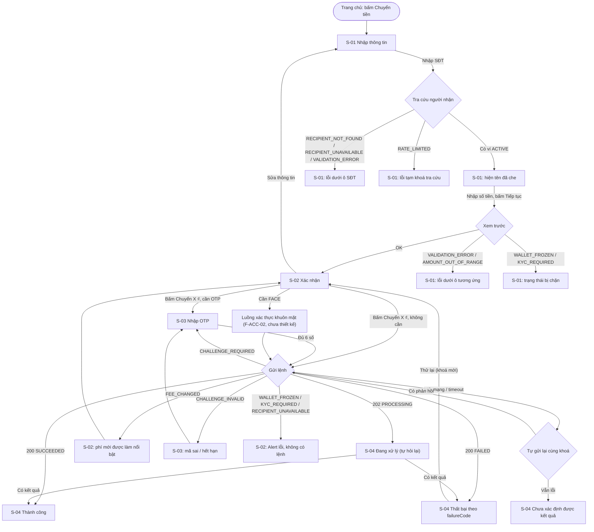

# UI — F-PAY-03 Chuyển tiền ví–ví

| | |
|---|---|
| Trạng thái | Draft |
| Phiên bản | 0.1 |
| Ngày | 2026-11-04 |
| SRS | [F-PAY-03](../../srs/features/F-PAY-03-chuyen-tien-vi-vi.md) v0.1 |
| Bề mặt | Web khách hàng (`apps/web`) |
| Design system | [design-system.md](../design-system.md) v0.1 |

Tính năng này không có màn hình CMS: tra cứu lệnh P2P của nhân viên thuộc F-BO-02.

## 1. Mục tiêu & người dùng
- **Người dùng:** khách hàng cá nhân, chủ yếu trên trình duyệt điện thoại, thường chuyển cho người quen; nhiều người lo lắng về việc chuyển nhầm hoặc chuyển trùng.
- **Mục tiêu UX:**
  - Hoàn tất chuyển tiền trong 3 màn hình (nhập → xác nhận → kết quả) khi không cần xác thực tăng cường.
  - Không có tình huống nào khiến khách hiểu nhầm là thất bại trong khi tiền đã chuyển.

## 2. User flow



## 3. Danh sách màn hình

| ID | Tên | Loại | Ghi chú |
|---|---|---|---|
| F-PAY-03.S-01 | Nhập thông tin chuyển | Trang `/transfer` | Có trạng thái bị chặn (ví khoá, chưa đủ định danh) |
| F-PAY-03.S-02 | Xác nhận chuyển tiền | Trang `/transfer/confirm` | Giữ `Idempotency-Key` (mục 4.5) |
| F-PAY-03.S-03 | Nhập mã OTP | `Sheet` (mobile) / `Dialog` (≥ `md`) | Chỉ khi `requiredFactor = OTP` |
| F-PAY-03.S-04 | Kết quả chuyển tiền | Trang `/transfer/result/[orderId]` | 4 biến thể: thành công, thất bại, đang xử lý, chưa xác định |

Dữ liệu nhập ở S-01/S-02 giữ trong state của luồng (client), **không** đưa vào URL.

## 4. Chi tiết màn hình

### F-PAY-03.S-01 — Nhập thông tin chuyển

**Mục đích:** nhập người nhận, số tiền, lời nhắn; biết ngay người nhận là ai và mình có đủ tiền không.

**Wireframe (mobile ~360 px)**
```
┌──────────────────────────────────┐
│ ←  Chuyển tiền                   │
├──────────────────────────────────┤
│ Số điện thoại người nhận         │
│ ┌──────────────────────────────┐ │
│ │ 0900 000 002                 │ │
│ └──────────────────────────────┘ │
│ ✓ NGUYEN V*** A                  │   ← aria-live
│                                  │
│ Số tiền                          │
│ ┌──────────────────────────────┐ │
│ │ 100.000                    ₫ │ │
│ └──────────────────────────────┘ │
│ Số dư khả dụng: 1.000.000 ₫      │
│                                  │
│ Lời nhắn (không bắt buộc)        │
│ ┌──────────────────────────────┐ │
│ │ Tiền ăn trưa                 │ │
│ └──────────────────────────────┘ │
│                          12/140  │
│                                  │
├──────────────────────────────────┤
│ [          Tiếp tục          ]   │   ← cố định đáy, h-11
└──────────────────────────────────┘
```

**Thành phần**
| Vùng | Component | Ghi chú |
|---|---|---|
| Thanh trên | `Button` variant `ghost` (icon) + `h1` | `aria-label="Quay lại"` |
| SĐT | `Input` `type="tel"` `inputMode="tel"` `autoComplete="off"` trong `Form` | Hiển thị nhóm 4-3-3 khi rời ô |
| Tên người nhận | Dòng chữ + icon `CircleCheck` | Vùng `aria-live="polite"` |
| Số tiền | `MoneyInput` | `aria-describedby` → dòng số dư khả dụng + lỗi |
| Số dư khả dụng | `MoneyText` | Từ `GET /wallet` → `available` |
| Lời nhắn | `Textarea` 2 dòng, bộ đếm ký tự | Giới hạn 140 ký tự `[SRS FR-31, mặc định thiết kế]` |
| Tiếp tục | `Button` `h-11 w-full` | |

**Dữ liệu**
| Hiển thị | Nguồn | Định dạng |
|---|---|---|
| Số dư khả dụng | `GET /wallet` → `available` | `MoneyText` |
| Trạng thái ví | `GET /wallet` → `status` | Dùng cho trạng thái bị chặn |
| Tên người nhận | `GET /transfers/recipient?phone=` → `displayName` | Nguyên văn (đã che từ server) |

**Tương tác & validation**
- **Tra cứu người nhận:** khi rời ô SĐT, hoặc 500 ms sau khi ngừng gõ và đủ 10 chữ số. Đang tra cứu: hiện `Skeleton` một dòng thay chỗ tên. Đổi SĐT thì xoá kết quả cũ ngay.
- **Kiểm phía client** (để báo sớm; server vẫn kiểm lại):
  - SĐT đúng định dạng (10 chữ số bắt đầu bằng `0`, hoặc `+84` + 9 chữ số).
  - Số tiền là số nguyên > 0.
  - Số tiền ≤ số dư khả dụng. Đây chỉ là kiểm sớm, vì phí chưa biết cho tới khi xem trước.
  - Lời nhắn ≤ 140 ký tự và không có ký tự điều khiển.
- Lỗi hiện dưới ô khi rời ô hoặc khi bấm "Tiếp tục"; không hiện khi đang gõ dở.
- **"Tiếp tục"**: chỉ bấm được khi đã có tên người nhận hợp lệ và số tiền hợp lệ. Bấm → gọi `POST /transfers/preview` (nút hiện spinner) → thành công thì sang S-02; lỗi thì hiện tại ô tương ứng (mục 5).
- **FE không biết `p2p.amount.min`** nên không kiểm số tiền tối thiểu phía client; dựa vào `AMOUNT_OUT_OF_RANGE` từ xem trước (xem UQ4).

**Trạng thái**
| Trạng thái | Hiển thị |
|---|---|
| Đang tải (lần đầu) | `Skeleton` cho dòng số dư; các ô nhập dùng được ngay |
| Rỗng | — (form trống là trạng thái mặc định) |
| Lỗi tải `GET /wallet` | `Alert` "Chưa tải được số dư. [Thử lại]"; vẫn cho nhập nhưng nút "Tiếp tục" bị khoá tới khi tải được |
| Lỗi nhập liệu | Chữ lỗi `destructive` + icon dưới ô (mục 5) |
| Đang tra cứu / đang xem trước | `Skeleton` dòng tên / spinner trong nút "Tiếp tục" |
| **Bị chặn** | Ví `status ≠ ACTIVE` (từ `GET /wallet`) hoặc xem trước trả `WALLET_FROZEN`/`KYC_REQUIRED`: thay form bằng `ErrorState` (mục 5) + nút hành động |
| Phiên hết hạn | Theo pattern chung: dialog cảnh báo trước 60 giây; hết hạn → đăng nhập → quay lại S-01 (dữ liệu đã nhập không giữ) |
| Mất mạng | Banner "Không có kết nối mạng"; khoá "Tiếp tục" |

**Nội dung chữ**
| Khoá | Nội dung |
|---|---|
| `p2p.title` | Chuyển tiền |
| `p2p.field.phone.label` | Số điện thoại người nhận |
| `p2p.field.phone.placeholder` | Nhập số điện thoại |
| `p2p.field.amount.label` | Số tiền |
| `p2p.field.amount.available` | Số dư khả dụng: {amount} |
| `p2p.field.note.label` | Lời nhắn (không bắt buộc) |
| `p2p.action.continue` | Tiếp tục |
| `p2p.error.phoneFormat` | Số điện thoại không hợp lệ. |
| `p2p.error.amountFormat` | Vui lòng nhập số tiền hợp lệ. |
| `p2p.error.amountOverBalance` | Số tiền vượt số dư khả dụng. |
| `p2p.error.noteTooLong` | Lời nhắn tối đa 140 ký tự. |

**Accessibility:**
- Khi vào trang, focus vào ô SĐT.
- Kết quả tra cứu (tên hoặc lỗi) được đọc qua `aria-live="polite"`.
- Nút "Tiếp tục" bị khoá thì dòng hướng dẫn phía trên nút giải thích lý do (không dùng tooltip).

**Truy vết:** FR-01, FR-02, FR-03, FR-04, FR-12, FR-13, FR-14, FR-15, FR-31 · AC-23, AC-24, AC-25, AC-26, AC-27, AC-28, AC-39.

---

### F-PAY-03.S-02 — Xác nhận chuyển tiền

**Mục đích:** khách đọc lại lần cuối đúng con số sẽ bị trừ trước khi chuyển.

**Wireframe (mobile)**
```
┌──────────────────────────────────┐
│ ←  Xác nhận chuyển tiền          │
├──────────────────────────────────┤
│ ┌──────────────────────────────┐ │
│ │ Người nhận                   │ │
│ │ NGUYEN V*** A                │ │
│ │ 0900 000 002                 │ │
│ ├──────────────────────────────┤ │
│ │ Số tiền          100.000 ₫   │ │
│ │ Phí                1.000 ₫   │ │   ← nổi bật khi phí vừa đổi
│ ├──────────────────────────────┤ │
│ │ Tổng trừ         101.000 ₫   │ │   ← text-lg font-semibold
│ ├──────────────────────────────┤ │
│ │ Lời nhắn: Tiền ăn trưa       │ │
│ └──────────────────────────────┘ │
│                                  │
│ ⓘ Giao dịch cần xác thực bằng    │   ← khi requiredFactor ≠ NONE
│   mã OTP.                        │
│                                  │
├──────────────────────────────────┤
│ [     Chuyển 101.000 ₫       ]   │   ← SubmitButton
│        Sửa thông tin             │   ← Button variant link
└──────────────────────────────────┘
```

**Thành phần:** `Card` tóm tắt; `MoneyText` cho số tiền, phí, tổng; `Alert` variant `info` cho yêu cầu xác thực; `SubmitButton`; `Button` variant `link` "Sửa thông tin".

**Dữ liệu** (từ response của `POST /transfers/preview`)
| Hiển thị | Field |
|---|---|
| Tên người nhận | `recipientDisplay` |
| SĐT người nhận | số khách đã nhập (đã chuẩn hoá), nhóm 4-3-3 |
| Số tiền / Phí / Tổng | `amount` / `fee` / `total` |
| Yêu cầu xác thực | `requiredFactor` |

**Tương tác**
- **Nút chính** ghi đúng tổng tiền: "Chuyển {total}". Bấm:
  - `requiredFactor = NONE` → gửi `POST /transfers`.
  - `OTP` → gọi `POST /challenges` rồi mở S-03.
  - `FACE` → chuyển sang luồng xác thực khuôn mặt của F-ACC-02 (UQ1).
- **"Sửa thông tin"** → quay về S-01, giữ dữ liệu đã nhập, **huỷ `Idempotency-Key` hiện tại**.
- **Kiểm số dư:** khi vào S-02, tải lại `GET /wallet`. Nếu `total > available` thì hiện `Alert` `destructive` "Số dư không đủ để chuyển {total}." kèm nút "Nạp tiền", và khoá nút chính. Đây chỉ là kiểm sớm cho khách; server vẫn là nơi quyết định (FR-23).
- **Khi nhận `FEE_CHANGED`:** tự gọi lại xem trước, cập nhật dòng phí và tổng, làm nổi bật dòng phí (nền `warning`, chữ "Phí đã thay đổi từ {old} thành {new}"), nút chính cập nhật tổng mới. Khách phải bấm lại; **không tự gửi**.

**Trạng thái**
| Trạng thái | Hiển thị |
|---|---|
| Đang tải | Không áp dụng: dữ liệu có sẵn từ bước xem trước; dòng số dư tải lại có `Skeleton` |
| Đang gửi | `SubmitButton` khoá, chữ "Đang xử lý…"; "Sửa thông tin" và nút quay lại bị khoá |
| Lỗi trước khi tạo lệnh | `Alert` `destructive` ngay trên nút chính (mục 5); giữ nguyên dữ liệu |
| Phí thay đổi | Như trên |
| Mất mạng khi gửi | Xem 4.5 |
| Truy cập trực tiếp URL không qua S-01 | Chuyển về S-01 |

**Nội dung chữ**
| Khoá | Nội dung |
|---|---|
| `p2p.confirm.title` | Xác nhận chuyển tiền |
| `p2p.confirm.recipient` | Người nhận |
| `p2p.confirm.amount` / `.fee` / `.total` | Số tiền / Phí / Tổng trừ |
| `p2p.confirm.note` | Lời nhắn: {note} |
| `p2p.confirm.stepup.otp` | Giao dịch cần xác thực bằng mã OTP. |
| `p2p.confirm.stepup.face` | Giao dịch cần xác thực bằng khuôn mặt. |
| `p2p.confirm.feeChanged` | Phí đã thay đổi từ {old} thành {new}. |
| `p2p.action.submit` | Chuyển {total} |
| `p2p.action.edit` | Sửa thông tin |

**Accessibility:**
- Vào trang thì focus vào `h1`; thẻ tóm tắt đọc theo thứ tự người nhận → số tiền → phí → tổng.
- Thông báo phí thay đổi dùng `role="alert"`.

**Truy vết:** FR-05, FR-08, FR-16, FR-18, FR-28 · BR-01, BR-02, BR-07 · AC-01, AC-12, AC-16, AC-17.

---

### F-PAY-03.S-03 — Nhập mã OTP

**Mục đích:** xác thực tăng cường khi số tiền vượt ngưỡng.

**Wireframe (Sheet từ dưới lên, mobile)**
```
┌──────────────────────────────────┐
│ Nhập mã xác thực             ✕   │
│ Mã gồm 6 chữ số đã được gửi tới  │
│ {nơi nhận đã che} (UQ2)          │
│                                  │
│   ┌──┐┌──┐┌──┐ ┌──┐┌──┐┌──┐      │
│   │ 1││ 2││ 3│ │  ││  ││  │      │
│   └──┘└──┘└──┘ └──┘└──┘└──┘      │
│ Mã hết hạn sau 02:45             │
│                                  │
│ Chưa nhận được mã? Gửi lại (0:30)│
│                                  │
│ [      Xác nhận chuyển       ]   │
└──────────────────────────────────┘
```

**Thành phần:** `Sheet` (side `bottom`) trên mobile, `Dialog` từ `md`; `InputOTP` 6 ô, `inputMode="numeric"`, `autoComplete="one-time-code"`; `SubmitButton`.

**Tương tác**
- **Đủ 6 số** → tự gửi `POST /transfers` (kèm `challengeId`, `otp`, **cùng `Idempotency-Key`**) đúng **một lần**; sau đó các ô bị khoá cho tới khi có phản hồi. Nút "Xác nhận chuyển" dành cho người dùng bàn phím hoặc khi tự gửi bị tắt.
- **Đếm ngược hết hạn** theo `expiresAt`. Hết hạn → khoá ô nhập, chữ "Mã đã hết hạn", chỉ còn nút "Gửi lại mã".
- **"Gửi lại mã"** → gọi `POST /challenges` lại, thay `challengeId`; vẫn giữ `Idempotency-Key`. Thời gian chờ gửi lại và số lần thử còn lại chưa có trong API (UQ2): tạm thời không hiển thị số lần còn lại; nút "Gửi lại" khả dụng sau 30 giây `[Giả định, chờ UQ2]`.
- **`CHALLENGE_INVALID`** → xoá 6 ô, focus ô đầu, hiện lỗi dưới ô. Không có lệnh nào được tạo, nên giữ cùng khoá.
- **Đóng sheet** (✕ hoặc vuốt xuống) → quay về S-02; huỷ challenge phía client.

**Trạng thái**
| Trạng thái | Hiển thị |
|---|---|
| Đang tạo challenge | Nút chính S-02 có spinner; mở sheet khi có `challengeId` |
| Lỗi tạo challenge | `Alert` trên S-02: "Chưa gửi được mã xác thực. Vui lòng thử lại." |
| Đang gửi lệnh | Ô OTP khoá + spinner trong nút |
| Mã sai / hết hạn | Như trên |
| Kết quả có | Đóng sheet, sang S-04 |
| Mất mạng | Xem 4.5 |

**Nội dung chữ**
| Khoá | Nội dung |
|---|---|
| `otp.title` | Nhập mã xác thực |
| `otp.sentTo` | Mã gồm 6 chữ số đã được gửi tới {destination}. |
| `otp.expiresIn` | Mã hết hạn sau {mm:ss} |
| `otp.expired` | Mã đã hết hạn. |
| `otp.resend` / `otp.resendIn` | Gửi lại mã / Gửi lại sau {s} giây |
| `otp.error.invalid` | Mã xác thực không đúng hoặc đã hết hạn. |
| `p2p.action.confirmOtp` | Xác nhận chuyển |

**Accessibility:**
- `InputOTP` có nhãn nhóm "Mã xác thực 6 chữ số"; mỗi ô có `aria-label` "Chữ số thứ n".
- Đếm ngược không đọc mỗi giây; chỉ thông báo qua `aria-live` khi còn 30 giây và khi hết hạn.
- Đóng sheet thì trả focus về nút chính S-02.

**Truy vết:** FR-16, FR-17 · BR-07 · AC-06, AC-18, AC-19.

---

### F-PAY-03.S-04 — Kết quả chuyển tiền

**Mục đích:** khách biết chắc kết quả và biết làm gì tiếp.

**Wireframe — biến thể "Thành công" (mobile)**
```
┌──────────────────────────────────┐
│                                  │
│              ( ✓ )               │   ← success
│      Chuyển tiền thành công      │
│           −101.000 ₫             │   ← text-3xl tabular-nums
│                                  │
│ ┌──────────────────────────────┐ │
│ │ Người nhận    NGUYEN V*** A  │ │
│ │ Số tiền           100.000 ₫  │ │
│ │ Phí                 1.000 ₫  │ │
│ │ Thời gian   04/11/2026 14:30 │ │
│ │ Mã giao dịch  0193F…A2C  [⧉] │ │
│ └──────────────────────────────┘ │
│                                  │
├──────────────────────────────────┤
│ [        Về trang chủ        ]   │
│   Chuyển tiền khác · Xem chi tiết│
└──────────────────────────────────┘
```

**Các biến thể**
| Biến thể | Khi nào | Icon/token | Tiêu đề | Hành động |
|---|---|---|---|---|
| Thành công | `status = SUCCEEDED` | `CircleCheck` / `success` | Chuyển tiền thành công | Về trang chủ · Chuyển tiền khác · Xem chi tiết |
| Thất bại | `status = FAILED` | `CircleX` / `destructive` | Chuyển tiền không thành công | Theo `failureCode` (mục 5) · Về trang chủ |
| Đang xử lý | `202`, hoặc `GET /orders/{id}` trả `PROCESSING` | `Clock` / `warning` | Giao dịch đang được xử lý | Xem lịch sử · Về trang chủ |
| Chưa xác định | Mất mạng/timeout, gửi lại vẫn không có phản hồi, chưa có `orderId` | `Clock` / `warning` | Chưa xác định được kết quả | Kiểm tra lại · Xem lịch sử |

- **Đang xử lý:** mô tả "Bạn sẽ nhận thông báo khi có kết quả. Vui lòng không thực hiện lại giao dịch này." Tự hỏi `GET /orders/{id}` mỗi 2 giây trong 30 giây đầu, sau đó mỗi 10 giây tới 5 phút; có kết quả thì chuyển biến thể tại chỗ `[Giả định: chu kỳ hỏi lại; SRS FR-27 nêu job hoàn tất sau 2 phút]`.
- **Chưa xác định:** không có `orderId` nên không hỏi `GET /orders/{id}` được. "Kiểm tra lại" gửi lại đúng yêu cầu cũ với **cùng `Idempotency-Key`** (lấy từ `sessionStorage`, mục 4.5): server trả lệnh đã có, hoặc tạo lệnh lần đầu nếu yêu cầu trước chưa tới server. Không bao giờ hiển thị "Thất bại" ở biến thể này.
- **Thất bại → "Thử lại"** (với `INSUFFICIENT_BALANCE`): quay về S-02 với dữ liệu cũ, gọi lại xem trước và **sinh `Idempotency-Key` mới** (FR-28).
- URL `/transfer/result/[orderId]` tải lại được: trang đọc `GET /orders/{id}`, không gửi lại lệnh. Lệnh không thuộc người đang đăng nhập → `ErrorState` "Không tìm thấy giao dịch" (NFR-03).

**Trạng thái**
| Trạng thái | Hiển thị |
|---|---|
| Đang tải (mở bằng URL) | `Skeleton` của thẻ tóm tắt |
| Lỗi tải | `ErrorState` "Chưa tải được thông tin giao dịch. [Thử lại]" + mã giao dịch từ URL |
| Rỗng | — |
| Không có quyền | `ErrorState` "Không tìm thấy giao dịch" (không tiết lộ lệnh có tồn tại hay không) |

**Nội dung chữ**
| Khoá | Nội dung |
|---|---|
| `p2p.result.success.title` | Chuyển tiền thành công |
| `p2p.result.failed.title` | Chuyển tiền không thành công |
| `p2p.result.processing.title` | Giao dịch đang được xử lý |
| `p2p.result.processing.body` | Bạn sẽ nhận thông báo khi có kết quả. Vui lòng không thực hiện lại giao dịch này. |
| `p2p.result.unknown.title` | Chưa xác định được kết quả |
| `p2p.result.unknown.body` | Kết nối bị gián đoạn trong lúc gửi giao dịch. Vui lòng bấm Kiểm tra lại để xem kết quả, không thực hiện lại giao dịch. |
| `p2p.result.orderId` | Mã giao dịch |
| `p2p.action.home` / `.another` / `.detail` / `.history` / `.recheck` | Về trang chủ / Chuyển tiền khác / Xem chi tiết / Xem lịch sử / Kiểm tra lại |

**Accessibility:**
- Tiêu đề kết quả nằm trong vùng `role="status"`; khi biến thể tự đổi (đang xử lý → thành công) thì thông báo qua `aria-live="polite"`.
- Icon kèm chữ, không chỉ dùng màu.

**Truy vết:** FR-26, FR-27, FR-28, FR-29 (thông báo đi kèm), FR-30 (liên kết lịch sử), NFR-03 · AC-01, AC-03, AC-10, AC-30, AC-31, AC-33, AC-37.

---

### 4.5 Vòng đời `Idempotency-Key` phía client (áp dụng cho S-02 đến S-04)

| Sự kiện | Khoá |
|---|---|
| Vào S-02 sau khi xem trước thành công | **Sinh mới** (UUID), gắn với bộ (SĐT, số tiền, lời nhắn) |
| Bấm lại nút chính, gửi lại sau mất mạng, mở S-03, gửi lại mã OTP, `CHALLENGE_INVALID`, `FEE_CHANGED` | **Giữ nguyên** (các lỗi này xảy ra trước khi lệnh được tạo, hoặc lệnh đã tạo và cần nhận lại) |
| Bấm "Sửa thông tin" quay về S-01 | **Huỷ**; lần vào S-02 sau sinh khoá mới. Nếu giữ khoá mà đổi nội dung, server sẽ trả `IDEMPOTENCY_KEY_REUSED` |
| Lệnh `FAILED`, khách bấm "Thử lại" | **Sinh mới** (FR-28) |
| Lệnh `SUCCEEDED` | Huỷ |

**Gửi lại khi mất mạng:**
- `POST /transfers` lỗi mạng hoặc timeout → hiện "Đang kiểm tra kết quả giao dịch…" ngay trên S-02/S-03.
- Tự gửi lại **cùng khoá, cùng nội dung** tối đa 3 lần (sau 1, 2, 4 giây).
- Có phản hồi → xử lý như bình thường. Vẫn lỗi → S-04 biến thể "Chưa xác định".

**Lưu tạm:**
- Trong lúc chưa có kết quả cuối, lưu `{idempotencyKey, payload}` vào `sessionStorage` (chỉ trong tab hiện tại), để tải lại trang vẫn "Kiểm tra lại" được với cùng khoá.
- Xoá ngay khi có kết quả `SUCCEEDED`/`FAILED`.
- Payload chứa SĐT người nhận và số tiền; không chứa OTP.

## 5. Ánh xạ lỗi

| Mã (SRS §6) | Thường nhận ở | Nơi hiển thị | Nội dung | Hành động cho khách |
|---|---|---|---|---|
| `VALIDATION_ERROR` | Xem trước / tạo lệnh | Dưới ô tương ứng (S-01); chuyển cho chính mình: dưới ô SĐT | "Thông tin không hợp lệ: {chi tiết}." / "Bạn không thể chuyển tiền cho chính mình." | Sửa |
| `IDEMPOTENCY_KEY_REQUIRED` | Tạo lệnh | Không hiển thị riêng (lỗi lập trình); hiện lỗi chung + log | "Chưa thực hiện được. Vui lòng thử lại." | Thử lại |
| `WALLET_FROZEN` | `GET /wallet`, xem trước, tạo lệnh | S-01 trạng thái bị chặn / `Alert` S-02 | "Ví của bạn đang bị tạm khoá. Vui lòng liên hệ hỗ trợ." | Liên hệ hỗ trợ |
| `KYC_REQUIRED` | Xem trước, tạo lệnh | S-01 trạng thái bị chặn / `Alert` S-02 | "Vui lòng hoàn tất xác thực danh tính để chuyển tiền." | Nút "Xác thực ngay" (F-ACC-02) |
| `RECIPIENT_NOT_FOUND` | Tra cứu | Dưới ô SĐT | "Không tìm thấy ví với số điện thoại này." | Sửa SĐT |
| `RECIPIENT_UNAVAILABLE` | Tra cứu, tạo lệnh | Dưới ô SĐT / `Alert` S-02 | "Không thể chuyển tiền cho người nhận này." | Sửa SĐT |
| `AMOUNT_OUT_OF_RANGE` | Xem trước | Dưới ô số tiền | "Số tiền tối thiểu là {min} ₫." | Sửa số tiền |
| `CHALLENGE_REQUIRED` | Tạo lệnh | Mở S-03 (không hiện lỗi) | — | Nhập OTP |
| `CHALLENGE_INVALID` | Tạo lệnh | Dưới ô OTP (S-03) | "Mã xác thực không đúng hoặc đã hết hạn." | Nhập lại / Gửi lại mã |
| `IDEMPOTENCY_KEY_REUSED` | Tạo lệnh | Không hiển thị riêng (lỗi lập trình, mục 4.5 ngăn trường hợp này); hiện lỗi chung + log | "Chưa thực hiện được. Vui lòng thử lại." | Quay về S-01 |
| `FEE_CHANGED` | Tạo lệnh | S-02 dòng phí nổi bật | "Phí đã thay đổi từ {old} thành {new}." | Xác nhận lại |
| `RATE_LIMITED` | Tra cứu | Dưới ô SĐT; khoá ô trong `Retry-After` giây | "Bạn thao tác quá nhanh. Vui lòng thử lại sau {n} giây." | Chờ |
| `INSUFFICIENT_BALANCE` | `order.failureCode` | S-04 thất bại | "Số dư không đủ để thực hiện giao dịch." | Nạp tiền · Thử lại (khoá mới) |
| `LIMIT_EXCEEDED` | `order.failureCode` | S-04 thất bại | "Giao dịch vượt hạn mức. Hạn mức còn lại: {remaining} ₫." | Sửa số tiền (về S-01) · Xem hạn mức |
| `ACCOUNT_BLOCKED` | `order.failureCode` | S-04 thất bại | "Giao dịch không thể thực hiện. Vui lòng liên hệ hỗ trợ." | Liên hệ hỗ trợ |
| `UNAUTHENTICATED` / `TOKEN_EXPIRED` | Bất kỳ | Theo pattern phiên hết hạn | — | Đăng nhập lại |
| Lỗi 5xx, lỗi lạ | Bất kỳ | `Alert` tại chỗ | "Chưa thực hiện được. Vui lòng thử lại sau ít phút." (kèm mã giao dịch nếu đã có lệnh) | Thử lại |

Với `LIMIT_EXCEEDED`, `{remaining}` cần có trong response (UQ5).

## 6. Responsive & accessibility tổng
- Luồng thiết kế cho mobile; từ `md` nội dung nằm trong cột `max-w-md` căn giữa, nút chính hết cố định đáy, S-03 chuyển từ `Sheet` sang `Dialog`.
- Mỗi lần chuyển bước (S-01 → S-02 → S-04), focus vào `h1` của trang mới và cập nhật `<title>` ("Xác nhận chuyển tiền – EWallet").
- Thứ tự tab: SĐT → số tiền → lời nhắn → Tiếp tục; S-02: Chuyển → Sửa thông tin.
- Dùng được khi phóng to 200% và ở 320 px: thẻ tóm tắt xuống dòng nhãn/giá trị khi hẹp.
- `prefers-reduced-motion`: tắt hiệu ứng trượt của `Sheet` và icon kết quả.

## 7. Truy vết SRS → UI

| SRS | Màn hình / phần tử |
|---|---|
| FR-01, FR-02, FR-03, FR-04 | S-01 ô SĐT, dòng tên người nhận, lỗi tra cứu |
| FR-05 | S-02 thẻ tóm tắt |
| FR-07, FR-08, FR-09, FR-10, FR-11, FR-28 | 4.5 vòng đời `Idempotency-Key` |
| FR-12, FR-13 | S-01 trạng thái bị chặn; `Alert` S-02 |
| FR-14, FR-15, FR-31 | S-01 validation ô số tiền, SĐT, lời nhắn |
| FR-16, FR-17, BR-07 | S-02 thông báo yêu cầu xác thực; S-03 |
| FR-18, BR-01 | S-02 phí thay đổi |
| FR-20, FR-23, FR-25 | S-04 thất bại theo `failureCode` |
| FR-26, FR-27 | S-04 biến thể đang xử lý + hỏi lại |
| FR-29 | Ngoài UI này (thông báo: F-NTF-01); S-04 nhắc "Bạn sẽ nhận thông báo" |
| FR-30 | S-04 "Xem chi tiết"/"Xem lịch sử" → F-PAY-04 |
| NFR-03 | S-04 lệnh không thuộc người dùng |
| NFR-07 | Mục 6 |

Không có biểu hiện UI riêng (xử lý ở server): FR-06, FR-19, FR-21, FR-22, FR-24, FR-32, BR-02 (chỉ hiển thị kết quả), BR-08.

## 8. Câu hỏi mở

ID chung và trạng thái trả lời: xem [open-questions.md](../../open-questions.md) (cột Nguồn: "UI F-PAY-03 UQ#").

| # | Câu hỏi | Ảnh hưởng | Ai quyết định |
|---|---|---|---|
| UQ1 | Luồng xác thực khuôn mặt (`FACE`) thuộc F-ACC-02, chưa có đặc tả UI. P2P chỉ nối vào; cần chốt điểm vào/ra (trả `challengeId` về S-02?) | S-02, flow | UI F-ACC-02 |
| UQ2 | **API chưa đủ cho màn hình OTP:** `POST /challenges` chỉ trả `{challengeId, factor, expiresAt}`. Thiếu: nơi nhận mã đã che, số lần thử còn lại, thời gian chờ gửi lại. Đề nghị bổ sung `destinationMasked`, `attemptsRemaining`, `resendAfter` | S-03 | Nhóm thiết kế API / F-ACC-01 |
| UQ3 | Xem trước có trả `WALLET_FROZEN`/`KYC_REQUIRED` không? SRS FR-12, FR-13 chỉ nói cho bước tạo lệnh. Trả sớm ở xem trước giúp khách không phải đi tới S-02 mới biết bị chặn | S-01 trạng thái bị chặn | SRS F-PAY-03 |
| UQ4 | FE không biết `p2p.amount.min` và `p2p.min_kyc_tier` nên không báo sớm được. Có nên đưa vào `GET /wallet/limits` (hoặc response xem trước)? | S-01 validation | API / Product |
| UQ5 | `order` khi `FAILED LIMIT_EXCEEDED` cần chứa hạn mức còn lại (`remaining`) để hiển thị đúng thông điệp SRS §6; API hiện chỉ trả `failureCode` | S-04 | API |
| UQ6 | "Chuyển tiền khác" sau khi thành công: giữ sẵn người nhận cũ hay form trống? | S-04 | Product |
| UQ7 | Danh sách người nhận gần đây / danh bạ: không có trong SRS nên không thiết kế. Có cần cho giai đoạn 1? | S-01 | Product |
| — | Kế thừa từ SRS: Q4 (quy tắc che tên), Q5 (gộp lỗi người nhận), Q8 (nội dung thông báo) | S-01, S-04 | Xem SRS mục 9 |

## 9. Lịch sử thay đổi
| Phiên bản | Ngày | Thay đổi | Lý do |
|---|---|---|---|
| 0.1 | 2026-11-04 | Tạo mới | Chạy thử pipeline với F-PAY-03 |
